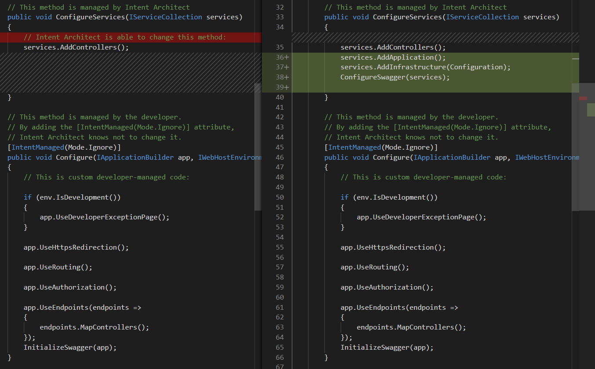

# About Code-Management

Simply put, code-management is the system that tells Intent Architect which parts of the codebase are governed by its deterministic guardrails and which parts are owned by developers and AI agents, at a very granular level of control. It ensures that architectural code and business logic live side by side in ordinary source files, so the codebase never needs to be convoluted or distorted to accommodate the guardrails.

Code-management uses abstract syntax tree parsing and intelligent merge algorithms to combine the architectural code that Intent Architect maintains with the code that developers and agents write. Developers control this from a high level all the way down to the individual members within each file (e.g. classes, fields, functions, methods, etc.).

Because Intent Architect knows exactly which code it is responsible for, it can guarantee that code conforms to the architecture, and track and flag where developers or agents have taken ownership of it or deviated from it. This is what makes review by exception possible: conforming architectural code needs little review, so reviewers can focus on business logic, deliberate customizations and deviations.

As a simple example, a developer may configure a C# class such that they are managing the implementation of one method, while Intent Architect manages the remaining methods. They may then choose to change this configuration, perhaps deciding to take over management of the entire class or just one of the other methods. The configuration of each file is completely controlled by the team, ensuring that the guardrails never get in the way.

_An example of how Intent Architect would change a C# `Startup.cs` file that is partially managed by the developer and partially by Intent Architect. Changes are staged before being accepted by the developer, allowing them to diff the changes before accepting or rejecting them._
