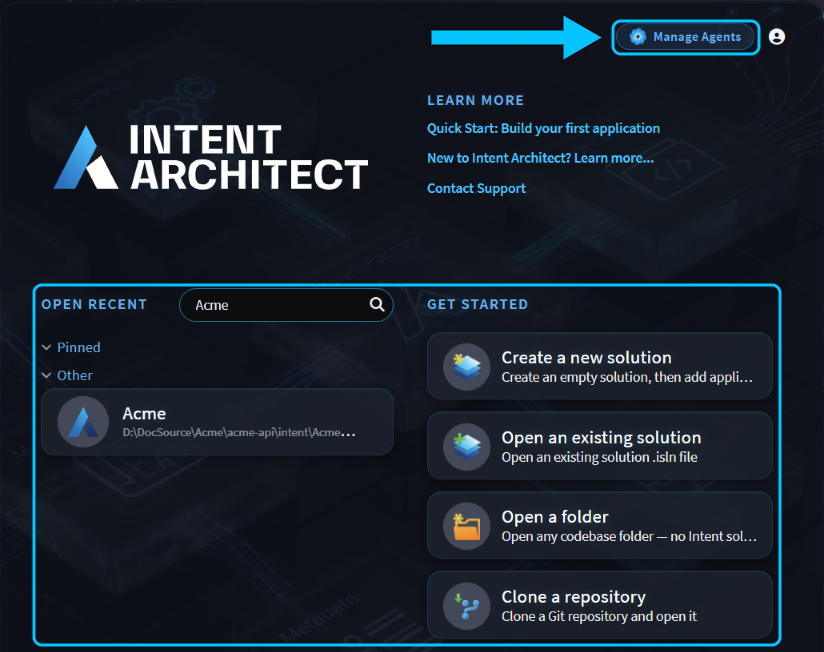
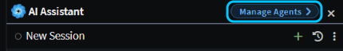

# Agents Shell and Solution Shell

Intent Architect has two shells, two ways of arranging the window around your work:

- The **Solution Shell** is for working on a workspace: one solution with its designers, Software Factory, code and Git repositories, and the AI Assistant beside them.
- The **Agents Shell**, opened with **Manage Agents**, is for orchestrating agents: many AI conversations, across your repositories and solutions, running at the same time.

Both shells share the same conversations, so you can start a task in one and continue it in the other, and you can switch between them at any time.

## The Solution Shell is for working on a workspace

The Solution Shell opens one solution and everything around it: the Solution Explorer and designers, the Software Factory, the **Codebase** pane, **Source Control**, and the AI Assistant docked on the right.

It's workspace-oriented. The Codebase pane shows every application's output folder plus any related folders you add, and Source Control covers every Git repository they're in. A chat in the Solution Shell can work across all of them; see .

Use the Solution Shell when you're working hands-on on a solution: modelling, generating code, reviewing changes, or asking the agent for a change while you follow along.

## The Agents Shell is for orchestrating agents

The Agents Shell lists every AI conversation on your machine, across every repository and solution, and shows which are running, which have finished and which are waiting for you.

It's repository-oriented. Each conversation runs in one folder of one Git repository, optionally in a Git worktree of its own, so several agents can work at once without their changes landing on top of each other. The **Codebase** and **Source Control** tabs beside the selected conversation stay within that conversation's folder.

Use the Agents Shell when you're running several tasks at once, or checking on agents you've already started. For everything it can do, see .

## Getting to each shell from the Home screen

- **Solution Shell:** open a recent solution, or use anything under **Get started**: create a new solution, open an existing solution, open a folder, or clone a Git repository.
- **Agents Shell:** click **Manage Agents** at the top right. Its badges show how many conversations are running and how many are waiting for your answer.

_**Manage Agents** opens the Agents Shell. Everything under **Open recent** and **Get started** opens the Solution Shell._

## Switching between the Agents Shell and the Solution Shell

The two shells take turns in the same window, and your conversations are there in both.

**From the Solution Shell to the Agents Shell**, click **Manage Agents** in the AI Assistant's header. If you have unsaved changes, Intent Architect asks about them first. The solution then closes, and the Agents Shell opens on the solution's folder.

**From the Agents Shell to the Solution Shell**, select a conversation whose folder holds a solution, then click **Open _name_ solution** in the toolbar. The window switches to that solution, with the conversation in its AI Assistant.

To get back to the Home screen from either shell, click the Intent Architect logo at the top left.

## Related articles

-  - everything the Agents Shell can do.
-  - use the Solution Shell's workspace across several Git repositories.
-  - the Codebase pane in each shell.
-  - the Source Control pane in each shell.
-  - what a solution is.
