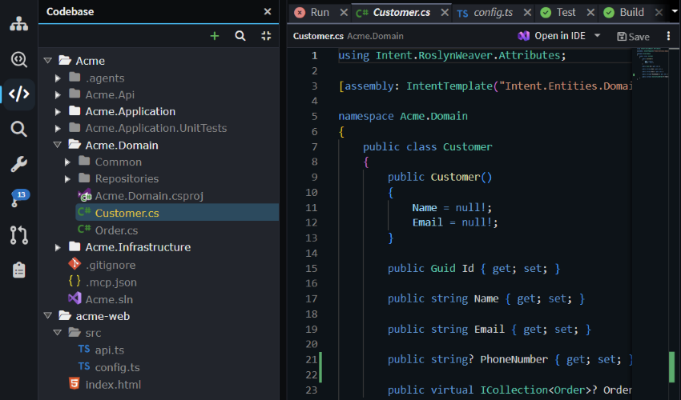

# Codebase Explorer

The Codebase Explorer, shown in Intent Architect as the **Codebase** pane, is a file tree of your solution's code as it is on disk. It shows each application's output folder, plus any related folders you add, such as a frontend or a shared library kept in another Git repository. In the Solution Shell, open it from the activity bar or press `Ctrl+Shift+C`. In the Agents Shell (**Manage Agents**), it's the **Codebase** tab in the panel on the right.

_The Codebase pane with the `Acme` application's output folder and an added `acme-web` folder._

For a step-by-step guide to adding a related Git repository, see .

## What the Codebase pane shows

In the Solution Shell, the **Codebase** pane is workspace-oriented. Each top-level folder, or root, is either an application's output folder or a folder you added to the solution. If one root is inside another, only the outer one is shown, and roots are sorted by name. Together they're the workspace the Solution Shell's AI agent and Source Control pane work across.

In the Agents Shell, the **Codebase** tab is repository-oriented. It shows a single root: the folder the selected conversation runs in, or its worktree. Folders added to the solution don't appear there, and you can't add any.

Files and folders with no uncommitted changes are dimmed, so the ones you, or an agent, have changed stand out.

## Adding and removing folders in the Codebase pane

In the Solution Shell, click **+** (**Add a folder to the workspace...**) in the **Codebase** pane's toolbar, or right-click a root or empty space in the pane and choose **Add folder to workspace...**. The folder is saved in the solution's `.isln` file as a path relative to that file, so everyone who uses the committed solution file gets the same roots. If a teammate's copy of the folder isn't at the same relative path, the root shows a red cross, with a tooltip saying it isn't found on disk.

To stop showing a folder you added, right-click its root and choose **Remove from workspace**. This only changes the solution file; the files stay on disk.

> [!WARNING]
> **Delete**, on the same menu, doesn't remove the root from the solution. After you confirm, it moves the folder and everything in it to the recycle bin.

Adding folders needs a single solution file. If you opened a folder that holds several `.isln` files, the option is hidden. If you opened a folder with no `.isln` file, Intent Architect asks **Create a solution?** first.

## Finding and working with files in the Codebase pane

The magnifier in the **Codebase** pane's toolbar (**Search files**) filters the tree by file and folder name across every root. It doesn't search inside files. For that, right-click a folder and choose **Find in Folder...**, which opens the **Search** pane limited to that folder.

Click a file to open it in a preview tab, which the next file you click replaces, or double-click it to keep its tab open. Right-click a file or folder to create, rename or delete files and folders, copy a path, open the file in your IDE, see its Git history, or open a terminal in a folder. **Delete** moves items to the recycle bin rather than deleting them permanently.

## The Codebase pane and the AI agent

In the Solution Shell, the AI agent is told about every root in the **Codebase** pane on each turn, including folders you added, so it can read and edit files across all of them. Its edits in an added folder are written straight to disk rather than staged through the Software Factory, so review them in [Source Control](xref:application-development.user-interface.source-control) before you commit.

An Agents Shell conversation works within its own folder, the one its **Codebase** tab shows, and isn't told about folders added to the solution.

## Related articles

-  - add a related Git repository and have the agent work across it.
-  - review and commit the changes the Codebase pane shows.
-  - how the Agents Shell and the Solution Shell differ.
-  - the Agents Shell and its panels.
-  - all keyboard shortcuts.
