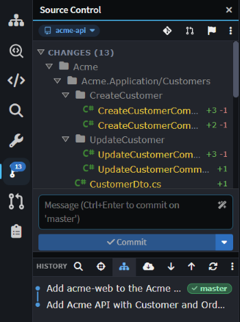

# Source Control

The **Source Control** pane is where you review, commit and sync your changes with Git without leaving Intent Architect. It works on one Git repository at a time. In the Solution Shell, open it from the activity bar or press `Ctrl+Shift+G`. In the Agents Shell (**Manage Agents**), it's the **Source Control** tab in the panel on the right.

_The Source Control pane on the `acme-api` Git repository, with uncommitted changes, the commit box and the history._

> [!TIP]
> If your solution spans several Git repositories, such as an API and a separate frontend, you can switch between them by clicking the repository name at the top of the Source Control pane. See  for how to set this up.

## Reviewing and committing changes in the Source Control pane

The **Source Control** pane lists your uncommitted changes, with staged files under **Staged Changes**. Click a file to open its diff, or hover over it to stage it or discard its changes. The flag button in the toolbar opens [Change Review](xref:application-development.change-review) for everything you haven't committed yet.

Type a message in the commit box and click **Commit**, or press `Ctrl+Enter`. The box's placeholder names the branch you're committing to, and its AI button writes a message for you. The caret next to **Commit** offers **Amend last commit** and **Stash changes**.

Below the commit box, **History** lists the Git repository's commits, with **Fetch**, **Pull** and **Push** in its toolbar.

## Git Explorer and Pull Requests

Branches, tags, worktrees and the full history are in the **Git Explorer** tab, which you open from the **Source Control** pane's toolbar. Git Explorer lists every Git repository at once, each with its branches and worktrees. Pull requests are in the **Pull Requests** panel; see .

## Related articles

-  - add a related Git repository and commit to each one.
-  - the Codebase pane, where related folders are added.
-  - reviewing uncommitted changes before you commit.
-  - creating and reviewing pull requests.
-  - which Intent Architect files to commit.
-  - how the Agents Shell and the Solution Shell differ.
-  - the Agents Shell and its panels.
