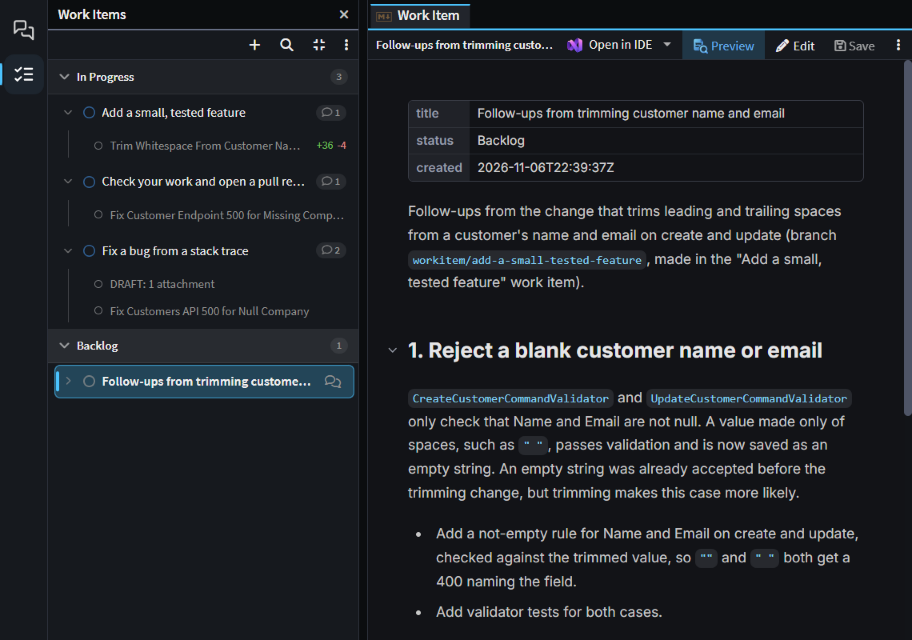

# Work Items

**Work Items** is your own to-do list and scratch pad in the Agents Shell. Each Work Item is a short Markdown note, for the informal tasks you keep track of day to day, notes for a piece of work, or a prompt you reuse. The AI agent can read and update them too, and each one lists the chats you started from it, so everything done on it is in one place.

_Work Items grouped by status, with one item's linked chats listed under it._

## Opening Work Items in the Agents Shell

Work Items is in the [Agents Shell](xref:application-development.user-interface.agents-shell-and-solution-shell) only. Click **Work Items** on the left-hand bar, under **Sessions**.

- **Add an item** with **+** (**New work item**). It's created as `Untitled` in **Backlog**, ready for you to type its name.
- **Open an item** by clicking it. It opens as a document: click **Edit** to change it in place, or **Open in IDE** to change it in your editor. Edits are saved a second after you stop typing.
- **Group them** by status, **In Progress**, **Backlog** and **Done**, which is the default, or into groups of your own: right-click an item and choose **Move to group** > **New group**. **View options** (**⋮**) switches between the two, and hides **Done** items older than seven days unless you turn that off.
- **Search** matches item titles, their text and the titles of their chats.

Right-click an item for the rest, such as **Set status**, **Priority**, **Rename** and **Delete**.

## Starting and linking chats from a Work Item

**Start chat** opens a new chat with the Work Item attached and the message box empty, ready for you to add to it before you send. Hover the item and click its **Start chat** button, right-click it and choose **Start chat**, or select it and press `Ctrl+Enter`. By default the chat runs in a Git worktree of its own, on a `workitem/<id>` branch, where `<id>` is the item's name in lower case with hyphens. To run these chats in your own checkout instead, turn off **Start chats from work items in a worktree** under **Agents** in [User Settings](xref:application-development.user-interface.how-to-change-user-settings#agents).

Chats are linked to a Work Item in three other ways:

- Right-click a chat on the **Sessions** panel and choose **Link to work item**, then **New work item…** or one of your **In Progress** items.
- Hover a message in a chat and click **Create work item from message**. The new item holds the message and is linked to the chat.
- Ask the agent to add the chat to an item.

Click an item to list its linked chats under it, newest first, and click one to open it. On the **Sessions** panel, a linked chat shows an icon that names its Work Item. To remove a link, right-click the chat under the item and choose **Unlink from work item**.

When a linked chat starts working, its Work Item moves to **In Progress**. Nothing moves it to **Done**: that's up to you or the agent.

## Letting the agent read and update Work Items

The agent is given the Work Items its chat is linked to and reads them when the link is made, so it knows what the chat is for. In **Agent** and **Plan** modes, it can also list, create and update your Work Items, link chats to them, and delete them once you've confirmed. For example, ask it to _"Create a work item for the follow-ups from this chat."_

## Where Work Items are kept

Your Work Items belong to you, not to a solution or a Git repository: you see the same list whichever folder you're working in. Each one is a Markdown file named after the item, with its title, status and dates in front matter.

They're kept in your user profile, in `%APPDATA%\Intent Architect\work-items` on Windows. To keep them somewhere else, such as a synced folder or a folder you commit to share them, set **Work Items Folder** in [User Settings](xref:application-development.user-interface.how-to-change-user-settings#work-items-folder). Changing it moves them there.

## Related articles

-  - reuse a prompt by keeping it as a Work Item and starting chats from it.
-  - the Agents Shell, where Work Items is.
-  - everything else the Agents Shell can do.
-  - running chats in worktrees of their own.
