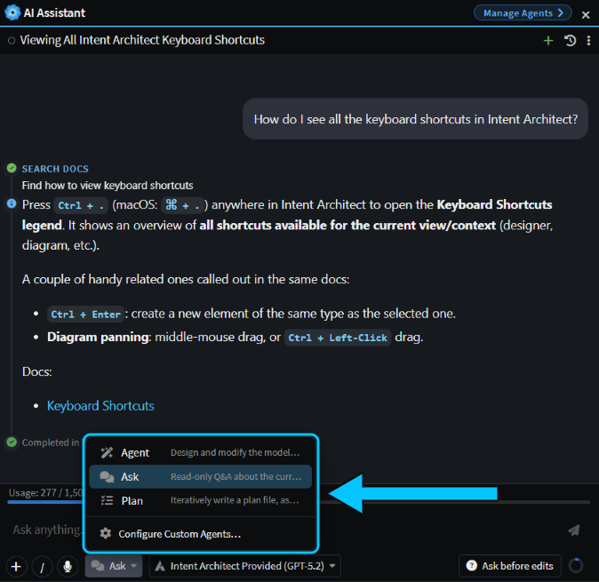
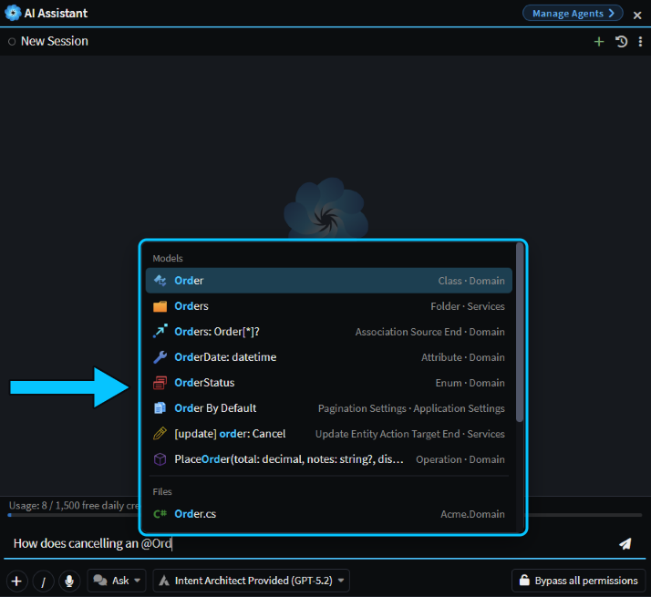
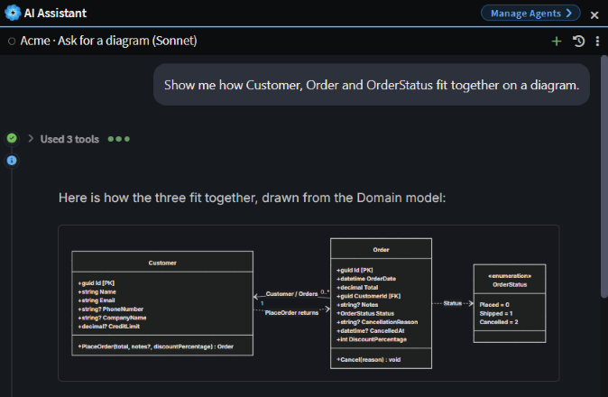
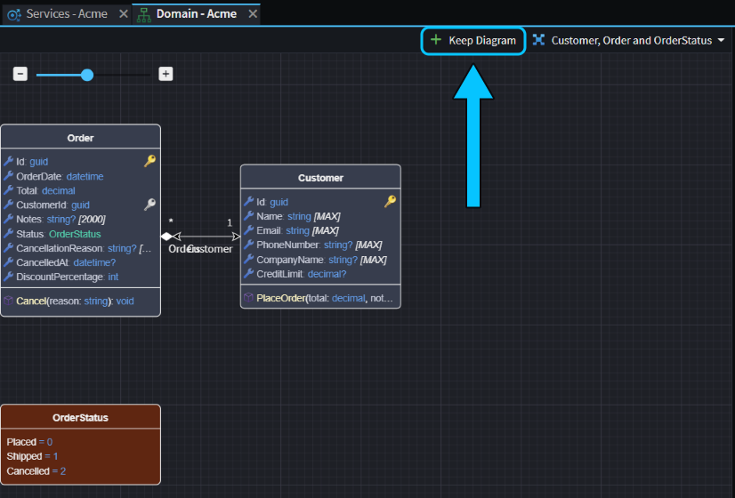

# Ask the AI Assistant about Intent Architect and your solution

Not sure how to do something in Intent Architect, or what a term means? Ask the AI Assistant. It looks the answer up in these docs and gives you the steps with a link to the page, and it can explain how your own solution fits together too. Hit an error? Many have a button next to them that hands the problem straight to the AI.

This guide shows how to ask about Intent Architect and about your own solution, start a chat straight from an error or a file, and where to turn when the AI can't answer.

## Ask the AI Assistant how to do something in Intent Architect

Open the AI Assistant with **F8**, or with the AI Assistant button on the toolbar. Under the message box, open the agent menu and choose **Ask**. The Ask agent is the one for questions: it can read your solution, but it can't change anything.

Then type your question the way you'd ask a colleague. Each of these got an answer with links on the Acme sample:

- "How do I see all the keyboard shortcuts in Intent Architect?"
- "What's a stereotype, and how do I add one to an attribute?"
- "How do I stop the Software Factory from overwriting a method I changed by hand?"

Whenever you ask about Intent Architect itself, Ask searches these docs before it answers. A **Search docs** step appears in the chat, and the answer links the pages it used, so you can read more or check it. For the keyboard shortcuts question, that was the Keyboard Shortcuts page.

_Choose Ask in the agent menu. Its answer links the docs pages it used._

Agent and Plan can search the docs too, so you can ask a quick question in the middle of a task. They don't always search, though, so use Ask when you want an answer you can check.

## Ask the AI Assistant about your own solution

The **Ask** agent reads your designers and your code as well, so you can ask what's in your solution or how part of it works. On the Acme sample, this question took 36 seconds:

> How does cancelling an @Order work in this solution, from the API down to the database?

The answer traced the request from the API endpoint, through the command and its handler and the `Cancel` operation on `Order` with its business rule, to the database mapping, and named the file for each step.

The AI knows which designer you have open, but not which element you've selected in it. To point it at an element or a file, type `@` and the start of its name, then pick it from the list: **Models** lists elements from your designers, and **Files** lists files in your codebase. What you pick is attached to your message.

_Type @ and the start of a name, then pick the element or file from the list._

> [!TIP]
> You can also paste a screenshot, attach files, drag in a change from Change Review or say your question out loud. See .

To see how elements fit together, ask for a diagram. Ask draws one in the chat, from your model:

_Ask draws the diagram in its answer. It doesn't change your designers._

To see the real elements laid out in a designer, ask in **Agent**, and say not to change anything:

> Show me how Customer, Order and OrderStatus fit together on a diagram. Don't change anything.

The agent opens a temporary Explorer Diagram of those elements in the designer they belong to, and leaves your model unchanged. To save it as a normal diagram, click **Keep Diagram**.

Some models don't handle this well and come back with an empty diagram. If that happens, choose a different model from the menu next to the agent menu and ask again.

_The diagram is temporary until you click Keep Diagram._

## Start a chat from the AI button next to an error or a file

Many places in Intent Architect have a button that starts a chat in the AI Assistant with the details already filled in, so you don't have to copy anything across:

- **A Software Factory error:** click **Try fix with AI** on it. The chat starts straight away with the error message. See .
- **A task that failed:** click **Resolve with AI** on the task's tab. See .
- **Conflicts in a merge or rebase:** click **Resolve with AI** on the bar at the top of the Source Control pane.
- **A file you want changed:** right-click it, in the Codebase pane for example, and choose **Create AI Task**. The chat opens with the file attached, and you type what you want.
- **A file Change Review shows as Unclassified:** click **Unclassified**, then **Ask AI**. The chat opens with the file's details for you to finish.
- **A solution with no applications yet:** click **Ask the AI Assistant** and describe what you want to build.

## Open Help or contact support when the AI can't answer

Press **F1**, or click the **?** button on the toolbar, to open **Help**. It lists help topics for the designer and element you're working in, such as **Adding a Diagram** in the Domain designer, and its search box searches every topic. Use it to browse what you can do where you are. It opens topics in your browser and doesn't connect to the AI chat. See .

Help also always offers **Contact Support**. Contact support when the AI tells you the docs don't cover what you asked, when its answer has no link, or when something looks like a bug. Say what you asked, so the answer can be added to the docs.

If the problem is with a chat itself, such as an agent that stops or errors, type `/diagnostics` in that chat. **Gather Diagnostics** saves the chat's logs and session details as a zip in your Downloads folder, ready to attach to your support request. No API keys or credentials are included.

## Limitations

- **An answer without a link may be a guess.** When the docs don't cover a question, the AI answers from its general knowledge instead. For example, asked how to export a diagram to Visio, it suggested an image export from the diagram's toolbar, with no link to back it up. Treat anything without a link as unchecked, and contact support if the docs don't cover it.
- **The AI can't use Intent Architect's menus and dialogs for you.** It can't click menus, open dialogs or change your user settings, and it may describe menus that don't exist. Use the Ask agent to find out how to do it, then do it yourself. When you choose **Agent**, the AI can still change your model, your code and your application settings.

## Related articles

-  - the AI Assistant, its agents and its AI providers.
-  - what Ask, Agent and Plan can each do.
-  - every way to get help, including how to contact support.
-  - when to just prompt, plan first or write a spec.
