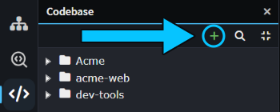
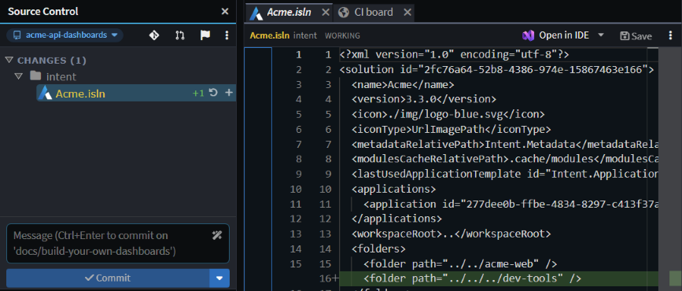
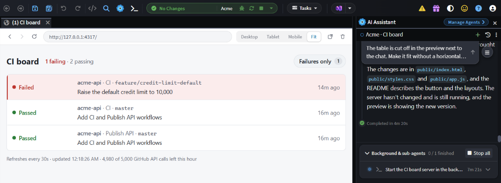
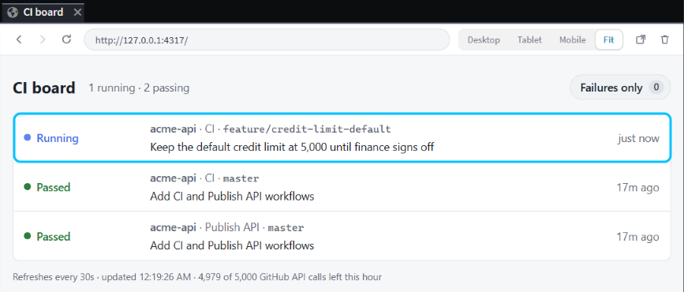
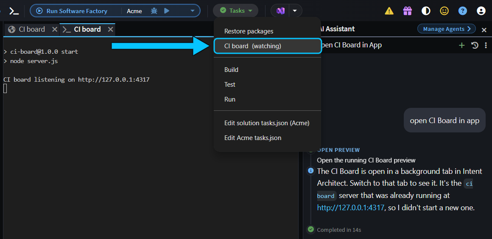
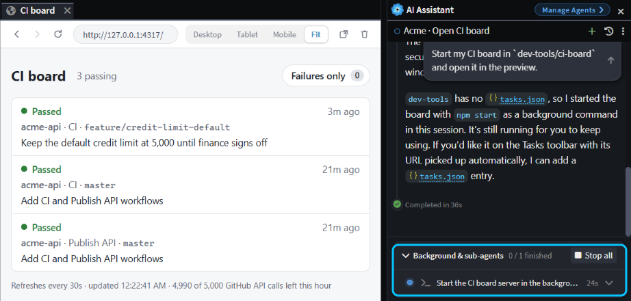

# Build your own dashboards and dev tools with the agent

Want your CI/CD pipelines, or every pull request waiting on you, on one screen without leaving Intent Architect? Have the agent build it as a small dashboard of your own and open it in the app preview, where it shows live data every time you look.

This guide builds a CI/CD status board for GitHub Actions as the example, then shows where to keep its code, how to keep your tokens out of it, and how to open it again next week.

## Choose a live dashboard or an MDX report

The agent can answer a question about your work in two ways. An [MDX report](xref:how-to.visual-reports) is a document it writes once, with diagrams, tables and links, showing what it found at that moment. A dashboard is a small web app that runs on your machine and fetches its data again each time it refreshes, so it's never out of date.

- **Ask for a report** when you want an answer once, such as who can call each endpoint of your API.
- **Build a dashboard** when you'll ask the same question again and the answer keeps changing, such as which builds are failing or which pull requests are waiting for your review.

## Keep your dashboard's code in your solution or in a folder of your own

Decide first whether the dashboard is for your team or only for you:

- **For your team**, such as a board of your team's pipelines, put it in a folder inside your solution's Git repository, such as `tools/ci-board`, and commit it like any other code. Commit the task that starts it too, as the last section shows, and everyone who pulls gets a button for it. Each person sets their own token, so nothing secret is committed.
- **Only for you**, such as a list of your own pull requests, keep it out of your solution's Git repository. Create a folder for your own tools outside it, such as `dev-tools` next to your Git repositories. Then, in the Solution Shell's **Codebase** pane, click **+** (**Add a folder to the workspace...**) and choose that folder. The agent is told about every folder in the Codebase pane, so it can build in it. This guide's example uses a folder like this.

_The `dev-tools` folder, added with **+**, next to the solution's own folders._

Adding a folder adds a line to your solution's `.isln` file. Leave that change out of your commits, or your teammates get a folder they don't have.

_Source Control shows the new `<folder>` line in `Acme.isln`. Don't commit it._

> [!NOTE]
> Chats in the Agents Shell aren't told about folders you add to the Codebase pane. Build and open your dashboards from the Solution Shell's **AI Assistant**.

## Ask the agent to build your dashboard in the Solution Shell's AI Assistant

Describe the dashboard in the **AI Assistant**: what it shows, where the data comes from and where the code goes. Then ask the agent to start it and open it in the app preview, a browser tab inside Intent Architect that shows an app running on your machine. We asked:

> Build me a CI/CD status board as a small web app in `dev-tools/ci-board`. For each GitHub repository in a config file, starting with the one this solution pushes to, show the latest GitHub Actions run of each workflow on each branch: the repository name without its owner, the workflow, branch, status, commit message and how long ago it ran, failures first, each linking to its run. Refresh it every 30 seconds. Call GitHub from a small local server that reads the token from the GITHUB_TOKEN environment variable, and never write the token to a file or print it. Then start it and open it in the preview.

About nine minutes later, the board was open in a tab beside the chat, with the one failing branch at the top. The agent had written a Node server with no packages to install, a `repos.json` file listing the repositories to watch, and a README saying how to start it. It had also checked in the preview that the page loaded and refreshed itself.

Change it the way you'd change any code: say what you want while you look at it. The table didn't fit beside the chat, so we asked _"The table is cut off in the preview next to the chat. Make it fit without a horizontal scrollbar at this width, and add a button that shows only failures."_ Four minutes later, it fitted and had a **Failures only** button.

_The board after one follow-up prompt. The server the agent started runs in the background of the chat._

Because it's running code, the board keeps itself up to date. When we pushed a fix to the failing branch, the new run showed up as **Running** at the next refresh, without anyone touching the board.

_The board picked up the new run by itself._

The same kind of prompt works for anything else you check often, such as your open pull requests across Git repositories or the version deployed to each environment. In your prompt:

- **Say where the code goes, what each row shows and where the data comes from.**
- **Ask for a config file** listing what to watch, so you can add a Git repository or a pipeline without another prompt.
- **Say how it gets its token** (see the next section), and ask the agent to start it and open it in the preview.

## Keep tokens in environment variables, not in the dashboard's code

A dashboard that calls GitHub, Azure DevOps or another service needs a token. Keep the token out of the code and out of every file in the dashboard's folder:

- **Set it as an environment variable** for your user account, such as `GITHUB_TOKEN`, then restart Intent Architect, so everything it starts sees the new variable.
- **Ask for a small local server** that reads the variable and calls the service. A page that calls the service from the browser needs the token in its own code, where anyone who opens the page can read it.
- **Use a token that can only read** what the dashboard shows, such as a fine-grained GitHub token with read access to those repositories.
- **Say in your prompt that the token mustn't be printed or written to a file.** Before it finished, our agent searched the dashboard's files and the server's log to make sure the token wasn't in them.

> [!NOTE]
> Check your organization's rules before a dashboard of your own calls internal systems. Some organizations don't allow personal tools to call internal APIs or to use your token outside approved apps.

## Open your dashboard again next week

Ask the agent to start your dashboard and open it in the preview whenever you want it, or better, set up a task so starting it is one click on the **Tasks** toolbar.

A task is a command on the **Tasks** toolbar that you and the agent can both run. We asked _"Set up a task that starts my CI board in `dev-tools/ci-board` and keeps it running, so you can open it in the preview."_, and a minute and a half later the agent had added a **CI board** background task to the solution's `tasks.json`. From then on, start the board from the **Tasks** toolbar, where it's a button of its own, or an item in the **Tasks** menu when the window is narrow.

The task starts the server and shows its output in a tab, but it doesn't open the preview, and there's no button to open one yourself. Clicking the address in the output opens the board in your web browser instead. To see it inside Intent Architect, ask any chat to open it in the preview, for example _"Open my CI board in the preview."_ That took 13 seconds, because the agent reads the board's address from the running task. The preview opens in a background tab, so click its tab, the one with a globe icon, to see the board. Closing the task's own tab stops the server.

_**CI board** in the **Tasks** menu, running, and a chat that opened the board in the preview from it._

If the dashboard is in your solution's Git repository, commit the task with it. The task's folder is relative to the root of the Git repository, so it works in everyone's copy: when we moved our board into `tools/ci-board`, the agent changed the task's folder to that, and the board started from there. If the dashboard is in a folder of your own, the task holds a path on your machine, so leave the task out of your commits, as you do the `.isln` line.

Without a task, ask any chat to start it:

> Start my CI board in `dev-tools/ci-board` and open it in the preview.

A fresh chat read the README in the dashboard's folder, started the server and opened the board in the preview, 36 seconds after we asked. The server runs in the background of that chat, under **Background & sub-agents**, where **Stop all** stops it.

_A one-line prompt in a new chat brings the board back. The server it started is under **Background & sub-agents**._

Either way, Intent Architect doesn't save the app preview as a tab, and the dashboard's server only runs while Intent Architect does:

- Starting another chat in the Solution Shell leaves the preview and the server running.
- Closing the solution closes the preview.
- Quitting Intent Architect stops the server. If a chat started it, Intent Architect first warns that **Agents are still working** and names the chat. **Stop agents and close** stops it.

## Build dashboards for your team's other tools

Anything with an API can feed a dashboard. Three that teams get a lot from:

- **Jira:** your team's current sprint, with each issue's status and assignee, blocked and overdue issues first, each linking to the issue. Jira Cloud's REST API takes your email address and an API token.
- **Slack:** the questions in your team's support or help channel that nobody has answered yet, oldest first, each linking to its thread. Slack's Web API needs a token from a Slack app that can read the channel's history.
- **Microsoft Teams:** the latest messages in the channels where your team announces releases and incidents, in one list. Teams messages come from Microsoft Graph, which needs an app registered in Microsoft Entra ID, and your admin may have to approve it.

Each of these needs its own token, so keep it in an environment variable, not in the dashboard's code, and check your organization's rules before you build one.

## Related articles

-  - ask the agent for a report you read once, rather than a dashboard.
-  - add folders to the Codebase pane, and review what the agent changes in them.
-  - have the agent try a change in your own app in the preview.
-  - give the agent tasks that start your app, so it can open it in the preview.
