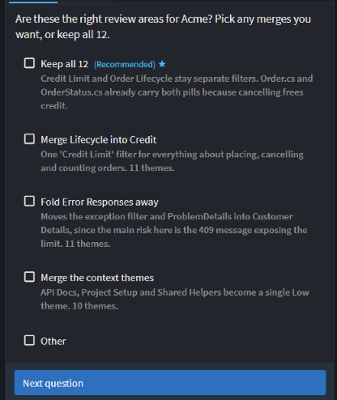
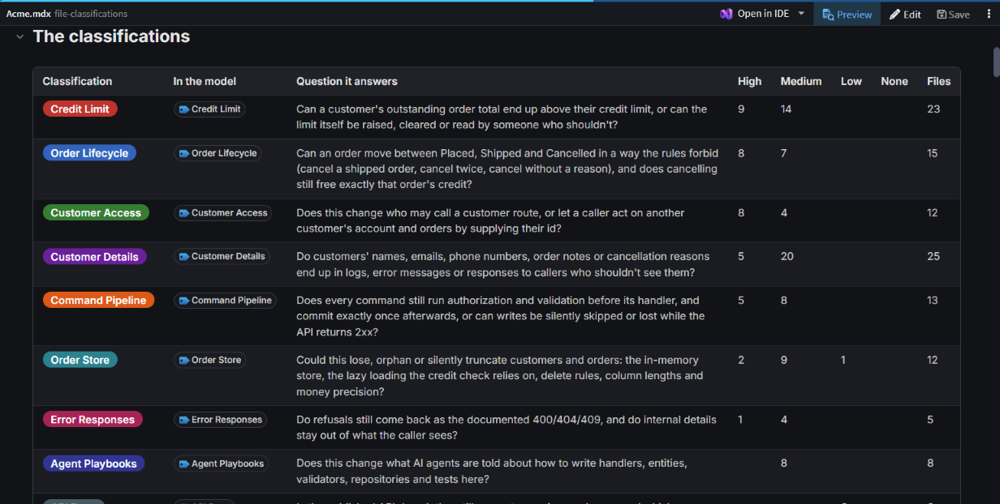
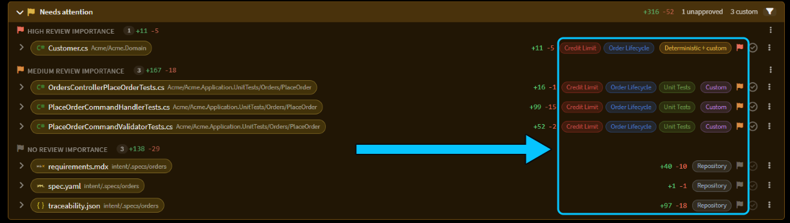
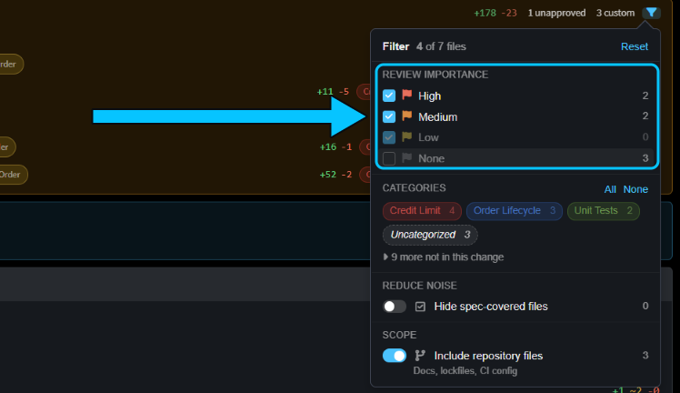
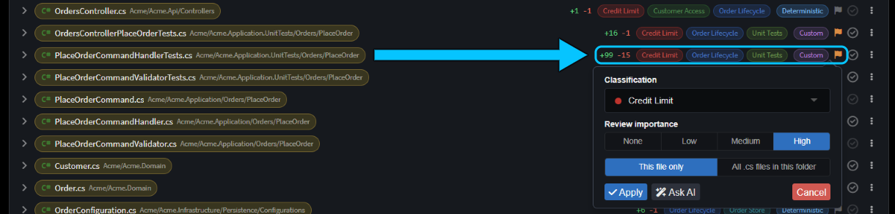

# Classify your codebase so reviews focus on what matters

Got an agent change that affects numerous files? Classify your codebase once, and Change Review tags each changed code file with what it's for and how closely to look, so you start with the files that need your eyes. The agent does the classifying: it reads your code, proposes areas in your system's own terms, and sets them up once you agree.

This guide shows how to have the agent classify your codebase, use the result in Change Review, correct a file as you review, and keep the classifications up to date.

## Have the agent classify your codebase with the classify-codebase skill

Classifying gives every file two things:

- **File Classifications** say what the file is for, in your system's terms. On the Acme sample they include **Credit Limit**, **Order Lifecycle** and **Customer Access**.
- **Review Importance** says how closely a developer needs to look when the file changes. It's one of four levels: **None**, **Low**, **Medium** or **High**.

To set them up, type `/classify-codebase` in the Solution Shell's AI Assistant. You can add areas you already know matter after the command.

The agent learns what your system does, scans the code with sub-agents and drafts classifications named after your own subsystems, data and flows, each with the question a reviewer should ask. Before it changes anything, it asks you:

- whether those are the right areas;
- whether there's anything else to cover;
- what **High** should mean. It recommends: a developer must review a change to the file, rather than leave it to AI review;
- whether to retire the generic classifications that Intent Architect's modules created.

After a dry run, it shows you the totals and asks whether to apply them.

On Acme, the agent proposed 12 classifications and classified all 106 files: 20 High, 56 Medium and 30 Low.

It finishes with a link to a review document, in a `file-classifications` folder next to your `.isln` file. It lists each classification's question and files, the decisions you agreed, and the defects the scan found but didn't fix: 15 on Acme, starting with endpoints that accept anonymous callers. Read it before you rely on the classifications, then commit it with the changes to your Intent solution, so the whole team sees the same pills.

_The review document for Acme, with the question each classification answers._

## Review a change by classification and Review Importance in Change Review

Open Change Review from the flag button in the Source Control pane. **Needs attention** holds the hand-written code in the change, grouped by Review Importance with **High review importance** first. Each row shows its classification pills and a flag in its importance's colour, so you know what a file touches before you open it.

_The agent's order-discount change on Acme. `Customer.cs` changes the credit check, so it's High._

Generated code that matches your model exactly isn't in **Needs attention**. It keeps its pills in the application's **Code** section, but its flag stays grey: Review Importance only counts where the change touched hand-written code.

To narrow the list, click the funnel in the **Needs attention** header. Untick a Review Importance, or click a category to hide its files. Change Review remembers the filter next time.

_Unticking **None** hides the three spec files, leaving four of seven._

Classification decides where you look first, not what you can skip. The filter only hides rows: the approval count still includes every file, so a filtered list can't make a change look reviewed.

## Correct a file's classification from Change Review

When a file's classification pill or Review Importance flag looks wrong in Change Review, fix it in place:

1. Click the file's flag, or one of its pills.
2. Under **Classification**, pick one, or type a name to create a new one.
3. Choose a **Review importance**, and whether it applies to **This file only** or to all files of its type in its folder.
4. Click **Apply**.

The change is saved to your model straight away, so commit it with the rest of your work.

_Raising the tests for placing an order to High, since they prove the credit check._

The popover gives a file a single classification. On Acme the tests became High, but lost their **Order Lifecycle** and **Unit Tests** pills. For a file that belongs to several areas, ask `/classify-codebase` for the change instead (see the next section).

> [!NOTE]
> Classifying from Change Review needs an up-to-date Codebase Structure module. If **Apply** says yours is too old, it opens the Modules manager on the update. Update the module, then try again.

## Keep the classifications up to date with the classify-codebase skill

As your code changes, run `/classify-codebase` again and say what you want, such as a new area or a different importance. It keeps the classifications you agreed, so the filters your team uses stay the same.

After the agent added a discount to Acme's orders, we ran _"/classify-codebase Catch up with the order discount change."_. The agent:

- folded the discount into **Credit Limit** and reworded that classification's question;
- noticed the tests we'd raised to High from Change Review, and asked whether to keep that;
- showed a preview, and asked before applying it.

The tests stayed High and got all three of their pills back. The review document now opens with **What changed since the previous map**.

## Related articles

-  - how classifications are stored and resolved, and how modules classify their own templates.
-  - everything in Change Review, including approvals.
-  - review and merge the work of agents running in their own worktrees.
