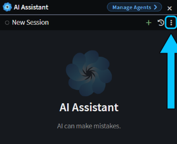
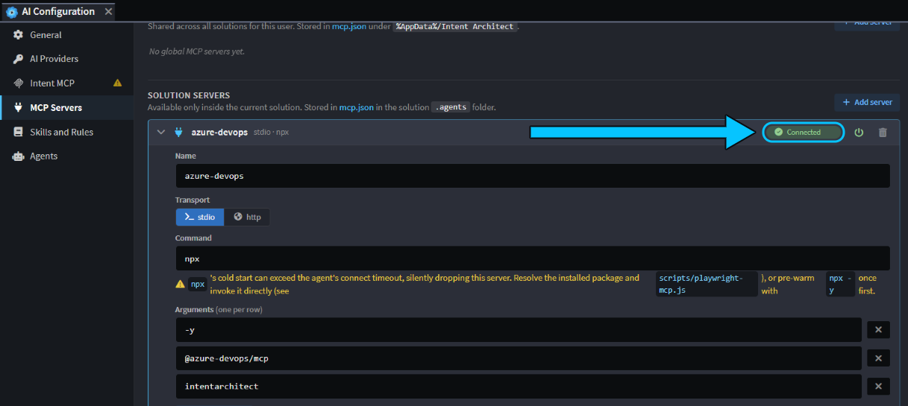
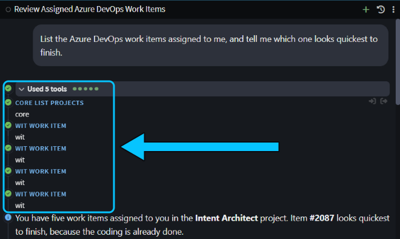

# Connect an MCP server to your chat

Let the agent work with the other systems your team uses, such as Azure DevOps, Jira or Slack. Instead of you copying work items, tickets or messages into the chat, the agent reads and updates them itself, in the same chat where it works on your code.

To do this, you connect each system's MCP server: a small program or web endpoint that gives an AI agent a set of tools for that system. This guide uses Azure DevOps as the example. The steps are the same for any MCP server, and the vendor's documentation tells you what to enter.

## Add the server on the MCP Servers tab of AI Configuration

In the Solution Shell, click **⋮** (**More actions**) at the top of the **AI Assistant**, choose **AI Configuration…**, and open the **MCP Servers** tab.

_The **More actions** button at the top of the AI Assistant._

The tab has two lists. Choose where the server belongs, and click its **Add server** button:

- **Global servers** are available in every solution you open, and stay on your machine.
- **Solution servers** are available only in this solution, and are saved in a file you can commit for your team.

Then fill in the server:

1. Enter a **Name**, such as `azure-devops`.
2. Choose the **Transport** the vendor documents, and fill in its fields:
   - **stdio** starts a program on your machine. Enter its **Command**, and its **Arguments** one per row.
   - **http** connects to a web endpoint. Enter its **URL**.
3. Click **Save Changes**.

For Azure DevOps, use Microsoft's [local Azure DevOps MCP server](https://github.com/microsoft/azure-devops-mcp): **stdio**, with the command `npx` and the arguments `-y`, `@azure-devops/mcp` and your Azure DevOps organization name. Microsoft also hosts an http version, but chats on Claude Code only get stdio servers, so the local one works in every chat.

> [!NOTE]
> Run the server's command once in a terminal before you add it, for example `npx -y @azure-devops/mcp --help`. The first run downloads the package, which can take half a minute: longer than the connection test or a Claude Code chat waits for a server to start. A chat that stops waiting carries on without the server's tools.

## Check that the server connects on the MCP Servers tab

When you save, Intent Architect starts the server to test it. The status next to its name shows **Testing…**, then:

- **Connected:** the server started and listed its tools. Click it to test again.
- **Retry:** the server didn't start or didn't answer. The error shows under the server, and when you hover over **Retry**. Fix the setting and save it, and Intent Architect tests it again.
- **Sign in:** an http server needs you to sign in. Click it and approve access in your browser.
- **Disabled:** you turned the server off with its power button, so no chat gets it.

_The Azure DevOps server added under **Solution servers**, showing **Connected**._

The Azure DevOps server signs in with your Microsoft account the first time the agent uses one of its tools. If your browser asks, sign in with an account that can see the organization.

## Use the server's tools from a chat in the AI Assistant

Start a new chat in the **AI Assistant** after you add or change a server. A chat that's already open on Claude Code keeps the servers it started with.

Name the system in your prompt, so the agent knows to use the server's tools:

> List the Azure DevOps work items assigned to me, and tell me which one looks quickest to finish.

The agent listed the organization's projects, fetched the five work items assigned to me, read the one it picked in full, with its comments, and explained its choice. The chat lists each tool call, so you can see what it read.

_The agent calls the Azure DevOps server's tools from the chat._

> [!WARNING]
> Intent Architect's own agent calls a server's tools without asking you first, even in **Ask before edits** mode. That includes tools that change data, such as creating a work item. A chat on Claude Code follows its permission mode. Give each server an account or token with only the access you want the agent to have.

## Share an MCP server with your team

**Solution servers** are saved in `.agents/mcp.json`, in the folder that holds your `.isln` file. Commit that file, and your teammates get the same servers when they open the solution. The Azure DevOps example holds no secrets, because each person signs in with their own Microsoft account.

Intent Architect encrypts anything you enter under **Environment variables** and **Headers** before saving it, and only you can read it, on your machine. Even so, don't put tokens in a file you share. If a server needs a token, add it under **Global servers** instead.

## Limitations

- **A Claude Code chat can only use stdio servers.** If the vendor offers a stdio server, use that one. If it only offers an http server, switch that chat to a model from another AI provider, such as an Intent Architect or OpenAI model.
- **A Claude Code chat only loads Solution servers when your `.isln` file is at the top of the chat's folder,** usually the root of your Git repository. If your `.isln` file is in a subfolder, such as `intent`, add the server under **Global servers** instead.
- **The vendor's setup can change.** The command, package name and sign-in steps come from the vendor, not Intent Architect. If the Azure DevOps example stops working, check the vendor's documentation for the current steps.

## Related articles

-  - every tab of AI Configuration.
-  - connect your coding agent to Intent Architect's own MCP server, the opposite direction to this guide.
