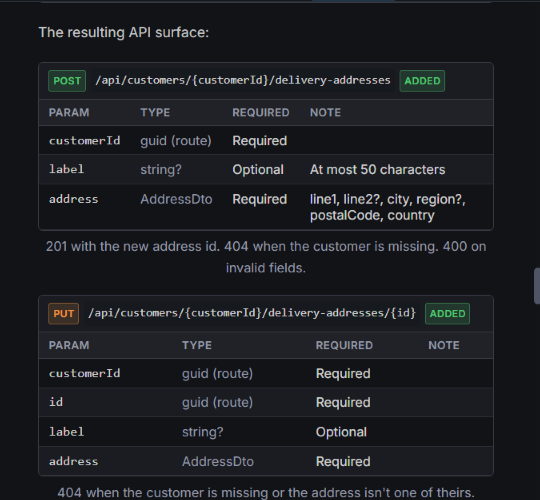
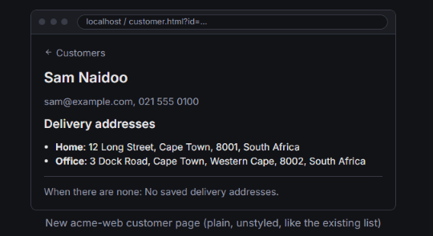
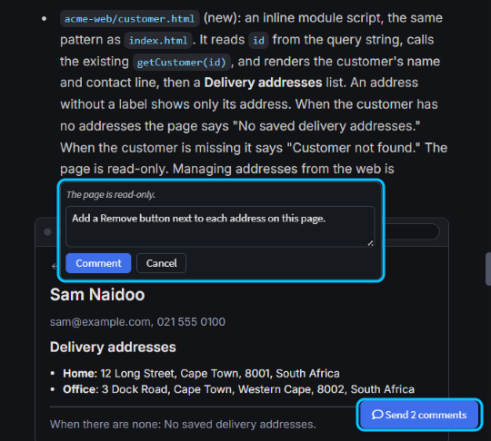
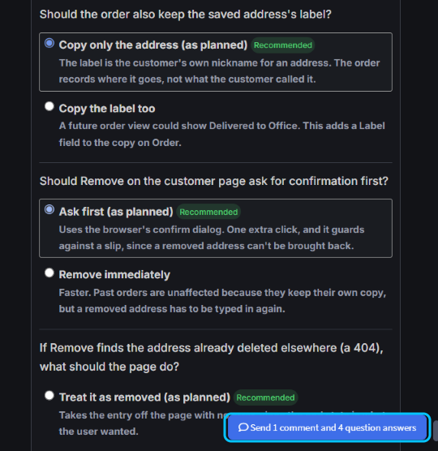
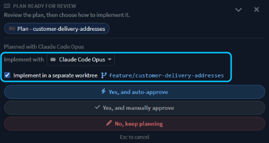

# Get it right the first time with Plan Mode

Get a change right the first time by getting its plan right first. Aligning with the AI upfront ensures a better implementation with less rework. Got a plan from Plan Mode? Check the data model, API and screens it sketches, then comment on anything that's off and answer its questions, all in one go. Happy with it? Choose the model that builds it, and build it in a worktree of its own so your own code stays untouched.

This guide shows how to review and correct a plan before the agent writes any code.

## Start Plan Mode in the AI chat before your first message

Pick **Plan** in the agent picker below the message box, or press `Shift+Tab` in the message box. Then describe what you want: what users should be able to do, and where. Leave the how to the agent.

> [!NOTE]
> `Shift+Tab` switches to Plan only before you send your first message. Once the conversation has started it does nothing, so pick **Plan** in the agent picker instead, or start a new chat.

Plan reads your model and code but changes nothing. It asks about any decision it can't make, with its recommended answer marked, then writes the plan to `intent/.plans` and opens it in a tab of its own.

With _"Customers should be able to save several delivery addresses and pick one when they place an order. Show a customer's addresses on the customer page of the web app."_, Plan asked four questions, such as whether an order should keep a copy of the address or a link to it. The plan was ready 9 minutes after the prompt was sent.

## Check the data model, API and screens in a plan

A plan from Plan Mode shows the shape of the change as well as describing it, so a wrong shape is quick to spot:

- **The data model:** a class diagram of the new and changed classes, then each one's fields and types. Look for a missing field, or one that's optional when it shouldn't be.
- **The API surface:** each new or changed endpoint, with its route and parameters, and which parameters are required.
- **The screens:** a wireframe of each new or changed page.

_The delivery addresses plan sketched the new customer page in the web app without being asked to._

A wrong field or route takes one comment to fix now, rather than a rework of code and tests later.

## Comment on the plan and answer its questions

Say what's wrong on the plan itself, rather than in a chat message:

1. Select the text, and click **Add Comment**.
2. Type what should change, and click **Comment**.
3. Do the same for anything else you want changed.
4. Click **Send N comments** in the bottom-right corner of the plan.

_Commenting on the text above a wireframe. Text inside a wireframe or diagram can't be selected for a comment, so comment on the text next to it._

The comments reach the agent as one message, each quoting its text. The agent revises the plan, asking first about any new decision a comment raises, and puts it up for review again. The **Plan ready for review** card in the chat lists the same comments, and its **Send feedback and keep planning** button sends them too.

On the sample, three comments asked for a required label, at most five addresses per customer, and a **Remove** button on the new page. After two rounds of follow-up questions, such as whether labels must be unique, the revised plan was back about 3 minutes later, with the buttons drawn into the wireframe.

To see what the agent decided on its own, click **No, keep planning** on the card and ask it to add those decisions as questions at the end of the plan. On the sample it added five, such as whether every address needs a postal code. Answer them in the plan; leave one unanswered and the agent keeps its recommendation. The answers go with your comments, on the same button.

## Choose the model that implements the plan

When the plan is right, the **Plan ready for review** card shows the model that planned it. **Implement with** sets the model that builds it, so you can, for example, plan with your most capable model and build with a faster one. Your choice becomes the default for your next plan.

Then click **Yes, and auto-approve** to build without being asked about each tool call, or **Yes, and manually approve** to be asked before each write. The chat switches to **Agent**, which starts fresh from the approved plan.

## Implement the plan in a separate worktree from the Agents Shell

A Git worktree is a second checkout of your repository, in its own folder and on its own branch. In the [Agents Shell](xref:application-development.user-interface.agents-shell-and-solution-shell), the card can build the plan in one, so your own checkout stays untouched while you carry on working.

Tick **Implement in a separate worktree** before you approve. The branch is named after the plan, such as `feature/customer-delivery-addresses`; click the name to change it.

When you approve, Intent Architect creates the worktree from your current commit and moves the chat and the plan into it. On the sample, the original checkout stayed clean on `master` throughout.

> [!NOTE]
> The option appears only in the Agents Shell, when the **Implement with** model is a CLI agent such as Claude Code, and when the chat isn't already running in a worktree. To work in a worktree from the start instead, tick **worktree** before you send your first message; see .

## Related articles

-  - when to plan first, and when to just prompt or write a spec.
-  - running agents in worktrees while you work.
-  - what Agent, Ask and Plan can each do.
-  - worktrees and session branches in the Agents Shell.
