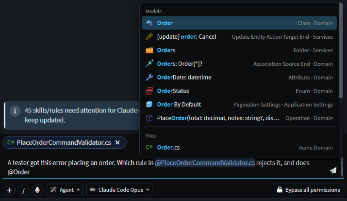
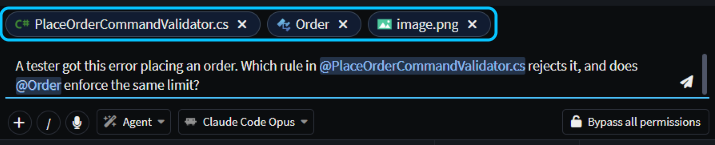
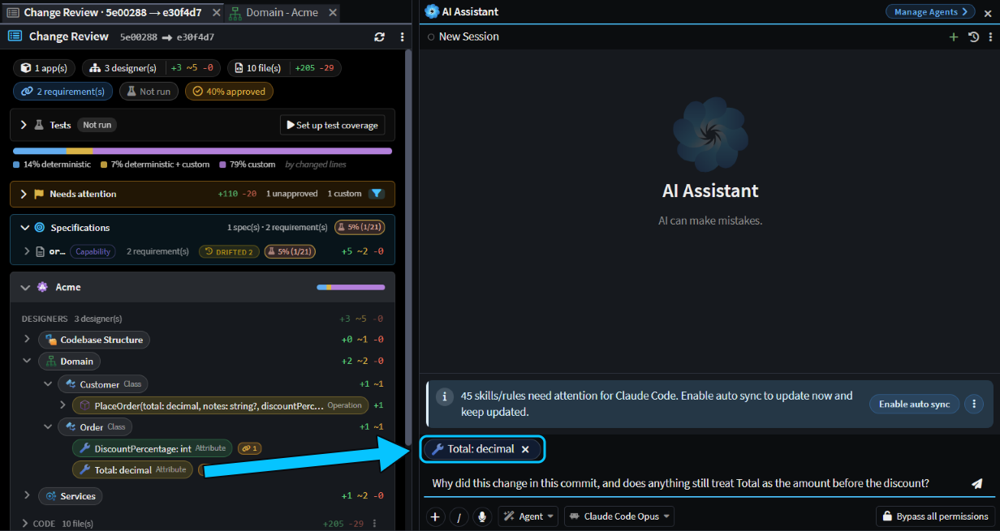
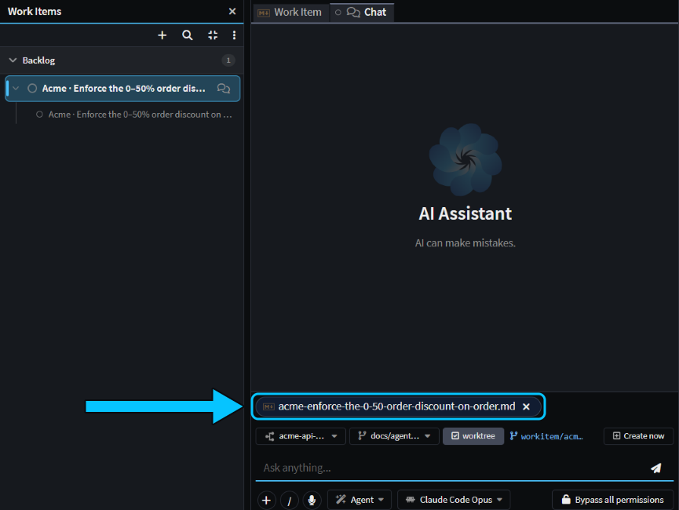
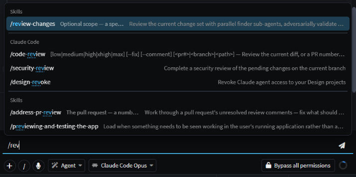

# Give the AI the right context, fast

Want the AI to look at a particular element, file, error or work item? Reference it directly instead of describing it: type `@` and pick it, paste a screenshot, or drag it in from Change Review, and the AI starts from the real thing. Got a lot to explain? Say it instead of typing it.

This guide shows each way to add context to a chat in the AI Assistant, what the AI gets from it, and how to reuse what you've already written.

## Point the AI at an element or a file with @

In the AI Assistant's message box, type `@` and the start of a name, then pick from the list. **Models** lists elements from your designers, such as a class, an attribute or an operation. **Files** lists files in your codebase. A bare `@` lists the files you changed most recently.

_Type @ and the start of a name. The file picked earlier is already attached above the message box._

Each pick is attached to your message and shows above the message box. The AI gets the element's current definition from your model, or the whole file, so it doesn't have to go looking for it.

You can also drag an element from a designer's model tree, or a file from the **Codebase** pane, and drop it on the message box.

> [!NOTE]
> The AI knows which designer you have open, but not which element you've selected in it or which file you're looking at. To ask about the element or file you're working on, type `@` and pick it.

## Attach screenshots and files to your message

To show the AI what's on your screen, paste a screenshot into the AI Assistant's message box with `Ctrl+V`. To attach files, drag them from File Explorer and drop them on the message box, click **+** (**Add content**) under it, or type `/attach`. Drop files anywhere else in the chat and they open as tabs instead. A message can carry up to 20 attachments, `@` mentions included.

Images (PNG, JPG, GIF, WebP and BMP) reach the AI as images, so it can read an error, a mockup or a diagram from them. Other files, such as code, logs and Markdown, are read as text.

For example, we pasted in a tester's screenshot of a `400 Bad Request` error and sent:

> A tester got this error placing an order. Which rule in @PlaceOrderCommandValidator.cs rejects it, and does @Order enforce the same limit?

_A file, an element and a screenshot attached to one message._

The answer quoted "You entered 60" from the screenshot, named the validator rule that allows 0 to 50, and pointed out that `Order` itself accepts any value: only `Customer.PlaceOrder` checks it.

## Drag a change from Change Review into the chat

When something in a review needs explaining, drag its pill from **Change Review** and drop it on the AI chat's message box. An element pill, such as an attribute under **Designers**, brings what changed on it in the range you're reviewing, from its old value to its new one. A file pill brings the file. Elements that were deleted can be dragged too.

_Drag the element from Change Review onto the message box._

For example, reviewing a commit that added order discounts, we dragged `Total: decimal` into a new chat and asked:

> Why did this change in this commit, and does anything still treat Total as the amount before the discount?

The answer explained that `Total` now holds the discounted amount, quoted the spec decision behind it, and flagged that `Total` on the place-order request still means the amount before the discount.

## Start a chat from a file or a work item

To start a task from a file, right-click it in the **Codebase**, **Source Control** or **Changes** pane, or on its tab, and choose **Create AI Task**. A new chat opens with the file attached and nothing sent, so you type what you want. **Create AI Task** is in the Solution Shell only.

To start from a work item, go to **Work Items** on the left-hand bar of the [Agents Shell](xref:application-development.user-interface.agents-shell-and-solution-shell). Hover the item and click **Start chat**, or select it and press `Ctrl+Enter`. The chat opens with the item attached and linked to it, so the agent knows what the chat is for. By default it runs in a Git worktree of its own: a separate checkout of your repository, on a new branch.

_Start chat attaches the work item and links the chat to it._

## Say it instead of typing it with voice input

Click the microphone under the AI Assistant's message box, or press `Ctrl+I`, and talk. What you say is typed into the message box as you speak, with punctuation, after anything already there. Press `Ctrl+I` again to stop, or just send, which also stops it. Nothing is sent until you send it, so read it over first.

The first time, you're asked to download a speech model of about 255 MB. Click **Download**, then click the microphone again once it's done. From then on, transcription runs entirely on your machine, so your voice isn't sent anywhere. It understands English only.

## Reuse your last prompt, skills and earlier chats

**Your last prompt:** in an empty AI Assistant message box, press `Up Arrow` to bring back the last message you sent in this chat, then change it and send it again. Only the text comes back, so attach anything you need again.

**Skills and commands:** type `/`, or click the **/** button, for a list that filters as you type. It has your **Skills**, instructions saved once for a task you repeat, such as `/review-changes`. It also has the agents, such as `/plan`, Intent Architect's own commands, such as `/compact`, and the commands of the agent you're using, such as Claude Code's `/code-review`. To add your own skills, see .

_Type / and a few letters to find a skill or command._

**An earlier chat:** open it, hover over the reply you want to continue from, and click **Fork from here**. A new chat opens with the conversation up to that reply, named after the original with "(fork)" added.

## Related articles

-  - the AI Assistant, its agents and its AI providers.
-  - Work Items and the chats linked to them.
-  - everything Change Review shows.
-  - skills, slash commands and instruction files.
-  - let the AI read tickets and messages from other systems itself.
