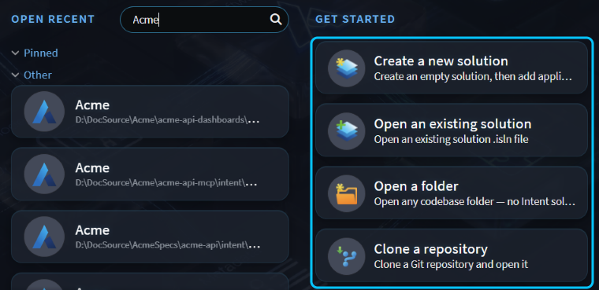
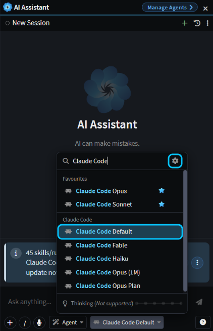
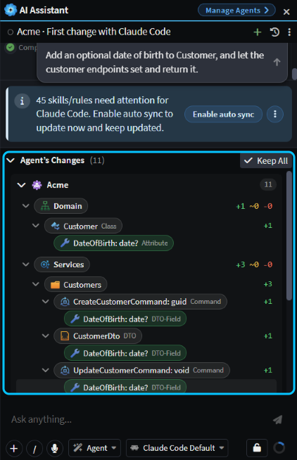
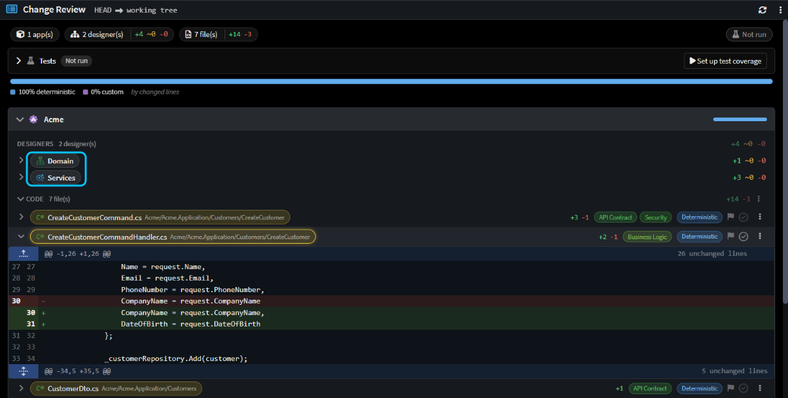
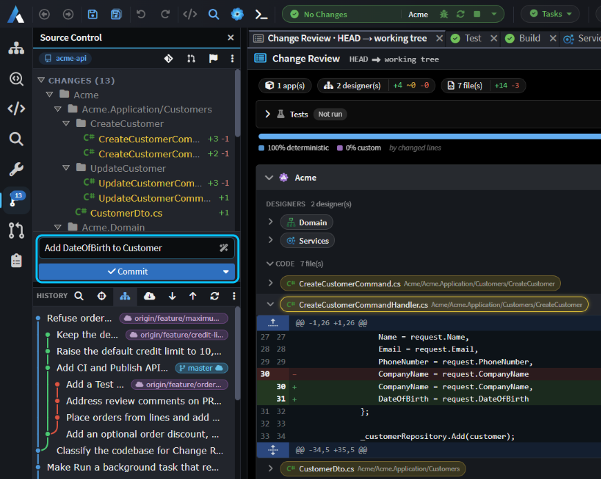

# Make your first change with the AI

Just installed Intent Architect? Get your first change from the AI, reviewed and committed, without leaving the app: open your code or start something new, choose your coding agent, ask for the change, then check what it did and commit it.

## Sign in and open your code from the Home screen

When Intent Architect starts, sign in with your Intent Architect account. If you don't have one yet, click **Create an account** on the sign-in screen.

The Home screen opens next. Under **Get started**, pick whichever fits:

- **Open a folder** opens code you already have, whether or not it has an Intent Architect solution.
- **Clone a repository** clones a Git repository from its URL into a folder you choose, then opens it the same way.
- **Open an existing solution** opens an Intent Architect solution, the `.isln` file your team may already have.
- **Create a new solution** starts from nothing. Name it and click **Create solution**, then click **Create new application** and choose a template for your first application. The solution gets its own Git repository by default.

_**Get started** on the Home screen, with the four ways to open or start your code boxed._

Each one opens your code in the [Solution Shell](xref:application-development.user-interface.agents-shell-and-solution-shell), with the AI chat docked on the right.

> [!NOTE]
> If the folder you open or clone contains an Intent Architect solution, open that solution with **Open an existing solution** before you ask for a change. When it's opened as a folder, the agent can change the solution's design but can't generate the code from it.

## Use your own coding agent in the AI Assistant

The AI Assistant chat can use a coding agent you already have: Claude Code, Codex, GitHub Copilot CLI, Cursor CLI, Kiro or OpenCode. The agent runs on your computer, signed in to your own account:

1. Install the agent's CLI and sign in to it from a terminal. If you haven't before, follow the [install steps for your agent](xref:ai.cli-agents#installing-an-agent).
2. In the **AI Assistant**, docked on the right of the Solution Shell (press `F8` if it's hidden), open the model picker below the message box and click the cog at the top of the list. **AI Configuration** opens on the **AI Providers** tab.
3. Check that your agent shows **Installed**, and turn on its power button if it's off.
4. Back in the model picker, pick one of the agent's models, such as **Claude Code Default**.

_The model picker filtered to Claude Code, with **Claude Code Default** and the cog that opens AI Configuration boxed._

The chat may show a banner offering to **Enable auto sync** for the agent's skills and rules. You can leave it for now; it adds files to your repository.

## Ask for your first change in the AI chat

Check that **Agent** is selected in the agent picker beside the model, then describe the change in plain words and press `Enter`. Start with something small that you can check yourself.

In an Intent Architect solution, the agent changes the design first and generates code from it. Asked _"Add an optional date of birth to Customer, and let the customer endpoints set and return it."_, Claude Code added the field to the domain and service designs, generated the code, added the field to the two hand-written request handlers itself, then checked that the solution built, in just under three minutes.

The agent asks before it edits files or runs a command. Click **Allow** to approve that one step, or **Allow all** to switch the chat to **Bypass all permissions**, so it stops asking for the rest of the chat and edits files and runs commands without checking with you.

When it's done, **Agent’s Changes** above the message box lists everything it changed: the design changes in each designer, then the files.

_The finished change, with **Agent’s Changes** expanded and boxed._

For a bigger change, plan it first. Pick **Plan** in the agent picker, or press `Shift+Tab` before you send: the agent asks its questions and writes a plan, and builds nothing until you approve it. To decide when to plan and when to just ask, see .

## See what changed in Change Review

The agent leaves its change uncommitted, so you can check it first. Open **Source Control** from the activity bar on the left, or press `Ctrl+Shift+G`, and click the flag button at the top of the pane. **Change Review** opens on everything you haven't committed yet:

- Under your application, each designer lists its design changes. Click one to see them on a diagram, with what changed highlighted.
- **Code** lists every changed file. Click a file to read its diff.
- When files need a person's eyes, such as hand-written code nobody has approved yet, they're listed first under **Needs attention**. Click a file's tick once you're happy with it.

For the date-of-birth change, that was four design changes in two designers, and seven code files, including the two handlers the agent edited by hand.

_Change Review for the date-of-birth change, with the designers boxed and one handler's diff open._

## Commit the change in Source Control

In the **Source Control** pane (`Ctrl+Shift+G`), type a commit message, or click the wand in the message box to have the AI write one. Then click **Commit**, or press `Ctrl+Enter`. If you haven't staged any files, it asks whether to **Stage all and commit**; click that to commit the whole change.

For the date-of-birth change, the AI wrote _"Add DateOfBirth to Customer"_, and the commit took the whole change.

_Source Control with the AI-written message and **Commit** boxed, beside Change Review._

To share it, push from the **History** toolbar below the commit box.

## Related articles

-  - setting up Claude Code, Codex, GitHub Copilot CLI and the other coding agents.
-  - when to just ask, when to plan first and when to write a spec.
-  - everything Change Review shows.
-  - committing, pushing and pulling.
-  - working with the coding agent you already use.
