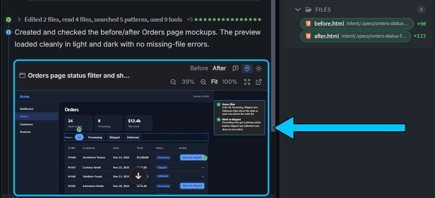
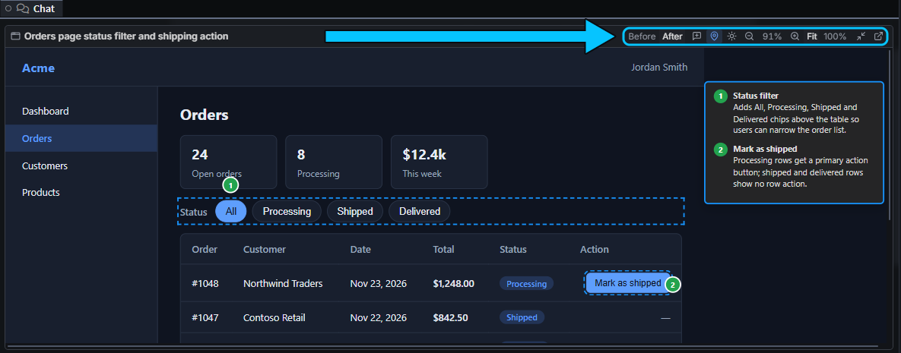
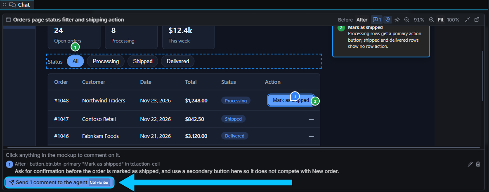
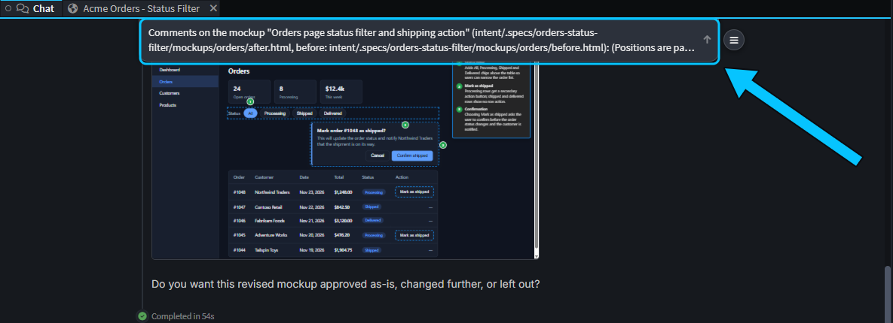
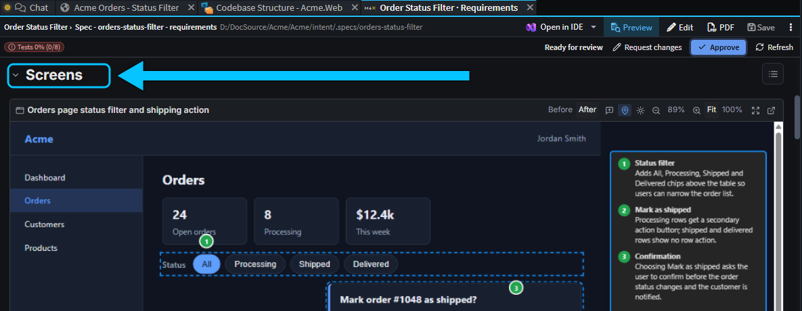

# Mock up a screen before it's built

Before the agent writes any code for a screen, ask it to show you the screen. It builds an HTML mockup in your app's own look and puts it in its reply, so you can:

- See the screen as a before and after, in light and dark.
- Click the part you'd change and tell the agent what to do about it.
- Keep the mockup you approve in the spec for the change.

This guide shows the flow on a small sample web app, an orders page, in the chat of the Agents Shell. The Solution Shell's **AI Assistant** works the same way.

## Capture your app's styles once with the mockup-kit skill

Mockups only look like your app if the agent has a copy of its styles. Capture them once per web app, with the `mockup-kit` skill, before you ask for your first mockup. Start a chat in the application's repository and send:

> Use the mockup-kit skill to snapshot the styles of the web app in the `acme-web` folder.

The agent finds the app's stylesheet and theme switch, saves a snapshot under `intent/.mockups/<app>/`, and checks it in the preview in both light and dark. The snapshot is a folder of files in your repository, so you can commit it and share it with your team.

> [!NOTE]
> The agent writes files while it snapshots. In the default **Ask before edits** mode, each write waits for you to approve it.

Capture the snapshot again when the app's look changes.

## Ask the agent for a mockup in the Agents Shell

Describe the change in the chat, naming the screen and what's different about it:

> Mock up a change to the Orders page in `acme-web`: add a status filter above the table (All, Processing, Shipped, Delivered) and a Mark as shipped button on processing orders.

The agent writes a `before.html` and an `after.html` for the screen under `intent/.specs/<slug>/mockups/`, checks them in the preview, and shows them in its reply.


_The mockup appears inside the chat reply, with its controls above it._

The controls above the mockup let you inspect it without leaving the chat:

- **Before** and **After** switch between the current screen and the change.
- The theme button (a sun or moon) switches between the light and dark theme.
- **Show pins** and **Hide pins** toggle the numbered notes that explain each change. Dashed outlines on the screen mark what's new.
- The zoom buttons, **Fit** and **100%** resize the mockup.
- **Maximize** gives it the whole chat area, and **Open in the preview browser** opens it in its own tab.


_Maximized, the notes panel and the numbered pins sit beside the screen._

## Comment on a mockup to steer the agent

Don't describe what to change in words alone. Point at it.

1. Click the comment button in the mockup's controls. Its tooltip reads **Comment on this mockup: click anything in it**.
2. Click the part of the screen you want to change, and type what you'd like.
3. Add as many comments as you need, then click **Send N comments to the agent** (or press `Ctrl+Enter`).


_Each comment records the element you clicked and which view you were on._

The agent receives your comments together with the mockup's file paths. It updates the mockup and shows the new version in the chat.


_The comment asked for a confirmation, so the revised mockup now has a confirmation dialog._

Repeat until the mockup is what you want. Then tell the agent you approve it.

> [!NOTE]
> A mockup only takes comments if it was built on the mockup kit that the snapshot provides. On one that wasn't, the comment button's tooltip says so.

## Keep the approved mockup in the spec

When the change goes into a spec, the agent adds the approved mockup to the requirements, in a **Screens** section. It's the same mockup, with the same Before and After view, theme switch and comments, sitting next to the requirements it illustrates.


_Whoever reviews the spec sees the screen as well as the requirements._

The spec holds the mockup as a block like this:

```mdx
<Mockup id="orders-status-filter-mockup" src="mockups/orders/after.html" before="mockups/orders/before.html" title="Orders page status filter and shipping action" caption="Status filtering and a confirmed Mark as shipped action." height={640} />
```

`src` is the After view and `before` is the current screen. Both paths are relative to the spec's folder.

## Related articles

- [](xref:how-to.vibe-coding-plan-mode-or-sdd)
- [](xref:how-to.get-it-right-with-plan-mode)
- [](xref:how-to.turn-existing-code-into-living-specs)
- [](xref:key-concepts.non-deterministic-codegen)
