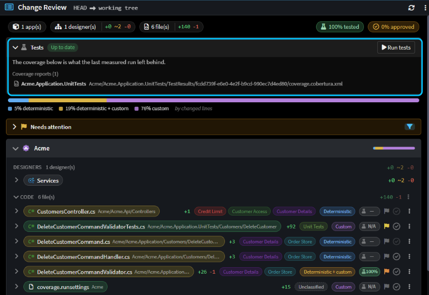
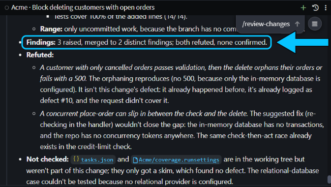
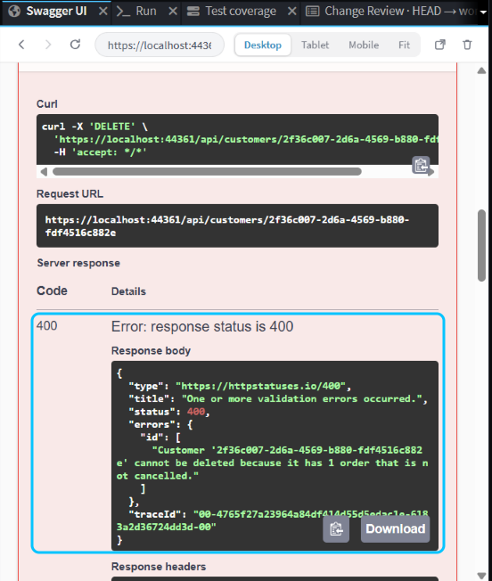
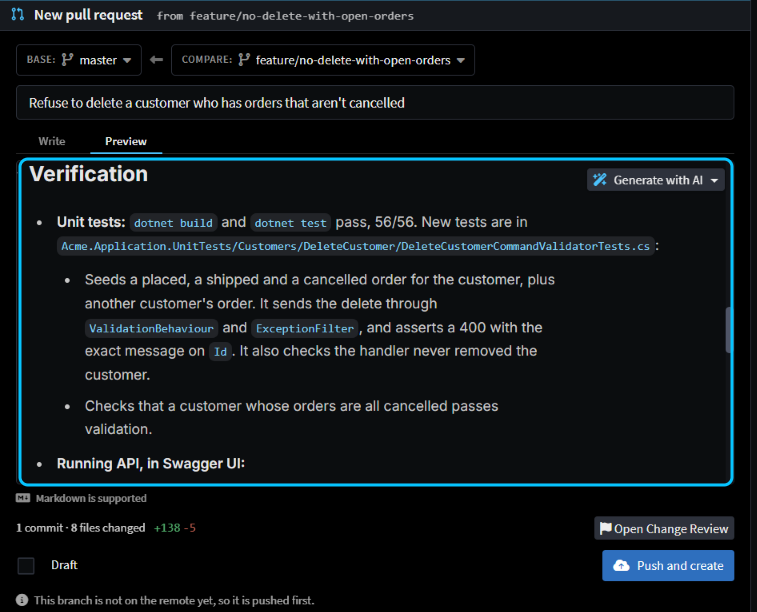
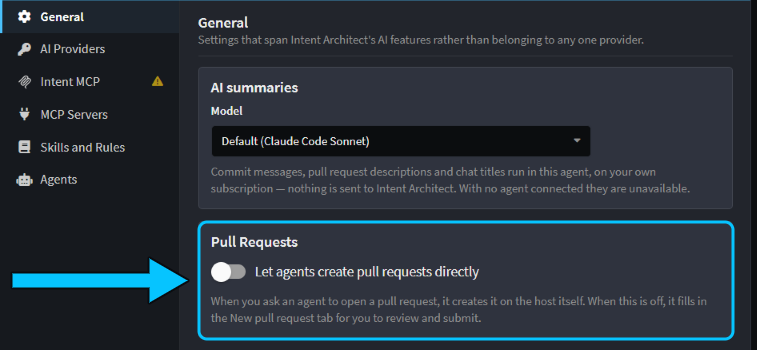

# Open pull requests that prove they work

Don't take an agent's "done" on trust: have it show you the change works before you read it, and put that proof in the pull request. Want to know it builds and the tests pass? Have it run your tasks. Want a second opinion? Have it review its own change. Want to see it working? Have it try the change in your running app and take screenshots.

This guide shows each check, when to skip it, how to get your app ready for the agent to run, and how to open the pull request.

## Build and test the change with your tasks

Once your build and test commands are tasks (see [](xref:how-to.set-up-tasks)), the agent can check its own change instead of telling you it works. Ask for it in the prompt.

In the Solution Shell's AI Assistant, we asked _"Don't let a customer be deleted while they have orders that aren't cancelled. Return a 400 that says why, and add a unit test for it. Build and run the tests when you're done."_ The agent made the change and ran the **Build** and **Test** tasks, fixed a warning its new test had introduced, and ran them again. All 56 tests passed, five minutes after we asked.

Don't skip this one. It's the cheapest check, and every other check assumes the code builds.

> [!NOTE]
> Agents in the Agents Shell don't get your tasks yet. They run your build and test commands in their own terminal instead.

## See which new lines your tests reach in Change Review

[Change Review](xref:application-development.change-review) shows how many of the lines a change adds are run by your tests: a **% tested** pill at the top, one on each changed file, and a **Tests** panel.

The first time, the **Tests** panel offers **Set up test coverage**. Click it, and a chat starts that adds a task to your solution's `tasks.json`, marked `"producesTestCoverage": true`, that runs your tests and writes a Cobertura or JaCoCo coverage report. For the Acme API, the agent wrote:

```json
"test:coverage": {
    "label": "Test coverage",
    "icon": "fa-flask",
    "dependsOn": ["restore"],
    "command": "dotnet test --settings coverage.runsettings",
    "workingDirectory": "Acme",
    "producesTestCoverage": true
}
```

From then on, click **Run tests** whenever you want to measure a change. It took about ten seconds, and the validator the agent had written was 100% tested. Skip this check if your test runner can't write either report format.


_The **Tests** panel is up to date, the change is 100% tested, and each changed file has its own pill._

> [!NOTE]
> On Windows, don't put `--collect:"XPlat Code Coverage"` in a task's command: the task runner splits the quoted value, and the agent's first attempt failed with `MSB1008: Only one project can be specified`. Name the collector in a `.runsettings` file instead, as above.

## Have the agent review its own change with /review-changes

Type `/review-changes` in the chat once the agent has finished. It's one of Intent Architect's built-in skills: a packaged set of instructions the agent loads when you type `/` and the skill's name.

The agent sends sub-agents to look for different kinds of problem, then hands each finding to another sub-agent whose job is to disprove it. Only findings that survive, with a concrete way to fail, are reported, each with a severity and a fix, under a verdict of **looks-good**, **minor-issues** or **changes-needed**. The review changes nothing, so ask for fixes in your next message.

On our change it took seven minutes. Three findings were raised and merged into two, both were refuted, and the verdict was **looks-good**.


_Both findings were refuted, so neither was reported as a problem with the change._

Skip it for a one-line fix, or for a change you're going to read line by line anyway.

> [!TIP]
> To review a pull request instead, use **Review with AI** on the pull request. See [](xref:application-development.pull-requests).

## Have the agent try the change in your running app

Ask for it in plain words. We asked _"Start the API and show me in the preview that deleting a customer with an open order now fails with your message. Take a screenshot of it."_

The agent started the API with its **Run** task and opened it in the app preview, a browser tab inside Intent Architect that shows your own running app. In Swagger UI it created a customer, placed an order for them and tried to delete them. The delete returned a 400 with the new message, and the agent took a screenshot, two minutes after we asked.


_The agent's last request in the preview: the delete fails with a 400 that says why._

Skip it when nothing a user could see or call has changed, such as in a refactor. The tests are the proof there.

## Get your app ready for the agent to run

Getting your app to run for the agent is usually the real work. It needs:

- **A run task:** a background task that starts your app and reports its address. See [](xref:how-to.set-up-tasks).
- **Data it can change.** The agent works against whatever database your app uses, so point the run task at a local or throwaway database with seed data, or ask the agent to create what it needs. Acme uses an in-memory database, so the agent created its own customer and order.
- **A login that stays on your machine.** The app preview only opens `localhost` and `127.x` addresses, plus the address it was opened at. Anything else, such as an SSO or OAuth sign-in page, opens in your system browser, so the agent can't sign in through it. Give your app a local test login for development. The preview keeps its cookies across chats and restarts, and **Clear preview data** in its toolbar resets them.
- **Secrets outside `tasks.json`.** The file is committed and has no field for environment variables. A task gets the environment Intent Architect started with, so set connection strings and keys as environment variables, or in your stack's secrets store, before you start it.

Set your expectations too. Each step in the preview takes a while, so ask for one flow you can describe in a sentence, and look at the screenshots yourself before you trust them.

## Open the pull request with /creating-pull-requests

When you're happy, type `/creating-pull-requests`, optionally with the base branch or "as a draft". The agent commits the change and writes the title and description. The description ends with a **Verification** section: what the agent ran, what it clicked and which tests passed, with each screenshot under a caption. If nothing visible changed, it says why there are no screenshots.

The agent then fills in Intent Architect's **New pull request** tab. Nothing is pushed or created until you click **Push and create**, or **Create pull request** if the branch is already pushed. Ours was ready in under a minute, and the agent had committed only the change's own files, leaving the coverage setup out.


_The **New pull request** tab the agent filled in, with its **Verification** section on the **Preview** tab._

The screenshots are uploaded to your Git host. Bitbucket Cloud and GitHub Enterprise Server don't accept image uploads, so the agent tells you which ones it left out. The Git repository must be on GitHub, Azure DevOps, GitLab or Bitbucket Cloud, and you must be [signed in to it](xref:application-development.pull-requests#connecting-to-a-git-host).

To have the agent create the pull request itself, open **AI Configuration…** from the chat's ⋮ menu and turn on **Let agents create pull requests directly** on the **General** tab. It's off by default.



## Related articles

- [](xref:how-to.set-up-tasks) - the build, test and run tasks the agent uses to check its work.
- [](xref:application-development.change-review) - test coverage and every changed file and model element, in one review.
- [](xref:application-development.pull-requests) - create, review and merge pull requests inside Intent Architect.
