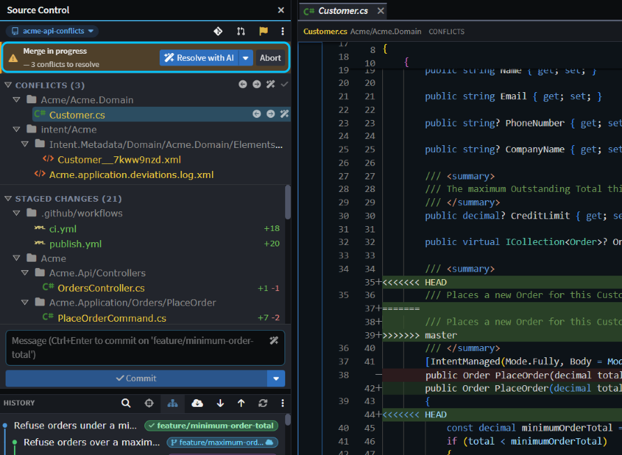
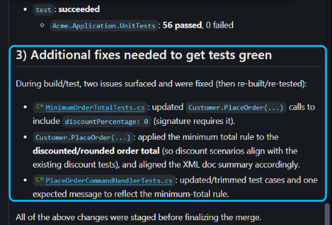
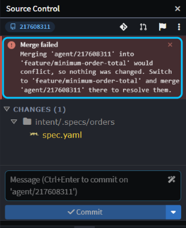
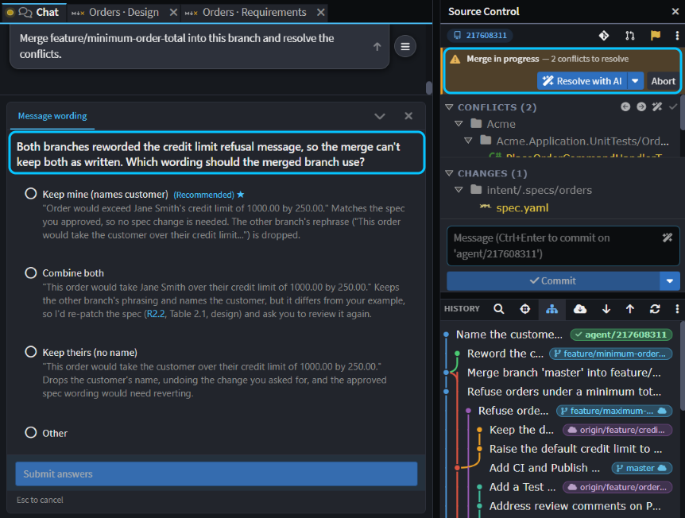
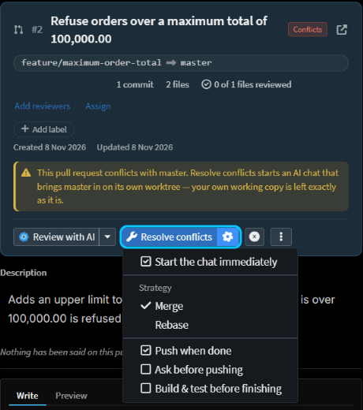

# Resolve merge conflicts with AI

Got a merge or rebase that stopped on conflicts? Click **Resolve with AI** and let the agent sort it out: it reads why each side changed the code, merges both changes, checks that it still builds and its tests pass, and finishes the merge. The same works when an agent's branch won't merge back into yours, or a pull request conflicts with its base.

This guide shows how, for your own branch, for an agent's worktree branch and for a pull request.

## Resolve a stopped merge or rebase with the Source Control conflict bar

When Git can't combine two sets of changes, the merge or rebase stops partway. It doesn't matter where you started it: from a branch's right-click menu in **Source Control** or **Git Explorer**, such as **Merge "master" into current branch "…"...**, or from a terminal. **Source Control** shows a bar such as **Merge in progress — 3 conflicts to resolve**, and lists the files under **Conflicts**. During a rebase the bar also says which commit Git is replaying, for example **commit 1 of 3**.

_Merging `master` into a feature branch on the Acme sample: conflicts in a C# file, a model file and Intent Architect's customization log._

> [!TIP]
> If you have uncommitted changes the merge would overwrite, Git refuses to start it, and **Source Control** offers **Stash & merge** (or **Stash & rebase**, or **Stash & pull**). Your changes are set aside while it runs and put back afterwards.

To hand the conflicts to the agent:

1. Click **Resolve with AI** on the bar. A new chat opens in the AI Assistant with the conflicted files attached, and loads the `resolving-git-conflicts` skill.
2. Approve the Git, build and test commands it asks to run. If both sides changed the same thing in ways it can't combine, it can stop and ask you which way to go.
3. Read its summary. The agent reads the commits behind both sides, keeps what each was for, builds, runs the tests that cover the merged code and stages its changes. Then it commits the merge, or continues a rebase through every commit that stops. It never pushes.

_On Acme, the agent also edited two existing tests to fit the new rule. It said so, but that's a call to check before you push._

Two options sit on the caret beside **Resolve with AI**:

- **Load conversation without starting** puts the prompt and files in the chat without sending them, so you can add your own guidance first, such as which side's wording to keep.
- **Complete the merge when resolved** (**Continue the rebase when resolved** during a rebase) is on by default. Untick it to have the agent stop once its changes are staged, so you can review them and click **Continue** yourself.

To deal with one file on its own, use the buttons on its row under **Conflicts**: **Resolve with AI**, take your side or theirs, or **Mark resolved** once you've fixed it by hand.

> [!NOTE]
> Intent Architect's own agent can't edit model files, the ones under `Intent.Metadata`. If one is conflicted, it resolves the other files and stops, saying which one is left. Open that file from **Conflicts**, keep both changes, click **Mark resolved** on its row, and tell the chat to carry on. A CLI agent such as Claude Code can resolve model files too. For how model files merge, see .

## Merge an agent's worktree branch back when it conflicts in the Agents Shell

A chat that works in its own Git worktree, as in [Run agents in parallel](xref:how-to.run-agents-in-parallel), is on a branch of its own. If your branch moves on while it works, merging the chat's branch back with **Merge current branch "…" into "…"...** can conflict. Then nothing is changed: **Merge failed** says the merge would conflict.

_Both branches had reworded the same credit limit message on Acme._

Resolve the conflicts in the chat's worktree instead, so your own checkout is never left half-merged:

1. In the Agents Shell, select the chat and ask it to bring your branch in, for example _"Merge feature/minimum-order-total into this branch and resolve the conflicts."_ It loads the `resolving-git-conflicts` skill. You can also start the merge from the chat's **Source Control**, which shows the conflict bar with **Resolve with AI**.
2. When the agent has committed the merge, merge the chat's branch back into yours again. There's nothing left to conflict, so it goes straight through.

_Given **Combine both**, the agent kept one branch's wording, added the customer's name from the other, built, and ran 56 passing tests._

## Bring a conflicting pull request up to date with Resolve conflicts

Open the pull request from **Pull Requests** in the Solution Shell's activity bar. When the host reports that it conflicts, its card says so and offers **Resolve conflicts**. Click it: a chat brings the base branch into the pull request's branch on a worktree of its own, resolves the conflicts with the `resolving-git-conflicts` skill, and pushes the result. Your own working copy stays exactly as it is.

The cog beside the button sets how it works: **Merge** or **Rebase**, **Push when done**, **Ask before pushing**, and **Build & test before finishing**. By default it merges, pushes without asking, and checks the result by reading it rather than building.

_Once the chat had pushed, **Merge** replaced the conflict warning. The agent had warned that one of the pull request's own tests would fail, and CI agreed._

> [!NOTE]
> Because it runs in a worktree, the chat needs a CLI agent such as Claude Code, Codex or GitHub Copilot CLI. See .

## Related articles

-  - how code and model files merge, and resolving conflicts by hand
-  - committing, stashing, fetching and pushing
-  - reviewing, updating and merging pull requests
-  - running chats in worktrees of their own
-  - reviewing a pull request before it merges
