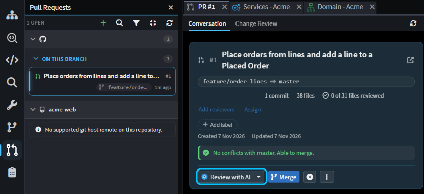
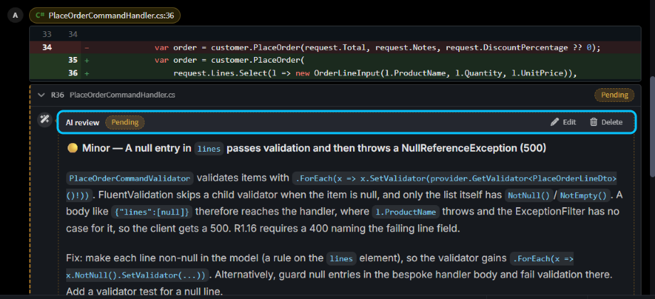
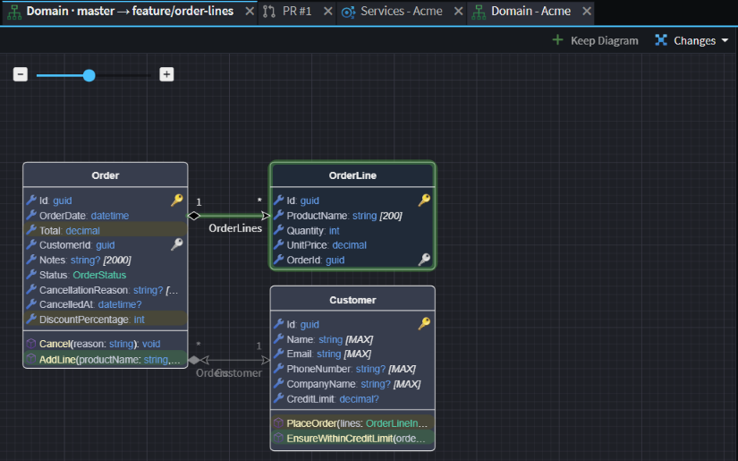
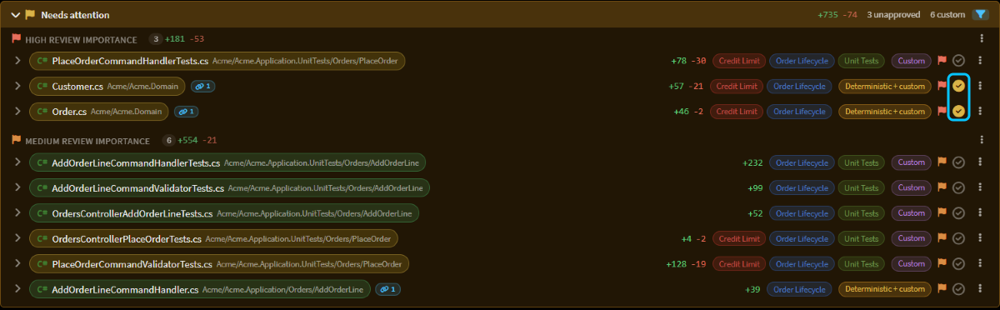
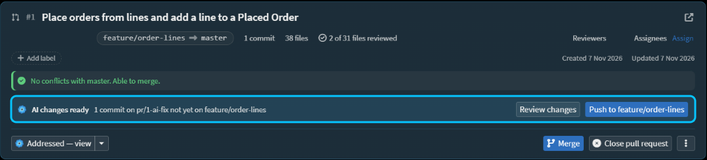

# Review pull requests effectively

Got a pull request that touches dozens of files, from a teammate or an agent? Let AI review it first, check the design change on a diagram, spend your own time on the code and tests that need a person, and hand your comments to an agent to fix.

This guide shows how, for pull requests on GitHub, Azure DevOps, GitLab or Bitbucket Cloud.

## Have AI review the pull request first

In the Solution Shell, click **Pull Requests** in the activity bar, then click the pull request. It opens in a tab of its own, on its **Conversation** tab.

_A 38-file pull request on the Acme sample, which lets an order have lines._

> [!NOTE]
> If you already `git push` to the host over HTTPS, Intent Architect is signed in for you. If not, the panel asks for a personal access token. See [Connecting to a Git host](xref:application-development.pull-requests#connecting-to-a-git-host).

Click **Review with AI**. A new chat runs the `review-changes` skill over exactly the changes in the pull request. It tries to disprove each problem it finds, keeps only the ones it can show going wrong, and grades them blocking, minor or nit. It skips generated code that matches your model.

Nothing it finds is posted. Each finding goes into your pending review, the comments only you can see until you submit them, and appears as **Pending** on the line it's about. Edit or delete any you disagree with. The AI's summary fills in the body of your review.

_On Acme, the review took about four minutes and found that a null order line got past validation and caused a 500 error._

When the pull request gets new commits, review it again. The AI skips anything it has already raised, so nobody gets the same comment twice.

## Check the design change on an Explorer Diagram

Before you read any code, check that the design changed the way you meant. Open the pull request's **Change Review** tab. Under each application, **Designers** lists the designers the pull request changed, with how many elements were added, changed and removed.

Click a designer's name to open its model diff. It opens on an Explorer Diagram of the change, where new elements and members are green and changed ones are amber.

_The Domain changes on Acme: a new `OrderLine`, a new `AddLine` operation, and changes to `Order` and `Customer`._

If the design is wrong, say so on the design itself: expand the designer in **Change Review** and click the **+** beside an element. Getting the design right first pays off: generated code that matches the model isn't listed for review, so once the design is right you can take that code as read.

## Read the code that needs you in Needs attention

**Needs attention**, near the top of the **Change Review** tab, lists the hand-written code in the pull request, and the generated files where the change touched hand-written parts. Generated code that matches the model isn't in it.

If you've [classified your codebase](xref:how-to.classify-your-codebase), the files are grouped by Review Importance, **High** first, with pills saying what each one touches. To narrow the list, click the funnel in the **Needs attention** header and untick what you'll leave for later.

As you finish each file, click the tick at the end of its row, **Mark as reviewed**. Its diff folds away, and the pull request's header counts how many files you've reviewed. The ticks stay on your machine and are never posted. If a file changes after you tick it, for example when a fix is pushed, its tick turns amber, so you know what to read again.

_After the agent's fix, the ticks on `Customer.cs` and `Order.cs` are amber: both changed after they were reviewed._

## Check that tests cover the change in Change Review

The **% tested** pill at the top of the **Change Review** tab shows how many of the lines the pull request adds ran during the tests. Each file shows its own percentage, and the diff marks the lines a test ran.

The **Tests** panel below it says where those numbers come from:

- With the pull request's latest commit checked out, it reads your last local test run, and **Run tests** runs them again.
- Otherwise it uses the Azure Pipelines build of that commit, if there is one, or **Run tests for this commit** runs your tests on a separate copy of it.
- With no test task that measures coverage, the button reads **Set up test coverage**. Click it and the agent adds one to your `tasks.json`, then commit what it adds.

## Hand your comments to an agent with Address review with AI

Add your own comments as you read: click the **+** beside a line in a diff, write the comment and click **Start a review** (**Add review comment** once the review has comments). They join the AI's in your pending review. At the bottom of the **Conversation** tab, choose a verdict and click **Submit review** to post them all at once. On a pull request you opened, the only verdict is **Comment**, because hosts don't accept your own approval.

Then click **Address review with AI** in the pull request's header. The agent runs the `address-pr-review` skill in a worktree, a separate checkout of the pull request's branch, so your own files aren't touched. It works through each unresolved comment, fixes what should be fixed, builds and tests, and makes one commit. It stages a reply on each comment in your pending review, with its reasons for anything it didn't change. It never pushes.

> [!NOTE]
> Worktrees only work with a CLI agent connected over ACP, such as Claude Code or Codex. If the chat says isolated worktrees are only available for external coding agents, switch the chat's model to one of those and click **Retry**. To set one up, see [CLI Agents as AI Providers](xref:ai.cli-agents).

When it's done, the header shows **AI changes ready**. Click **Push to** _branch_ to put the commit on the pull request, then submit your review to post the agent's replies. Any file you'd ticked that the fix changed now has an amber tick in **Needs attention**, so you know exactly what to re-read.

_On Acme, the agent dealt with both comments in about six minutes, in one commit with a reply on each thread._

## Related articles

-  - everything you can do with a pull request in Intent Architect, including merging and resolving conflicts.
-  - the review screen itself: model changes, approvals, traceability and test coverage.
-  - when an agent opens the pull request, have it show its change works first, so there's less to check here.
-  - tag your code with what each part is for and its Review Importance, so Needs attention puts the riskiest files first.
-  - give the agent your build and test commands, so it can check its own work.
