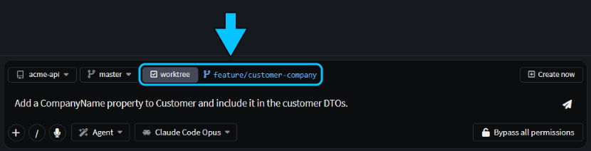
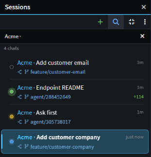
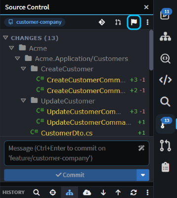
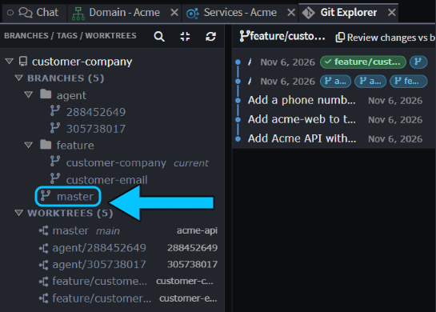

# Run agents in parallel

To really leverage the power of AI, you need to be running agents in parallel: one fixing a bug, another looking into a release branch, a third starting the next feature, while you carry on with your own work. Give each task its own copy of your code so no agent touches your files or another agent's, and merge its work back once you've reviewed it.

This guide shows how to start, track, review, merge and clean up chats that each have their own worktree.

## Start an Agents Shell chat in its own Git worktree

A Git worktree is a second checkout of the same Git repository, in its own folder and on its own branch. It shares the repository's history, so a commit made in one is visible from the other.

In the Agents Shell:

1. Click **Manage Agents** on the Home screen, or in the Solution Shell's AI Assistant header, to open the [Agents Shell](xref:application-development.user-interface.agents-shell-and-solution-shell).
2. Click **+** (**New session**) at the top of the **Sessions** panel, or press `Ctrl+N`.
3. In the composer, pick the folder, and check that the branch chip shows the branch to start from.
4. Tick **worktree**. Its new branch appears beside it, `agent/<id>` by default. Click it to rename it, for example to `feature/customer-company`.
5. Type your prompt and send it.

_**worktree** ticked, with its branch renamed to `feature/customer-company`._

> [!NOTE]
> The **worktree** chip needs a chat that runs on a CLI agent, such as Claude Code, Codex or GitHub Copilot CLI (see ), and a Git repository with at least one commit.

On the first send, Intent Architect creates the worktree in `~/.worktrees/<repository>/<branch>`, or under the **Worktree Location** in [User Settings](xref:application-development.user-interface.how-to-change-user-settings#worktree-location), and starts the agent there. Your own checkout isn't touched, so you can keep working in it.

> [!WARNING]
> **Fork** on a chat's right-click menu puts the copy in the original's worktree and branch, so both agents work in one checkout. For another task, start a new chat with **worktree** ticked instead.

With _"Add a CompanyName property to Customer and include it in the customer DTOs."_, the agent added `CompanyName` and left 13 changed files uncommitted on `feature/customer-company`. Two other chats had their own worktrees at the same time, one writing a README and one waiting for an answer, and the main checkout stayed clean.

> [!TIP]
> Forgot to tick **worktree**? When the agent has stopped, click the folder name above the message box and choose **Change location…**. The agent starts again there, with a summary of the chat so far.

## Track running chats in the Agents Shell

The **Sessions** panel lists every chat with the branch it's on and, when there's uncommitted work, how many lines it has added and removed. Hover a chat's status dot for where it is: **In progress**, **Waiting on your answer**, **Awaiting approval** or **Completed**. Click **Search sessions** to filter a long list.

_Four chats in their own worktrees: two completed, one waiting on an answer and one in progress._

While Intent Architect is in the background, it shows an OS notification when a chat finishes or needs your input, and a badge on its taskbar icon. You can switch both off under **Notifications** in [User Settings](xref:application-development.user-interface.how-to-change-user-settings#notifications).

## Review and merge a worktree chat's work in the Agents Shell

Select the chat on the **Sessions** panel. The panels on the right follow its worktree, so you deal with each chat's work on its own:

1. **Review the changes.** Ask the agent to review them with a review skill, look through them in **Source Control**, or click the flag button in its toolbar to open them in [Change Review](xref:application-development.change-review).

   
   _The flag button (boxed) opens the chat's uncommitted changes in Change Review._

2. **Merge the changes or create a pull request.** Ask the agent to merge its branch into yours, or do it yourself from **Source Control**: commit, open **Git Explorer**, right-click your branch and choose **Merge current branch "…" into "…"...**. If your team uses pull requests, ask the agent to create one, or see .

   

Worktrees keep agents apart while they work, but merging can still conflict when two chats changed the same lines. If it would, nothing is changed: have the chat bring your branch into its worktree and resolve the conflicts there, then merge again. See .

## Clean up a chat's worktree in the Agents Shell

When a chat's work is merged or dropped, right-click it on the **Sessions** panel and choose **Archive and Delete Worktree**. It deletes the worktree folder and archives the chat, keeping its history.

- If the worktree has uncommitted changes, you're asked first: they're lost, but commits on the chat's branch are kept.
- The branch is deleted only if this chat created it and it's already merged into a remote. After a local merge, delete it yourself with **Delete branch "…"...** on its right-click menu in Git Explorer.
- If another chat still uses the worktree, such as a fork, the folder is kept.

## Things to be aware of with Agents Shell worktrees

A new worktree only has committed files, so git-ignored ones such as `node_modules`, `.env` files and restored packages are missing until something puts them there:

- **`.worktreeinclude`**, at the root of the Git repository, lists git-ignored files and folders to copy into each new worktree, in `.gitignore` syntax. It's the same file Claude Code reads, and Intent Architect creates one with each new solution.
- If you want to run scripts that set up each new worktree, such as `npm install`, `dotnet restore` or building your LESS stylesheets, add a **setup task**: a task in the solution's `tasks.json` with `"triggers": ["worktree.created"]`. It runs in the new worktree before the agent starts. See .

## Related articles

-  - how the Agents Shell and the Solution Shell differ, and switching between them.
-  - everything the Agents Shell can do.
-  - setting up Claude Code, Codex and other CLI agents.
-  - reviewing what an agent changed.
-  - creating and reviewing pull requests in Intent Architect.
-  - **Worktree Location** and **Notifications**.
-  - the `tasks.json` format.
