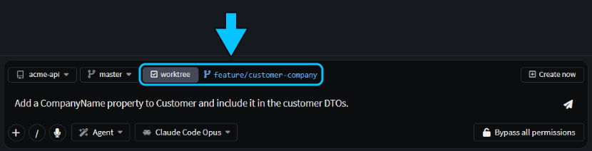
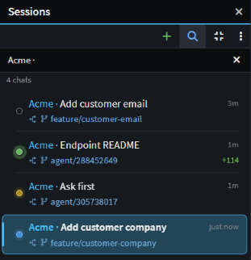
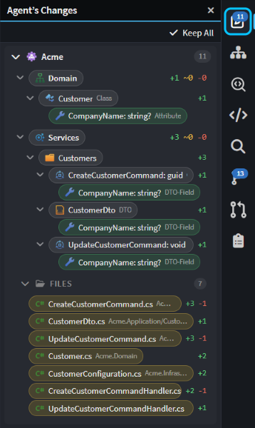
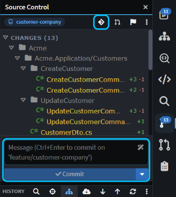
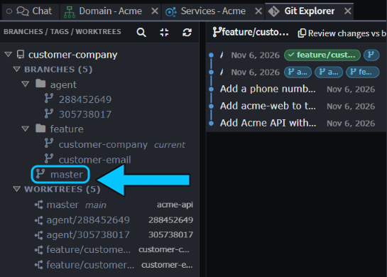

# Run several agents at once

If you want to start a second task while the agent is still working on the first, or keep its changes away from work you haven't committed yet, give each chat its own copy of the code, on its own branch. Each agent's changes then stay apart until you've reviewed them and merged them into your branch.

This guide shows how to start, track, review, merge and clean up chats that each have their own worktree.

## Start an Agents Shell chat in its own Git worktree

A Git worktree is a second checkout of the same Git repository, in its own folder and on its own branch. It shares the repository's history, so a commit made in one is visible from the other.

In the Agents Shell:

1. Click **Manage Agents** on the Home screen, or in the Solution Shell's AI Assistant header, to open the [Agents Shell](xref:application-development.user-interface.agents-shell-and-solution-shell).
2. Click **+** (**New session**) at the top of the **Sessions** panel, or press `Ctrl+N`.
3. In the composer, pick the folder, and check that the branch chip shows the branch to start from.
4. Tick **worktree**. Its new branch appears beside it, `agent/<id>` by default. Click it to rename it, for example to `feature/customer-company`.
5. Type your prompt and send it.


_**worktree** ticked, with its branch renamed to `feature/customer-company`._

> [!NOTE]
> The **worktree** chip needs a chat that runs on a CLI agent, such as Claude Code, Codex or GitHub Copilot CLI (see [](xref:ai.cli-agents)), and a Git repository with at least one commit.

On the first send, Intent Architect creates the worktree in `~/.worktrees/<repository>/<branch>`, or under the **Worktree Location** in [User Settings](xref:application-development.user-interface.how-to-change-user-settings#worktree-location), and starts the agent there. Your own checkout isn't touched, so you can keep working in it.

> [!WARNING]
> **Fork** on a chat's right-click menu puts the copy in the original's worktree and branch, so both agents work in one checkout. For another task, start a new chat with **worktree** ticked instead.

With _"Add a CompanyName property to Customer and include it in the customer DTOs."_, the agent added `CompanyName` and left 13 changed files uncommitted on `feature/customer-company`. Two other chats had their own worktrees at the same time, one writing a README and one waiting for an answer, and the main checkout stayed clean.

> [!TIP]
> Forgot to tick **worktree**? When the agent has stopped, click the folder name above the message box and choose **Change location…**. The agent starts again there, with a summary of the chat so far.

## Prepare new Agents Shell worktrees with .worktreeinclude and a setup task

A new worktree only has committed files, so git-ignored ones such as `node_modules`, `.env` files and restored packages are missing.

- **`.worktreeinclude`**, at the root of the Git repository, lists git-ignored files and folders to copy into each new worktree, in `.gitignore` syntax. It's the same file Claude Code reads, and Intent Architect creates one with each new solution.
- **A setup task** runs a command in each new worktree before the agent starts. Add `"triggers": ["worktree.created"]` to a task in the solution's `tasks.json`, at the root of the Git repository or in its `intent` folder, and commit the file, because it's read from the new worktree.

```json
{
    "tasks": {
        "restore": {
            "label": "Restore packages",
            "icon": "fa-download",
            "command": "dotnet restore Acme/Acme.sln",
            "triggers": ["worktree.created"]
        }
    }
}
```

## Track running chats in the Agents Shell

The **Sessions** panel lists every chat with the branch it's on and, when there's uncommitted work, how many lines it has added and removed. Hover a chat's status dot for where it is: **In progress**, **Waiting on your answer**, **Awaiting approval** or **Completed**. Click **Search sessions** to filter a long list.


_Four chats in their own worktrees: two completed, one waiting on an answer and one in progress._

While Intent Architect is in the background, it shows an OS notification when a chat finishes or needs your input, and a badge on its taskbar icon. You can switch both off under **Notifications** in [User Settings](xref:application-development.user-interface.how-to-change-user-settings#notifications).

## Review and merge a worktree chat's work in the Agents Shell

Select the chat on the **Sessions** panel. The panels on the right follow its worktree:

1. Open **Agent’s Changes** to see what the agent changed, element by element and file by file.

   

2. Review the changes in **Source Control**, or in [Change Review](xref:application-development.change-review) for a fuller review, and commit them. The message box names the chat's branch.

   
   _Commit on the chat's branch, then open Git Explorer (boxed, top) to merge it._

3. Click the Git Explorer button in the Source Control toolbar. In **Git Explorer**, right-click the branch you want the work in, such as `master`, and choose **Merge current branch "feature/customer-company" into "master"...**. The merge is made where `master` is checked out, in your main checkout.

   

Worktrees keep agents apart while they work, but merging can still conflict when two chats changed the same lines. If it would, nothing is changed: merge the chat's branch from your main checkout instead, for example in the Solution Shell, and resolve the conflicts there.

If your team uses pull requests, push the chat's branch and open one instead. See [](xref:application-development.pull-requests).

## Clean up a chat's worktree in the Agents Shell

When a chat's work is merged or dropped, right-click it on the **Sessions** panel and choose **Archive and Delete Worktree**. It deletes the worktree folder and archives the chat, keeping its history.

- If the worktree has uncommitted changes, you're asked first: they're lost, but commits on the chat's branch are kept.
- The branch is deleted only if this chat created it and it's already merged into a remote. After a local merge, delete it yourself with **Delete branch "…"...** on its right-click menu in Git Explorer.
- If another chat still uses the worktree, such as a fork, the folder is kept.

## Related articles

- [](xref:application-development.user-interface.agents-shell-and-solution-shell) - how the Agents Shell and the Solution Shell differ, and switching between them.
- [](xref:application-development.manage-agents) - everything the Agents Shell can do.
- [](xref:ai.cli-agents) - setting up Claude Code, Codex and other CLI agents.
- [](xref:application-development.change-review) - reviewing what an agent changed.
- [](xref:application-development.pull-requests) - creating and reviewing pull requests in Intent Architect.
- [](xref:application-development.user-interface.how-to-change-user-settings) - **Worktree Location** and **Notifications**.
- [](xref:application-development.software-factory.terminal-and-tasks) - the `tasks.json` format.
