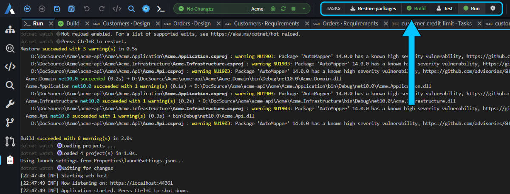
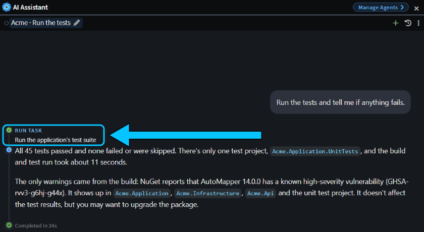
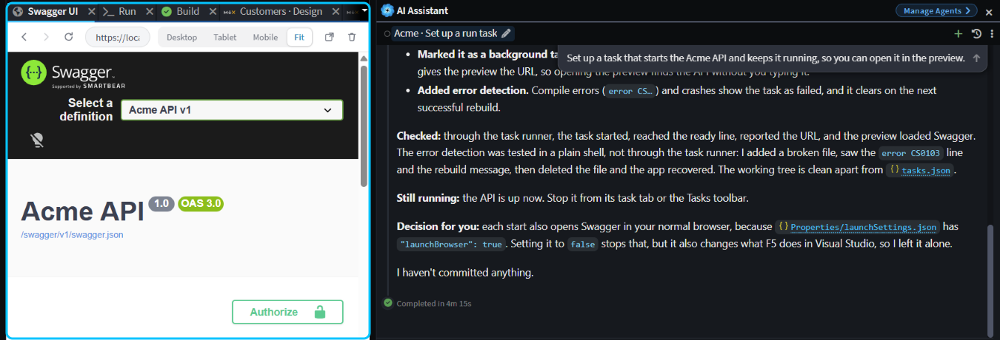
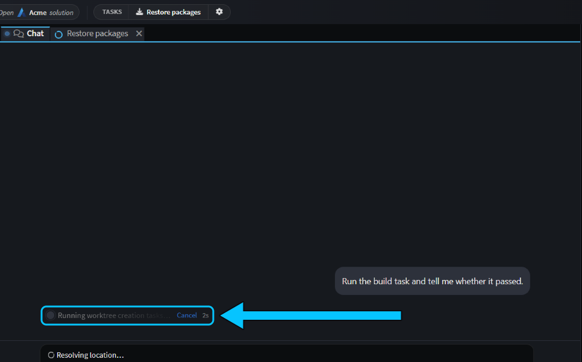
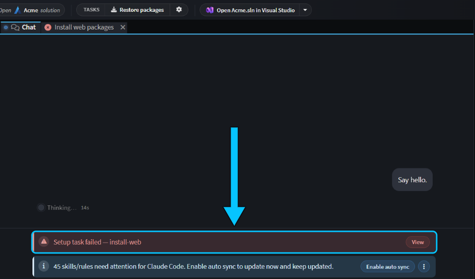
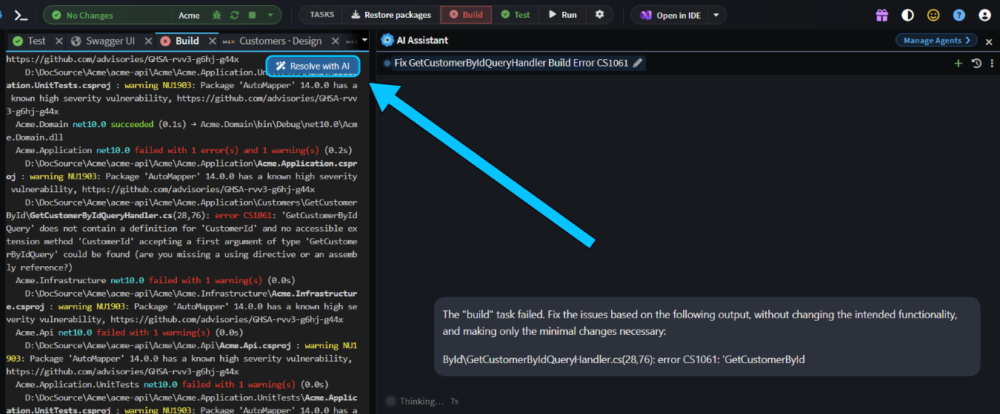

# Set up tasks so the agent can build, test and run your app

Give the agent the same build, test and run commands you use, so it can check its own work instead of guessing. Want it to build and test after a change? Add build and test tasks. Want it to run your app? Add a run task it can open in the preview. Starting agents in new worktrees? Add a setup task that gets each one ready first. Every task is a one-click button for you too.

This guide shows how to add tasks, have the agent use them, keep your app running, set up new worktrees and hand failures to AI.

## Add build, test and run tasks to the Tasks toolbar

A task is a named command, such as `dotnet build` or `npm test`, kept in a `tasks.json` file. Each task is a button on the **Tasks** toolbar, and the agent can run it too. The file goes in one of two places:

- **The solution's `tasks.json`**, at the root of the Git repository or in its `intent` folder, for commands that belong to the whole Git repository. These are the only tasks the Agents Shell shows.
- **An application's `tasks.json`**, next to its `.application.config` file, for commands that belong to one application. They run in the application's output folder.

The quickest way to set them up is to ask the agent. When we asked the Solution Shell's AI Assistant to _"Set up a task that starts the Acme API and keeps it running, so you can open it in the preview."_, it loaded its built-in skill for tasks, rewrote the existing **Run** task, ran it to check that it worked, and opened the API in the preview.

To write tasks yourself, click the cog at the end of the **Tasks** toolbar. If the file doesn't exist yet, it's created with a sample **Build** task. Changes show on the toolbar as soon as you save:

```json
{
    "tasks": {
        "build": { "label": "Build", "icon": "fa-cogs", "command": "dotnet build" },
        "test": { "label": "Test", "icon": "fa-flask", "command": "dotnet test" }
    }
}
```

Click a task to run it. Its output opens in a tab named after it, and the button turns green or red. For all available options, see [](xref:application-development.software-factory.terminal-and-tasks).


_The solution's **Restore packages** task, then the application's. **Build** passed, and **Run** is serving the API._

## Let the agent build and test with your tasks in the Solution Shell

In the Solution Shell's AI Assistant, the agent sees your tasks and runs them when it needs to build, test or start your app. When the agent runs a task, you see it just as if you'd run it yourself: the output opens in a tab and the task's toolbar button shows the result.

When we asked _"Run the tests and tell me if anything fails."_, the agent ran the **Test** task and reported that all 45 tests passed.



> [!NOTE]
> Tasks aren't available to agents in the Agents Shell yet. To have an agent run your tasks, use a chat in the Solution Shell. In the Agents Shell, tell the agent which command to run instead, and it runs it in its own terminal.

## Keep your app running for the agent with a background task

A dev server or a watcher doesn't exit, so mark its task `"isBackground": true` and give it a `readyPattern`: a regular expression that matches the line it prints once it's up. Add a `urlPattern` that captures the app's address, or a `previewUrl` if the address is fixed, and the agent can start your app, leave it running and open it in the preview to check its changes.

This is the core of the **Run** task the agent wrote for the Acme API:

```json
"run": {
    "label": "Run",
    "icon": "fa-play",
    "command": "dotnet watch --non-interactive run --project Acme.Api.csproj",
    "workingDirectory": "Acme.Api",
    "isBackground": true,
    "readyPattern": "Now listening on: https?://",
    "urlPattern": "Now listening on: (https?://\\S+)"
}
```


_The agent started the **Run** task, and the preview found the API's address from it._

When you click a background task yourself, its button shows a green dot once the ready line appears. Clicking it again takes you to its output rather than starting a second copy, and closing its tab stops it.

## Set up each new Agents Shell worktree with a setup task

An Agents Shell chat can run in its own Git worktree: a second checkout of your Git repository, in its own folder. A new worktree only has your committed files, so packages aren't restored and tools aren't installed.

To get each worktree ready, add `"triggers": ["worktree.created"]` to a task in the solution's `tasks.json`. The task then runs in every new worktree before the agent starts:

```json
"restore": {
    "label": "Restore packages",
    "icon": "fa-download",
    "command": "dotnet restore Acme/Acme.sln",
    "triggers": ["worktree.created"]
}
```

- **Commit `tasks.json`.** It's read from the new worktree, so the branch you start from must have it.
- **List them in order.** Setup tasks run one at a time, in the order they're listed. An application's `tasks.json` is never used for them.
- **Hide them if you like.** `"hidden": true` keeps a task off the toolbar, and it still runs.

While they run, the chat shows **Running worktree creation tasks…** with a **Cancel** link, and each task's output opens in a tab beside the chat.



If a setup task fails, the agent still starts, and the chat shows **Setup task failed** with the task's name. Click **View** for its output. The agent isn't told, so mention it in your prompt if it matters.



> [!TIP]
> To copy git-ignored files such as `.env` into each new worktree instead, list them in `.worktreeinclude`. See [](xref:how-to.run-agents-in-parallel).

## Fix a failed task with AI

When a task fails, its tab shows **Resolve with AI**. Click it to start a chat that's given the task's output and asked to find the cause, fix it and run the task again.

To have that happen as soon as a task you clicked fails, turn on `aiAutoFix`, with the error parser that suits its output: `dotnet` for .NET builds, or `generic` for anything else.

```json
"build": {
    "label": "Build",
    "command": "dotnet build",
    "aiAutoFix": { "enabled": true, "errorParser": "dotnet" }
}
```

With a typo in a query handler, clicking **Build** failed and started a fix chat straight away. The agent put the line right and ran **Build** again, and the button turned green.


_**Build** failed, and `aiAutoFix` started a fix chat by itself._

## Related articles

- [](xref:application-development.software-factory.terminal-and-tasks) - every `tasks.json` field, and the terminal.
- [](xref:how-to.run-agents-in-parallel) - running chats in their own worktrees.
- [](xref:how-to.prove-it-works) - have the agent check its change with your tasks, an AI review and your running app, then open a pull request that shows it.
- [](xref:application-development.user-interface.agents-shell-and-solution-shell) - how the Agents Shell and the Solution Shell differ.
