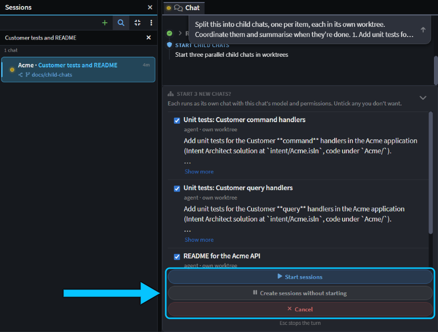
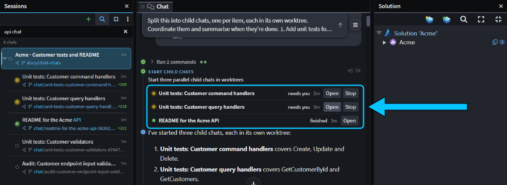
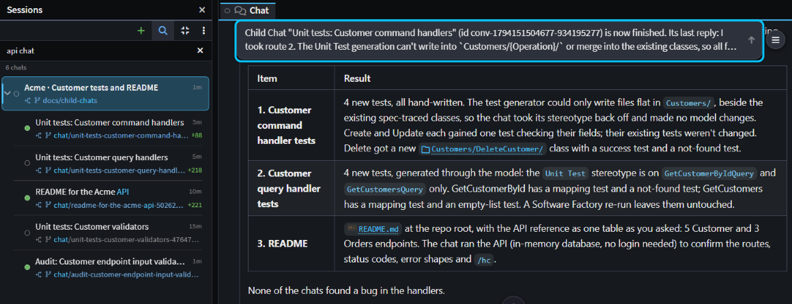
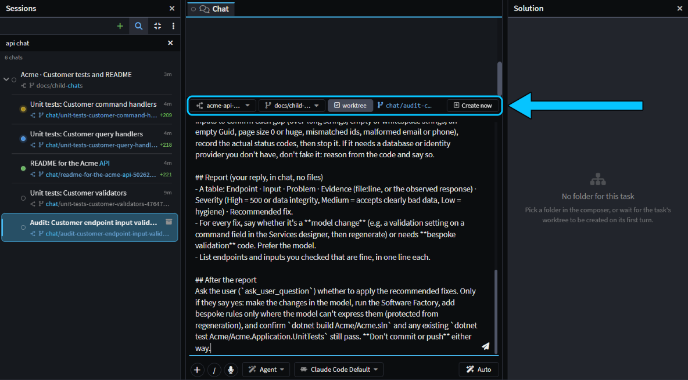

# Split a big task across child chats

Got a task that's too big for one chat? Ask the agent to split it into child chats: it proposes one chat per part, you approve them, and they run side by side, each in its own copy of your code. Every child is a full chat you can open and steer, and the chat that started them follows their progress and brings the results together.

This guide shows how to ask for child chats, follow and steer them, get their results back and merge their work.

## Ask the agent to split a task into child chats

A child chat is an ordinary chat that another chat's agent proposes and you approve. It's listed under that chat, its parent, on the **Sessions** panel of the [Agents Shell](xref:application-development.user-interface.agents-shell-and-solution-shell). It isn't a sub-agent, the hidden helper an agent uses inside one reply, in the same folder, while the chat waits for it.

Ask for child chats in your own words, or the agent may hand the work to a sub-agent or do it all in one chat. Say how to split the work, that each part gets its own worktree, and what you want back, for example:

> Split this into child chats, one per item, each in its own worktree. Coordinate them and summarise when they're done.

Then list the items. On the Acme sample, with three items (unit tests for the Customer command handlers, unit tests for the Customer query handlers, and a README for the API), the agent read the code first, then proposed three chats. Each one had a brief of its own: what to change, what to leave to the other two, and what to report back.

_The agent's three proposals, each ticked, with **Start sessions**, **Create sessions without starting** and **Cancel** below._

The card, **Start 3 new chats?**, lists each proposal with its title, where it will run, and the start of its prompt (**Show more** shows the rest). Untick any you don't want. You can't edit a proposal; if a brief is wrong, click **Cancel** and tell the agent what to change. Then choose:

- **Start sessions** starts each ticked chat straight away.
- **Create sessions without starting** saves them for you to start yourself. See [Prepare child chats to start yourself later](#prepare-child-chats-to-start-yourself-later).
- **Cancel** declines them all, and the agent carries on without them.

By default, each child chat gets its own Git worktree, a second checkout of your Git repository in its own folder and on its own branch, so the children never touch your files or each other's. Its branch, `chat/<title>-<id>`, starts from the branch the parent chat is on. To have a child work in the parent chat's own folder instead, say so: the card then shows **this chat's folder** instead of **own worktree**. Each child uses the parent chat's model, permission mode and reasoning effort as they are when you click **Start sessions**.

> [!NOTE]
> A child chat with its own worktree needs a CLI agent, such as Claude Code, Codex or GitHub Copilot CLI (see ), and a Git repository. With Intent Architect's own agent, the worktree is created but the agent still reads and writes the parent chat's folder.

## Follow child chats on the Team Card and the Agents Shell's Sessions panel

Once they've started, a **Team Card** under the agent's tool call lists the child chats, with each one's status (**running**, **needs you**, **finished**, **failed**, **stopped** or **not started**) and when it was last active. **Open** opens a child chat, and **Stop** stops its current turn, like the stop button in that chat.

_On Acme, two child chats wait on a permission and one has finished. The Team Card (boxed) lists the three the first card started; the two below them on the **Sessions** panel came from a second card._

On the **Sessions** panel, child chats are nested under their parent. Click the chevron beside the parent (**Hide child chats**) to fold them away. A folded parent shows counts of its child chats that need you, are running, failed or have results you haven't read, so you can tell at a glance whether to look.

Each child chat is a chat like any other. Open it to see what it's doing, answer its questions, approve its permission prompts, or type to steer it. On Acme, both test chats asked before writing their test files to disk, and carried on after **Allow**.

## Steer child chats through the parent chat

You don't have to open each child chat. Ask the parent in plain words, for example:

- _"List your child chats and how each is doing."_ The parent reports each one's status and latest progress.
- _"Tell the README child to keep the API reference to one table, with no section per endpoint."_ The parent sends the child a message. A running child takes it into account straight away; an idle one starts a new turn. On Acme, the finished README had its API reference in one table.
- _"Stop the audit child for now."_ The parent stops the child's current turn. The chat stays, so you can carry on with it later.

The parent can only do this with the child chats it started, not with their own child chats. The children can't message the parent or each other: anything they need to share goes through you or the parent.

## Get child chats' results back in the parent chat

When a child chat finishes, fails, is stopped by you, or starts waiting on you for an answer, a permission or a plan approval, the parent gets a message with that child's last reply. It's shown with a bell, **from** the child's title. If the parent is idle, the message starts a new turn; if it's busy, the message joins what it's doing.

_The message from the last child to finish (boxed), and the start of the parent's summary._

The parent sees only each child's last reply, not its whole chat, so make sure each brief says what to report. On Acme, when the test chats stopped for a permission, the parent said which ones were waiting and that it couldn't approve them itself. After the last child finished, it applied all three chats' changes together in a scratch worktree, built the solution, ran the 86 tests, and summarised each item with the decisions still to make.

> [!NOTE]
> After 10 such turns in a row with no message from you, the parent stops reacting to its child chats and shows as needing you on the **Sessions** panel. Send it any message and it picks up again.

## Prepare child chats to start yourself later

To read or change each brief first, or to start the chats one at a time, choose **Create sessions without starting** on the card where the agent proposes them. Each child chat is saved under the parent, **not started**, with its prompt waiting in the message box. The parent doesn't wait for these chats.

_A not-started child chat on Acme: its own worktree is ticked, on its `chat/…` branch, and is created when you send._

Select the chat on the **Sessions** panel, or click **Open** on the Team Card, change the prompt if you need to, and send it. Its worktree is created then, from the branch shown beside the folder.

## Review and merge each child chat's work

A child chat that worked in its own worktree leaves its changes there, on its own `chat/…` branch. Review and merge each one like any chat with its own worktree: see [Run agents in parallel](xref:how-to.run-agents-in-parallel#review-and-merge-a-worktree-chats-work-in-the-agents-shell). If two children changed the same lines, see .

When a child chat's work is merged or dropped, use **Archive and Delete Worktree** on it. Archiving the parent doesn't archive or stop its child chats; they move up to the top level of the **Sessions** panel.

## Related articles

-  - start, review and merge chats that each have their own worktree.
-  - everything the Agents Shell can do.
-  - setting up Claude Code, Codex and other CLI agents.
-  - the tools the agent uses to start and coordinate child chats.
-  - when merging an agent's branch conflicts.
