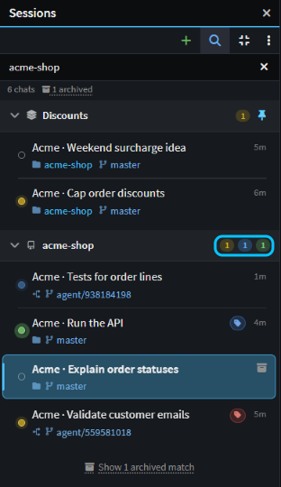
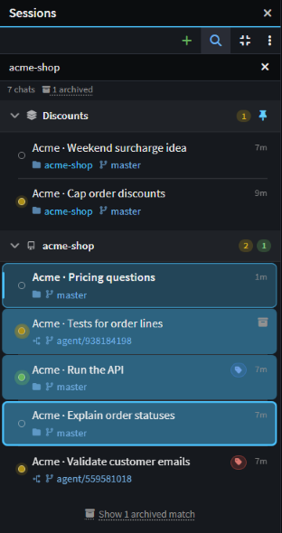
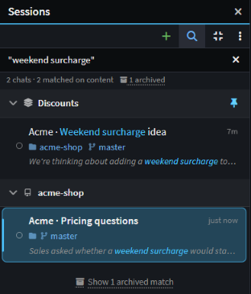

# Stay on top of many agents at once

Got a dozen agents going? See at a glance which ones are waiting on you, deal with those first, and put away what's finished, so no agent sits idle waiting for you and no result slips past.

This guide shows how to spot the chats that need you, work through them from the keyboard, keep the list tidy and find any chat again.

## See which agents need you on the Agents Shell board

Click **Manage Agents** to open the [Agents Shell](xref:application-development.user-interface.agents-shell-and-solution-shell). Its **Sessions** panel is the board: every chat on your machine, grouped by Git repository.

The dot beside each chat says where it is. Hover it for the words:

- **Amber, Waiting on your answer:** the agent has a question, or wants you to approve an edit, a command or a plan. It glows until you open the chat.
- **Blue and pulsing, In progress:** the agent is working.
- **Green and filled, Completed — new:** it finished since you last looked. Once you open it, the dot becomes an empty ring.
- **Red, Failed:** the last run ended in an error.
- **"— background work running"** means the agent left something running after its turn, such as a dev server.

_The boxed counts: in this group, one chat needs you, one is running and one is unread._

Each group header counts its chats that need you (amber), are running (blue), failed (red) or are unread (green), so even a collapsed group tells you whether to open it. The **Sessions** button on the left-hand bar counts the questions and results you haven't seen yet, and the status bar counts the chats running and needing an answer.

The **Manage Agents** button on the Home screen shows those two counts too, so you can check before you open the Agents Shell.

## Get notified when an agent needs you, from any app

While you're in another app, Intent Architect shows an OS notification when a chat asks you something, wants an approval, finishes or fails. Click it to go straight to that chat. Notifications are withdrawn once you've seen their chats.

On Windows, the taskbar icon also carries a badge: amber with a count while any chat needs your input, green when all that's left is finished chats you haven't read, and **9+** above 9. On macOS, the Dock icon shows the count.

Both are on by default. Switch either off under **Notifications** in [User Settings](xref:application-development.user-interface.how-to-change-user-settings#notifications).

## Work down the Agents Shell board from the keyboard

There's no separate inbox or "needs me" filter: the board is the list, and the dots and counts show where to start. To work through it without the mouse:

1. In an empty message box, press `Left Arrow` to move to the board.
2. Press `Up Arrow` or `Down Arrow` to move between chats.
3. Press `Enter` or `Right Arrow` to open a chat. You're back in the message box, ready to answer.
4. Press `Left Arrow` again for the next one. `Esc` on the board goes back to the message box without opening anything.

Opening a chat marks it read, and a chat that finishes or asks you something while you're elsewhere becomes unread again. To come back to one later, right-click it and choose **Mark as Unread**. **Mark All as Read** on the same menu marks every chat the board is showing, so after a search it marks only the matches.

To deal with several at once, select them. `Shift+Up Arrow` and `Shift+Down Arrow` select a run of chats, and `Space` adds or removes the one you're on (move with `Ctrl+Up Arrow` and `Ctrl+Down Arrow` to keep what's selected). `Ctrl`+click and `Shift`+click work too. Then right-click for **Mark 3 as Read**, **Archive 3**, **Move to group** or **Categorise**. `Esc` clears the selection.

_Three chats selected with the keyboard, ready to mark as read or archive together._

`Ctrl+N` starts a new chat, and `F2` in a chat renames it.

## Keep the Agents Shell board tidy with groups, categories and archiving

- **Group the chats for one piece of work.** Right-click a chat, choose **Move to group › New group…** and name the group, then move other chats into it from the same menu. Your own groups can hold chats from any Git repository. To keep one at the top, right-click its header and choose **Pin to top**. Both need the default **Group by workspace** in the board's **⋮** menu.
- **Tag chats across groups.** **Categorise** on a chat's right-click menu tags it with one of six colours, for example red for anything you must look at today.
- **Archive what's done.** Hover a chat and click **Archive chat**, select several and choose **Archive 3**, or right-click a group header and choose **Archive All**. Archiving only hides a chat; its history, worktree and branch stay. To bring one back, turn on **Show archived chats** in the **⋮** menu, then right-click the chat and choose **Unarchive**.

By default, **Show recent chats** hides chats that have been quiet for seven days, but never one that's waiting on you.

## Find an agent chat by what was said in it

Click **Search sessions** (the magnifier) at the top of the Agents Shell board and type. Titles match anywhere, and branch, Git repository and solution names from the start of a word. From three characters, it also searches what you and the agent wrote in every chat, and shows the matching sentence under each chat. It doesn't search the agent's tool calls or their output, such as files it read. Put a phrase in quotes, such as `"weekend surcharge"`, to match those words together.

Archived chats are left out, but the end of the list says how many match, such as **Show 1 archived match**. Click it to list them.

_Two chats matched on what was said in them, and one archived chat is a click away._

To find something inside the open chat, press `Ctrl+F`. `Enter` and `Shift+Enter` step through the matches, and `Esc` closes the find bar.

## Related articles

-  - how the Agents Shell and the Solution Shell differ.
-  - start chats that each work in their own worktree, then review and merge their work.
-  - have an agent split a task into chats of its own.
-  - everything the Agents Shell can do.
-  - **Notifications** and the other settings.
