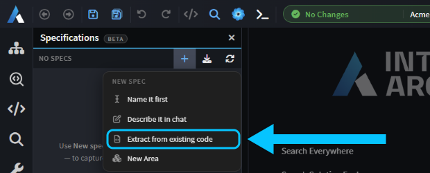
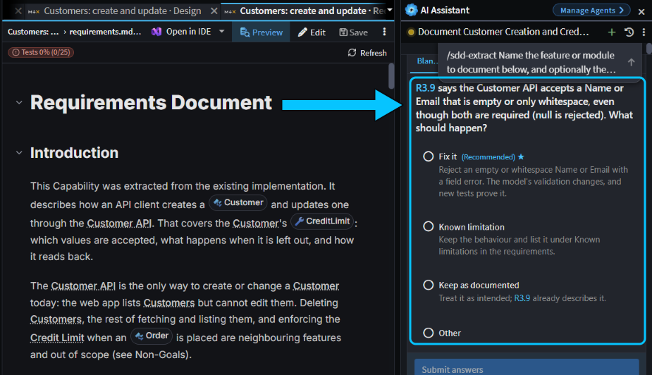
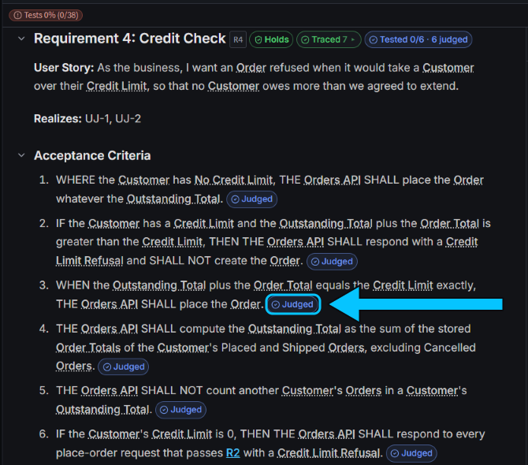
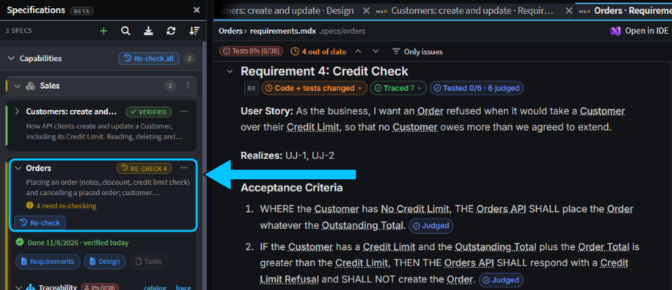
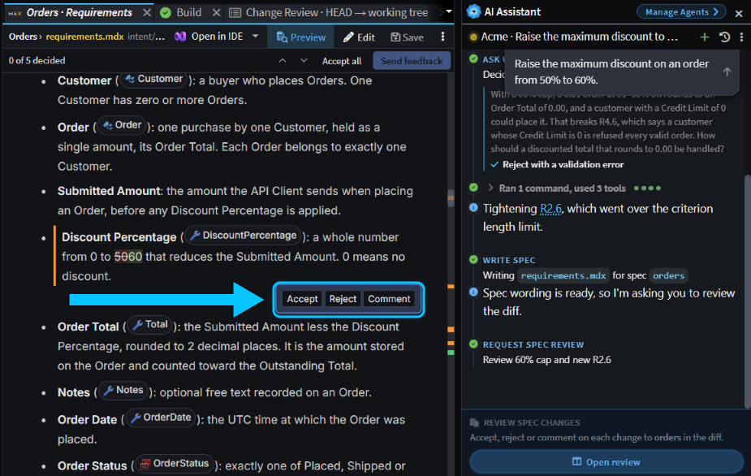
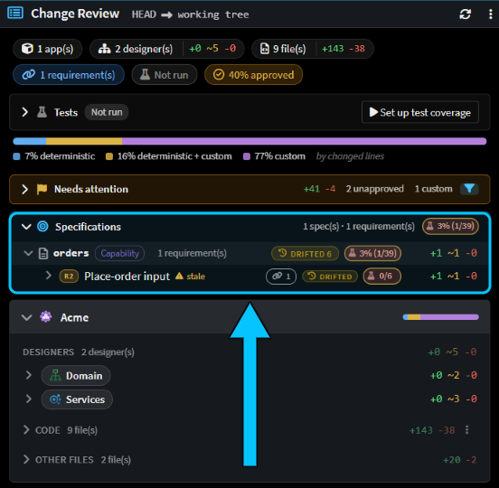

# Turn existing code into living specs

Got code that works but no record of the rules it follows? Have the agent write them down as a spec checked against your code. Then keep that spec true: back its rules with tests, and see when a change breaks one, in Intent Architect, in review and in CI.

This guide shows how to extract a spec from your code, read and group what you get, turn its rules into tests, and catch it when a rule changes.

## Extract a spec from existing code in the Specifications panel

In the Solution Shell, open **Specifications** from the activity bar, click **+** (**New spec**) and choose **Extract from existing code**. The AI Assistant fills in `/sdd-extract` and asks for the feature to document, and optionally the folders, files or model elements it covers. Add a line and send it.



We sent _"Orders: placing an order, adding a line to a placed order and cancelling an order, including the credit limit check."_ Adding a line only existed on an unmerged branch, so the agent asked whether to leave it out. It then wrote each rule down as an acceptance criterion, linked it to the files and model elements behind it, and checked it against the code and the running API, rewording any that didn't match.

Last, it asked about **suspected bugs**: behaviour that works, but probably not as intended. For each one, you choose to fix it, record it as a known limitation, or keep it as the spec now describes it. Two orders placed at the same moment could together go over a customer's credit limit, for example, so we recorded that as a known limitation.


_Extracting the Customers rules: a blank name is accepted, so the agent asks whether to fix it._

It took 20 minutes and produced 9 requirements with 38 acceptance criteria.

## Read the spec and group it into an Area in the Specifications panel

Extracting from existing code gives you a **Capability**: a spec of how one part of your system behaves now, kept true as the code changes. Its card sits under **Capabilities**, marked **Verified**. Click **Requirements** to read it, known limitations included.

Each acceptance criterion has a chip saying how it's proven. After an extraction most say **Judged**: the agent checked them by reading the code, and no test proves them yet. The spec is saved in `intent/.specs`, so commit it with your code.


_Every criterion of the credit check was judged by reading the code. None is tested yet._

To group related Capabilities, choose **New Area** from the **New spec** menu, then drag Capabilities onto it, or use **Add to Area** in a card's **⋯** menu. Click the Area's name to have the agent write an overview. An Area shows the worst health of its Capabilities.

## Turn judged criteria into tests with /sdd-run

A judged criterion, one the agent checked by reading the code, has to be checked again whenever that code changes. A tested one is proven every time its tests run.

Type `/sdd-run` and the spec's name in the AI Assistant. The agent counts the criteria no test proves and asks whether to write their tests now. For the Customers spec we chose **Write them now**: in 19 minutes it wrote tests for 24 judged criteria, and all 83 tests in the solution passed.

Each test cites the criteria it proves in its title, such as `[spec:customer-create-and-update R3.9]`, or in a comment directly above it, so your own tests can cite criteria too. A criterion's chip turns **Tested** once a separate agent confirms its tests assert everything it says.

## Catch a quiet change with Re-check in the Specifications panel

When code behind a judged criterion changes, the spec's card says **Re-check**, with the number of requirements to check again. To try it, we changed the credit check by hand so that an order taking a customer exactly to their limit was refused. After **Refresh**, the Orders card showed **Re-check 4**. The Customers card stayed **Verified**: code behind tested criteria doesn't count, because the tests prove it.


_The hand edit touched code behind four Orders requirements. Customers is fully tested, so it stays verified._

Click **Re-check** and send the chat it fills in. The agent checks only the requirements that moved. In 9 minutes it found that "an order that reaches the limit exactly is placed" no longer held, put the code back, and wrote a test for that rule. To change a rule on purpose, ask the agent for the change instead, so the spec changes first.

## Review the spec change before the code changes with Spec Review

Ask the agent to change a rule a Capability covers, and it changes the spec first, then asks you to review the wording before it touches any code.

We asked _"Raise the maximum discount on an order from 50% to 60%."_ The agent spotted that at 60% off, a 0.01 order rounds to 0.00, which a customer with a credit limit of 0 could then place. We chose to reject such orders. It then rewrote the spec and showed a **Review spec changes** card. Click **Open review** to see the changes as a diff.


_Five changes to decide on, including the new limit and a new criterion for discounted totals below 0.01._

Each changed block has **Accept**, **Reject** and **Comment**. When you've decided on them all, click **Approve review**, or **Send feedback** if you rejected or commented on any. A rejected block goes back to its old wording. Once you approve, the agent changes the code and tests, then offers to verify the spec again.

## Check spec health in Change Review and in CI

When a change edits a spec, the **Specifications** section of [Change Review](xref:application-development.change-review) shows the spec's kind, its health, how many criteria are tested, and how many were added, reworded or removed. Before the agent verified our discount change, Orders read **Drifted 6**: its rules had changed and nobody had checked them since.


_The discount change before verification: one criterion added, one reworded, and six requirements drifted._

To stop a change that leaves a spec out of date from being merged, run `verify-sdd` from the Software Factory CLI in your pipeline, after your build and tests:

```bash
dotnet tool install Intent.SoftwareFactory.CLI --global
intent-cli verify-sdd -- intent/Acme.isln
```

It needs no AI or sign-in and doesn't run your tests: it fails when anything a spec depends on has changed since its last verification, or the spec has gaps. With our hand edit to the credit check, it exited with `1`:

```text
[INF] customer-create-and-update: verified
[ERR] orders: out-of-date (4 requirement(s) moved since verdict)
[WRN] sales: unverified
[INF] 3 spec(s) checked: 1 verified, 1 unverified, 1 failed.
[ERR] Specs not in sync: orders
```

A spec that has never been verified only warns. That includes an Area, which has nothing to verify.

## Related articles

- [](xref:application-development.spec-driven-development) - Changes, Capabilities and Areas, the Specifications panel and traceability in full.
- [](xref:how-to.vibe-coding-plan-mode-or-sdd) - when to write a spec for new work rather than just prompt or plan first.
- [](xref:application-development.change-review) - review a change against the requirements behind it.
- [](xref:tools.software-factory-cli) - install the CLI on a build server, and the `verify-sdd` options.
