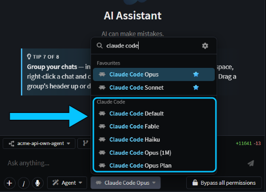
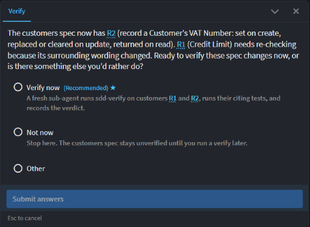
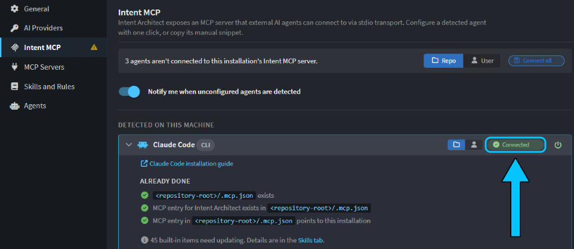
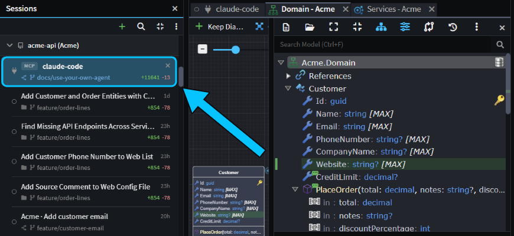
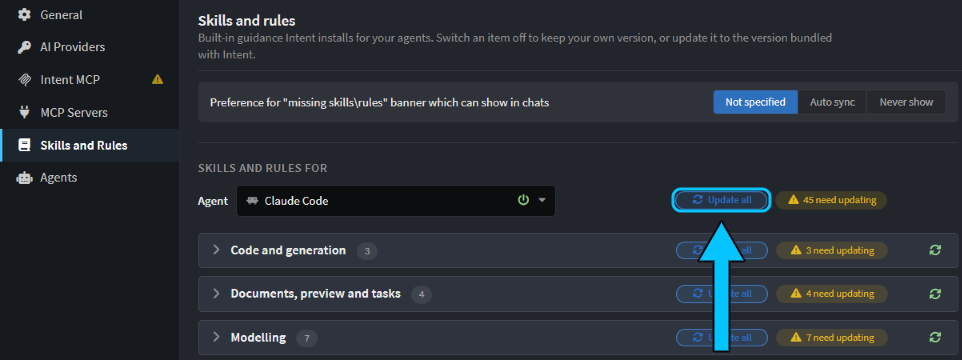

# Use Claude Code, Cursor or Copilot with Intent Architect

Keep the coding agent you already use, and get Intent Architect's modelling and deterministic guardrails with it. You can use it in two ways:

- **In Intent Architect's chat:** pick your agent as the model in the AI chat, to run tasks side by side in their own worktrees or build a feature from a spec.
- **From your terminal or editor:** connect Claude Code, Cursor, Copilot or another agent to Intent Architect, and keep prompting where you already do. The agent updates your model and generates your code from there.

You can set up both and use whichever suits the task. This guide compares the two, then shows how to set up each.

## Compare your agent in Intent Architect's chat with your terminal or editor

|                                            | In Intent Architect's chat                                         | From your terminal or editor                                                                                                          |
| ------------------------------------------ | ------------------------------------------------------------------ | ------------------------------------------------------------------------------------------------------------------------------------- |
| **Where you prompt**                       | Intent Architect's AI chat, with your agent picked as the model    | Your agent, where you already use it                                                                                                  |
| **Agents**                                 | Claude Code, Codex, GitHub Copilot CLI, Cursor CLI, Kiro, OpenCode | Claude Code, Codex, GitHub Copilot CLI, Cursor, Kiro and OpenCode in one click; other MCP agents, such as Copilot in VS Code, by hand |
| **Subscription**                           | Your own                                                           | Your own                                                                                                                              |
| **Modelling and code generation**          | Yes                                                                | Yes                                                                                                                                   |
| **A Git worktree for each task**           | Tick **worktree** in the Agents Shell                              | Create your own                                                                                                                       |
| **Spec-Driven Development**                | Yes                                                                | No                                                                                                                                    |
| **Questions and approvals**                | Cards you click in the chat                                        | Your agent's own prompts                                                                                                              |
| **Build, test and run tasks, app preview** | Yes                                                                | Your agent runs its own commands                                                                                                      |
| **Watching and reviewing**                 | Agents Shell, **Source Control**, Change Review                    | The same, with the session shown as an **MCP** row in the Agents Shell                                                                |

Either way, the agent updates the model, runs the Software Factory, then writes the code that isn't generated.

## Use your CLI agent in Intent Architect's chat

1. Install the agent and sign in to it from a terminal.  has the commands for each one.
2. Restart Intent Architect, which looks for installed agents when it starts.
3. In the AI chat, open the model picker below the message box and choose a model under your agent's name, such as **Claude Code**.

_The **Claude Code** group in the model picker._

The first chat with Claude Code, Codex or GitHub Copilot CLI installs a connector for it, which can take a minute. The agent runs signed in to your own account and still follows your `CLAUDE.md` or `AGENTS.md`, and Intent Architect adds its own agents, such as **Plan**, and its skills. To give a task its own copy of your code, start the chat in the Agents Shell and tick **worktree**; see .

With **worktree** ticked in the Agents Shell and the prompt _"Add an optional VatNumber to Customer and include it in the customer DTOs."_, Claude Code made the change in its own worktree, with all 60 tests passing. Because a spec covers customers, it also updated that spec, had the new wording reviewed first, and linked the new requirement to the code. Then it asked whether to check the spec now:

_Claude Code asking a question in Intent Architect's chat, answered with a click._

## Connect your terminal or editor agent on the Intent MCP tab

An MCP server lets an agent call another app's tools. Connect your agent to Intent Architect's, and it can change the model and run the Software Factory from wherever you use it.

1. In Intent Architect, open **AI Configuration**, for example by typing `/config` in the AI chat, and select **Intent MCP**.
2. Choose **Repo** to connect the agent in this Git repository only, or **User** to connect it everywhere you use it.
3. Click **Connect** on your agent's row. The row then shows **Connected**.

_Claude Code connected at **Repo** scope._

At **Repo** scope, **Connect** writes the agent's MCP settings file, such as `.mcp.json` for Claude Code, and adds it to `.gitignore`, because it holds the path to your Intent Architect installation. For an agent without a row, such as GitHub Copilot in VS Code, add the executable shown under **Other agent / manual configuration** to the agent's MCP settings.

Then work as usual in that Git repository. The agent finds the Intent Architect solution, loads Intent Architect's instructions, models the change, runs the Software Factory and writes the remaining code with its own file tools. Intent Architect doesn't need to have the solution open, and if it isn't running, the agent's first call starts it in the background.

> [!NOTE]
> Claude Code asks you to approve a new server from `.mcp.json` the first time it starts in that folder. Approve `intent-architect`.

From a terminal, with _"Add an optional Website to Customer and include it in the customer DTOs."_, Claude Code added `Website` to `Customer` and to the customer DTO and commands in the designers, ran the Software Factory, wrote the handler and test code, and finished with all 56 tests passing. It noted that it had no spec tools, so it couldn't update the spec that covers customers.

## Follow a terminal agent's session in the Agents Shell

While an agent connected on the **Intent MCP** tab works, the Agents Shell's **Sessions** panel lists its session as an **MCP** row named after the agent, `claude-code` here, in its Git repository's group. Select the row to see its folder and branch, and the designers it opened as tabs, so you can watch the model change. Its changes appear in **Source Control** like any others; click the flag button there to review them in [Change Review](xref:application-development.change-review). The row is kept until Intent Architect restarts.

_The `claude-code` session, with the `Website` attribute it added open in the Domain designer._

## Keep Intent Architect's skills up to date in your agent's folders

Whether your agent runs in Intent Architect's chat or connects from your terminal or editor, it uses Intent Architect's built-in skills and rules, copied into the agent's own folders, such as `.claude/skills` and `.claude/rules` for Claude Code. **Connect** doesn't copy them. To add or update them, open **AI Configuration** > **Skills and Rules**, choose your agent and click **Update all**. To keep them up to date from then on, choose **Auto sync** on that tab, or click **Enable auto sync** on the banner a chat shows when they need attention.

_45 skills and rules to update for Claude Code._

Commit the folders, so everyone on your team gets the same skills.

## Related articles

-  - installing each CLI agent, its permission modes and troubleshooting.
-  - what the Intent MCP server gives an external agent.
-  - every tab of AI Configuration.
-  - running chats in their own worktrees.
-  - when to prompt, plan or write a spec.
