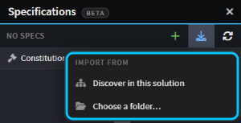
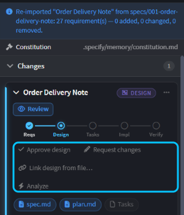
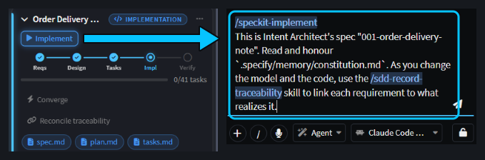
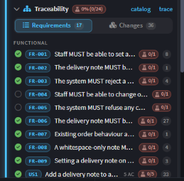
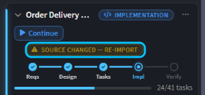

# Use Spec Kit, Kiro, BMAD or OpenSpec with Intent Architect

Already writing specs with Spec Kit, Kiro, BMAD or OpenSpec? Keep going. Bring the specs you have into Intent Architect, or run your framework's own commands from it, and see which code realizes each requirement.

This guide shows how to import your specs, keep driving your framework from the Specifications panel, trace requirements to code, and keep the two in sync.

## Import your specs in the Specifications panel

In the Solution Shell, open **Specifications** from the activity bar, click **Import specs** and choose:

- **Discover in this solution** to find the spec folders in your solution: the ones under `.kiro/specs`, `specs` and `openspec/changes`, and BMAD's output folder.
- **Choose a folder…** to import a spec folder from anywhere, such as one in another Git repository. Pick the spec's own folder.

_The Import specs menu, with Spec Kit's constitution listed above the specs._

Everything found is imported at once, and the panel says how many folders it imported. Each spec becomes a card named after the spec, with a badge naming its framework, at the phase its documents have reached. A Spec Kit spec with a `plan.md` starts at design, for example.

Your requirements keep the ids your framework gave them, such as `FR-001` and `US1` in Spec Kit or `R1` in Kiro, so links survive later imports. Intent Architect reads your framework's documents but never changes them, and keeps its own files under `intent/.specs`.

> [!NOTE]
> OpenSpec doesn't number its requirements, so Intent Architect derives each id from the requirement's name. If you rename a requirement in OpenSpec, the renamed requirement starts with no links, unless you record the rename under OpenSpec's RENAMED heading.

If your framework has governance documents, such as Spec Kit's constitution, the panel lists them above your specs, and the agent runs it starts are told to honour them.

## Keep driving your framework from the Specifications panel

Your framework owns each phase it has written a document for. For Spec Kit, `spec.md` is the requirements, `plan.md` the design, and `tasks.md` the tasks and the implementation. On a phase it owns, **Review** opens the framework's own document, and the card's buttons run your framework's own commands:

- **Request changes** runs its command for the phase, such as `/speckit-plan`, to revise the document.
- Its extra commands sit beside it, such as Spec Kit's **Clarify** and **Checklist** for the requirements, **Analyze** for the design and **Converge** for the implementation.
- At the implementation phase, **Implement** runs `/speckit-implement`.

_After a re-import, the design belongs to Spec Kit, and the card's buttons run Spec Kit's commands._

Each button opens a new chat in the AI Assistant with the command already typed, and waits for you to send it. Under the command, Intent Architect adds a line telling the agent to honour your governance documents. For the implementation, the line also asks it to record which model elements and files realize each requirement. For the other phases, it asks for a companion document with diagrams and links to your model, written beside the framework's document rather than in it.

_**Implement** fills a new chat with Spec Kit's own command, followed by Intent Architect's line about the constitution and traceability._

For a phase your framework hasn't written yet, the card's button runs Intent Architect's own phase instead. To keep that phase in your framework, run the framework's command yourself, such as `/speckit-plan` in the AI Assistant, then re-import. This lets you mix the two: Spec Kit for the requirements and design, say, and Intent Architect for the tasks and implementation.

The panel only offers commands it finds installed in your workspace, the way your framework installs them, such as with Spec Kit's `specify init`. Spec Kit can drive every phase, and BMAD its PRD. The **New spec** (**+**) menu lists either one, so you can start a new spec with it. Kiro and OpenSpec have no commands to run from the panel, so keep using their own tools and re-import.

## See which code realizes each requirement with traceability

When an agent implements the spec from the card's **Implement** button, it records links from each requirement to the model elements and files that realize it. Expand the card's **Traceability** section to see every requirement, with a check when it's traced and an empty circle when it isn't.  shows the same links from the other side: the requirements each change realizes.

_Requirements the implementation has realized have a check. The ones it hasn't reached yet have an empty circle._

If the work happened outside the card, such as in your terminal or in a teammate's agent, nothing recorded the links. From the implementation phase on, while any requirement has none, the card offers **Reconcile traceability**. It opens a chat that works back from what your framework leaves behind, such as Spec Kit's ticked tasks, Kiro's `_Requirements:_` lines or a BMAD story's Code Map. It records the links it can back up with evidence, and leaves the rest untraced.

## Re-import when your framework's documents change, or un-adopt a spec

Your framework stays in charge of the requirements, so make any changes there, not in Intent Architect. Once you've changed the framework's documents, the spec's card shows **Source changed — re-import**. Click it, or choose **Re-import** from the card's **Spec options** (**⋯**) menu. Intent Architect reads the documents again, keeps your links, and reports how many requirements were added, changed and removed, so you know which to check.

_The card spots that Spec Kit's documents have changed since the last import._

To stop tracking a spec as imported, choose **Un-adopt — clear imported requirements** from the card's **Reset** menu. It clears the requirements and links Intent Architect built, keeps the card and its name, and leaves your framework's documents where they are. If you import the same folder again later, it becomes a second card.

## Related articles

-  - the phases, the Specifications panel and traceability in full.
-  - when to write a spec rather than just prompt or plan first.
-  - review a change against the requirements behind it.
-  - use the coding agent you already have, in Intent Architect's chat or from your terminal.
