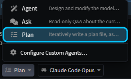
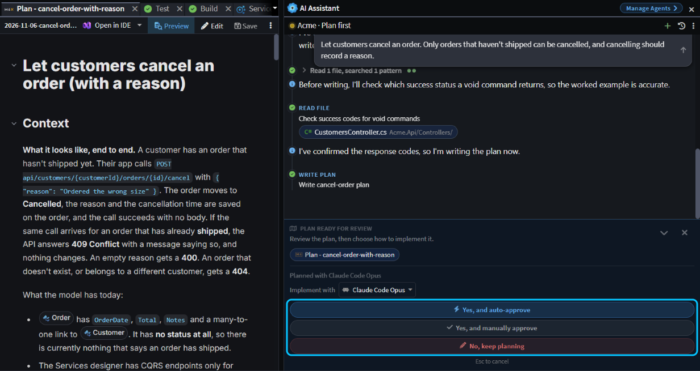
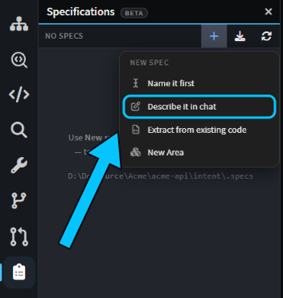
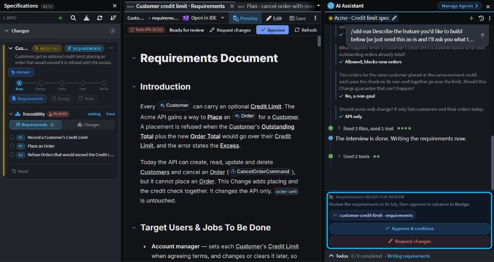
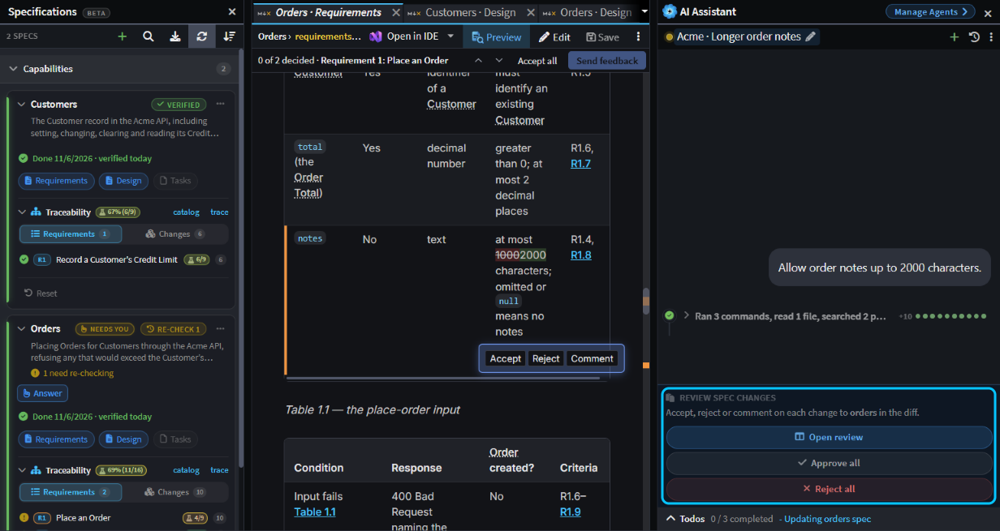

# Vibe coding, Plan Mode or Spec-Driven Development: when to use which

Get the outcome you're after by working with the agent the right way for the job:

- **Vibe coding:** for a quick question or an easy fix, just prompt it.
- **Plan Mode:** for a larger goal, have it plan first, so you agree the approach before anything changes and get a better result.
- **Spec-Driven Development:** for something whose requirements must be proven and stay true after it ships, write a spec.

This guide compares the three, then shows how to start each one.

## Compare vibe coding, Plan Mode and Spec-Driven Development

|                                     | Vibe coding                                                        | Plan Mode                                                    | Spec-Driven Development                                                                                                                  |
| ----------------------------------- | ------------------------------------------------------------------ | ------------------------------------------------------------ | ---------------------------------------------------------------------------------------------------------------------------------------- |
| **Best for**                        | A quick question or a change you can describe in a sentence or two | A larger goal, or one with more than one way to do it        | Requirements that must be agreed in detail, proven when the work is done, and kept true after it ships                                   |
| **What you agree before it starts** | Nothing, though the agent asks when something's unclear            | The plan: the approach, the changes and the steps            | The requirements, then the design, then the tasks                                                                                        |
| **What's left afterwards**          | The change                                                         | The change, plus the plan in `intent/.plans`                 | The change, plus specs in `intent/.specs`                                                                                                |
| **Traceability**                    | None beyond your Git history                                       | The plan explains the approach, but isn't linked to the code | Both ways: from each requirement to the model elements and code that realize it, and from any change back to the requirements behind it |
| **Stays true later**                | No                                                                 | No. The plan records what you intended at the time           | Yes, through Capability specs. Before the agent changes what one covers, it updates the spec and asks you to review it                   |
| **Example time**                    | 3 minutes                                                          | 9 minutes                                                    | 44 minutes                                                                                                                               |

Start with the lightest one that fits. If a prompt turns out to be bigger than you thought, stop and plan it. If a plan turns up rules that must always hold true going forward, write a spec.

> [!NOTE]
> These are example timings, to give you a sense of how long each approach might take. They come from running each one on the same small .NET sample, with Claude Code as the agent, so your own times will vary with the size of the change and your solution.

## Vibe code by prompting the agent in the AI chat

When you know what you want and can check the result yourself, just ask. Open the AI chat, check that **Agent** is selected in the agent picker below the message box, and type what you want. Agent makes the whole change: the model, the generated code and your custom code. When something's unclear, it asks first.

For example, we asked Agent: _"Add a Notes property to Order and include it in the order DTOs."_

- **Question it asked:** there were no order DTOs yet, so whether to add an endpoint or change only the domain.
- **Built:** in under 3 minutes, with `Notes` added to the model, the entity and its database configuration.

## Plan first with Plan Mode in the AI chat

For a larger goal, or one where there's more than one way to do it, have the agent plan first. Pick **Plan** in the agent picker, or press `Shift+Tab` in the message box before you send your first message.

Plan reads your model and code but changes nothing. It asks about anything it can't decide, then writes the plan to `intent/.plans` and opens it beside the chat, where you can read and edit it. The **Plan ready for review** card then asks how to proceed:

- **Yes, and auto-approve** builds the plan and approves every tool call that follows.
- **Yes, and manually approve** builds the plan, but asks before each write or risky tool call.
- **No, keep planning** keeps the conversation going.

_The plan for cancelling an order, with the card's three choices boxed._

When you approve, the chat switches back to **Agent**, which starts fresh from the plan.

For example, we asked Plan: _"Let customers cancel an order. Only orders that haven't shipped can be cancelled, and cancelling should record a reason."_

- **Questions it asked:** how an order gets marked as shipped, who may cancel, and what form the reason takes.
- **Plan ready:** in about 4 minutes.
- **Built:** in another 5 minutes, with a status on `Order`, a cancel command and endpoint, and five unit tests.

> [!TIP]
> To check and correct a plan before it's built, with comments, question answers and a choice of model, see .

## Use Spec-Driven Development when requirements must stay true

Use a spec when the requirements need agreeing in detail before anything is built, when you need to show that each one was met, or when they must keep holding after the work ships: business rules, pricing, anything a reviewer or auditor will ask about later. A spec is a written set of requirements that the agent designs, builds and is checked against.

To start one, open the **Specifications** panel from the activity bar, click **+** (**New spec**) and choose **Describe it in chat**. A new chat opens with `/sdd-run` already typed. Describe the feature under it and send.

One chat then takes the spec through requirements, design, tasks, implementation and verification. It asks about the edge cases, and after the requirements, the design and the tasks it stops so you can read the document and click **Approve & continue** or **Request changes**. As it builds, it records **traceability**: links from each requirement to the model elements and files that realize it. Finally, a separate agent checks each requirement against the code and tests, and asks you how to settle anything that doesn't match.

_The requirements gate, with the spec's phases and requirements in the Specifications panel._

That traceability runs both ways. From a requirement, the spec's card in the **Specifications** panel lists the model elements and files that realize it. From a changed element or file, [Change Review](xref:application-development.change-review) shows the requirements behind it. So when someone asks why a piece of code exists, or whether a requirement was actually built, the spec has the answer.

For example, we described: _"Customers have a credit limit. Placing an order must be refused if the customer's outstanding orders (placed but not cancelled) plus the new order would take them over their limit, and the error should say by how much."_

- **Questions it asked:** eight, about edge cases, such as what happens when a limit is lowered below what a customer already owes.
- **Done:** after 44 minutes, with three requirements and all 25 of their acceptance criteria covered by tests.

Larger features take longer, because each wave of tasks runs in turn, and a big one can run for hours.

## Keep Capability specs in sync after the work ships

There are two kinds of spec, both saved in `intent/.specs` next to your code for you to commit:

- A **Change** spec covers one piece of work, such as the credit limit above. `/sdd-run` writes one, and once it's done it's archived.
- A **Capability** spec is a living spec of how one area of your system behaves now. Only Capability specs are kept in sync as the code changes.

When a Change is done, the `/sdd-run` chat folds its requirements and traceability into the Capabilities they belong to. On the sample it asked how to split them, created **Customers** and **Orders** Capabilities, and archived the Change.

From then on, the agent keeps those Capabilities in sync. Asked later to _"Allow order notes up to 2000 characters."_, it changed the Orders Capability first and asked for a review before it touched any code. The **Specifications** panel showed **Re-check** on Orders until the change was built and checked again.

_The agent's change to the Orders Capability, waiting for review before any code changes._

> [!TIP]
> A spec run takes a while. Start it in the Agents Shell with **worktree** ticked and carry on with your own work; see .

## Related articles

-  - the phases, the Specifications panel and traceability in full.
-  - what Agent, Ask and Plan can each do.
-  - reviewing what an agent changed.
-  - running long tasks in their own worktree while you work.
