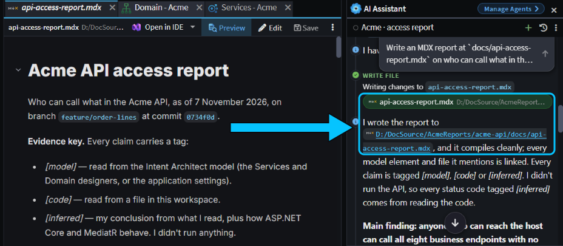
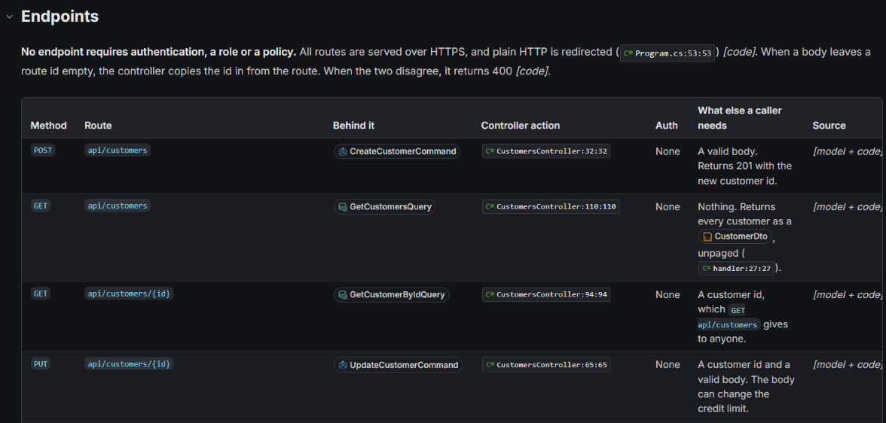
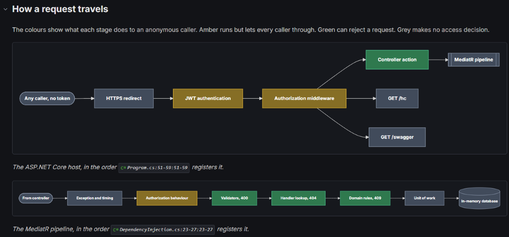
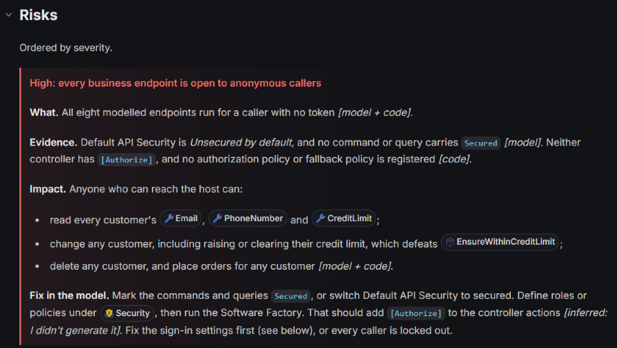
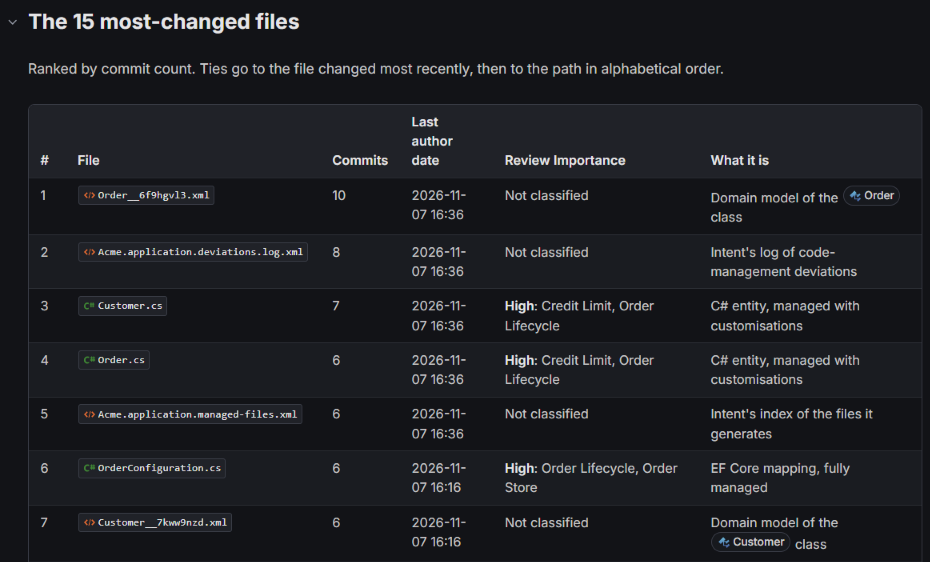

# Get visual reports on your system from the agent

Ask the agent for a report on part of your system, such as who can call which endpoint or which files change most, and it writes a document you can read at a glance: diagrams, tables and call-outs, with links that open the model elements and files it mentions. You get the answer as something to scan, not a wall of chat text.

This guide gives you copy-paste prompts for two reports, then shows how to write a prompt for any question about your system.

## Ask the agent for a report in the Solution Shell's AI Assistant

Type the prompt in the **AI Assistant** of the Solution Shell. Say that you want an `.mdx` report, and where to save it. MDX is Markdown that can also hold the diagrams, tables, call-outs and links the agent builds the report from.

A report takes the agent several minutes, because it reads your model and code before it writes anything. When it finishes, click the report's file name on the **Write file** step in the chat, or in the agent's reply if it links the file there. The report opens in a tab in Intent Architect's document viewer, which draws the diagrams and tables.

_The report's file name on the Write file step and in the agent's reply both open it._

Click a model element in the report to open it in its designer, or a file to open the file. A report is a file in your Git repository like any other, so you can commit it, or leave it out of Git.

> [!NOTE]
> A report is a snapshot. The counts and conclusions are what the agent found when it wrote the file, and they don't update as your system changes. The links do stay live: each time you open the report, they're checked against your model and files, and an element or file that's no longer there is flagged. Ask again for a fresh report.

## Recipe: see who can reach each endpoint of your API

Use this to check an API's access rules without reading every controller. The report is built from the Services designer and the code, so it tells you what your model and code say, not what a running system does.

Prompt for the AI Assistant, with your own API's name and path:

> Write an MDX report at `docs/api-access-report.mdx` on who can call what in the Acme API. List every HTTP endpoint with its method, route and the command or query behind it, and what a caller needs to reach it. Show how a request travels as a diagram, the endpoints as a table, and each risk as a call-out. Link every model element and file you mention. Mark each claim as read from the model or code, or inferred, and say what you didn't check.

On the Acme sample, the agent took about eight minutes, and the report shows:

- a table of every endpoint: the 8 in the model, each linked to its command or query, plus the health check and Swagger endpoints, which exist only in code;
- that none of them needs a signed-in user, a role or a policy, and that the model defines no roles or policies;
- diagrams of the stages a request passes through, coloured by which stages can turn a caller away;
- a call-out for each risk, ordered by severity, such as anonymous callers being able to change credit limits and delete customers;
- a tag on every claim saying whether the agent read it from the model, read it from the code or inferred it, and a list of what it didn't check.

_Each endpoint links to the command or query behind it and to its controller action._

_The colours show which stages let every caller through and which can reject a request._

The tags are why the prompt asks for them. A report that mixes what the agent read with what it guessed sounds equally sure of both, and you need to know which is which before you act on it. On Acme, the agent read the routes and the security settings from the model and the code, but it only inferred the status codes a caller would get, because it never called the running API.

_Each risk is a call-out with its evidence, its impact and a fix, and every claim carries a tag._

## Recipe: find the files that change most, from Git history

Use this to see where work concentrates in a Git repository, and which of those files need a person to review their changes. The report is built from Git history and from the Review Importance that Change Review gives each file.

Prompt for the AI Assistant:

> Write an MDX report at `docs/churn-report.mdx` on the files in this repository that change most. Use git history for the last 90 days. Show the 15 most-changed files as a table with commit count and the last author date, a call-out for any that are classified High in Change Review, and a link to each file. Say which period and which branch the numbers come from, and what you couldn't tell from history alone.

On the Acme sample, the report shows:

- a table of the 15 most-changed files, with commit counts, the last author date and Review Importance, each linked to its file;
- a call-out naming the 5 files that are High in Change Review;
- which files change together: every new field on `Customer` touched the same nine files;
- a warning that the 90 days cover the repository's whole history, about 29 hours of work, so the ranking says more about what was built first than about what's unstable.

_Model files link to their element as well as to the file._

Its list of what history alone can't tell you includes who made a change when commits share one identity, and how big or risky each change was.

> [!TIP]
> Review Importance comes from your file classifications. If you haven't set them up, run `/classify-codebase` in the AI Assistant, as  shows. It also writes a review document of its own, listing each classification and every file it covers.

## Write your own report prompt for the AI Assistant

The recipes in this guide follow the same pattern, and you can use it for any question about your system, such as an overview of your domain model, a list of the places a rule is enforced, or a map of which services call which.

- **Name the question and where the answer comes from.** "Which roles reach which endpoints, from the Services designer and the controllers" gives the agent a source to read, and you a reason to trust the result.
- **Say which block suits each part.** Ask for a diagram for a flow or a structure, a table for a list you want to scan, a call-out for a risk or a decision, and links for every element and file it names. The agent also knows other blocks, such as before and after code comparisons.
- **Ask it to separate what it read from what it inferred,** and to list what it didn't check.
- **Say where to save it,** so you can find, commit or delete it.

If a report comes out as plain text, ask the agent to write it again as an `.mdx` file. The agent plans in the same blocks, so  shows them in a plan.

## Related articles

-  - set up the classifications behind Review Importance.
-  - see the same blocks in the plan the agent writes before it changes code.
