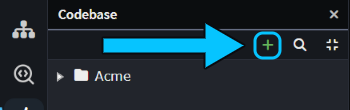
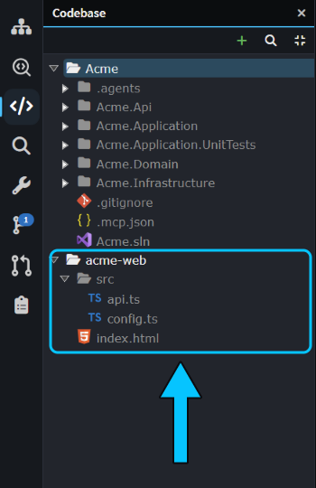
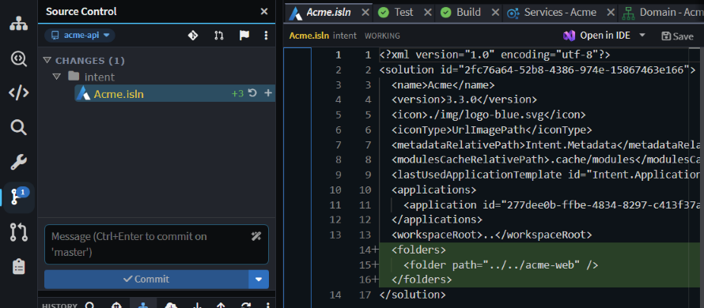
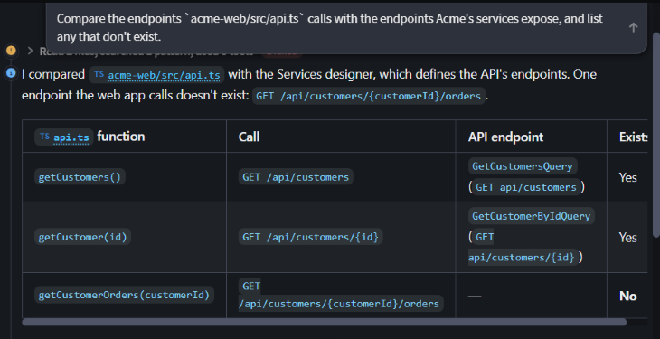
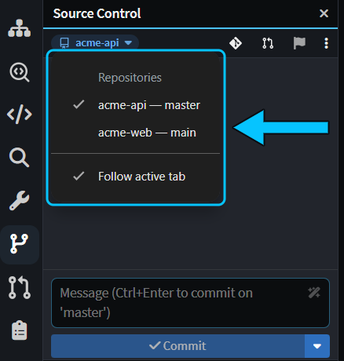
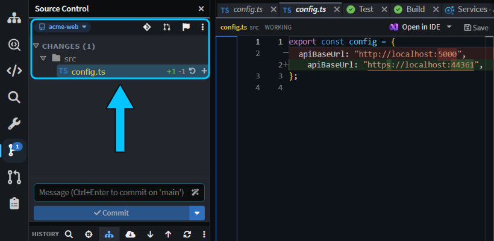

# Work across related codebases

If the agent needs code that isn't part of your solution, such as a frontend, a shared library or another service, add its folder to your workspace. The agent can then read it for context or change it as part of the same task, and you review and commit everything from the same place.

This guide shows how to add a related folder, what to ask the agent, and how to review and commit the result.

> [!NOTE]
> This only works in the [Solution Shell](xref:application-development.user-interface.agents-shell-and-solution-shell). Chats in the Agents Shell (**Manage Agents**) each run in a single folder of one Git repository and aren't told about folders you add, so start work that spans codebases from a Solution Shell chat.

## When to use this

Add a related codebase to the Solution Shell's **Codebase** pane when a change reaches beyond your Intent Architect applications' code, for example into:

- A frontend that calls your API.
- A shared library, or another service the change also touches.
- A legacy or reference codebase you want the agent to read.

The Codebase pane works like a multi-root workspace: one solution, several folders, each of which can be in its own Git repository.

The examples use a solution named `Acme` in an `acme-api` Git repository, with its frontend in a separate `acme-web` Git repository cloned next to it.

## Add a related codebase to the Codebase pane

In the Solution Shell:

1. Open the **Codebase** pane from the activity bar, or press `Ctrl+Shift+C`.
2. Click **+** (**Add a folder to the workspace...**) in the Codebase pane's toolbar. You can also right-click a root, or empty space in the pane, and choose **Add folder to workspace...**.

   

3. Choose the folder, for example the root of the other Git repository.

The folder appears as a new root, next to the root for each application's output folder.

_The `acme-web` Git repository added to the `Acme` solution's Codebase pane._

> [!NOTE]
> Adding a folder doesn't add the Intent Architect applications inside it to your solution. Use [Add Existing Application](xref:application-development.applications-and-solutions.about-solutions#add-existing-application) for that.

The folder is saved in the `.isln` file as a relative path, so committing the `.isln` change shares it with your team. If a teammate's copy isn't at the same relative path, the root shows a red cross and a "not found on disk" tooltip.

_Adding `acme-web` adds a `<folders>` entry to `Acme.isln`._

> [!WARNING]
> To take a folder out of the Codebase pane, right-click its root and choose **Remove from workspace**, which leaves the files on disk. Don't choose **Delete** on the same menu: it moves the folder and everything in it to the recycle bin.

## Ask the agent to work across codebases

In the Solution Shell's **AI Assistant**, the agent is told about every root in the **Codebase** pane, including added folders. It can read and edit files in those folders and query your Intent Architect model in the same turn. Name the folder or file in your prompt, such as `acme-web/src/api.ts`, because the agent's searches don't start in added folders.

This prompt only reads:

> Compare the endpoints `acme-web/src/api.ts` calls with the endpoints Acme's services expose, and list any that don't exist.

The agent read `acme-web`'s files, checked Acme's Services designer, and reported that nothing serves `GET /api/customers/{customerId}/orders`.

This prompt edits the added folder using a value from the solution's code:

> Set the API base URL in `acme-web/src/config.ts` to the HTTPS URL in Acme.Api's launchSettings.json.

One prompt can change both codebases too. _"Add a phone number to Customer and show it in acme-web's customer list."_ updated the Acme model, ran the Software Factory and updated the handlers, then updated `api.ts` and `index.html` in `acme-web`.

Edits in an added folder are written straight to disk, not staged through the Software Factory, so review them in **Source Control**.

## Review and commit the changes

Review the agent's changes in the Solution Shell's **Source Control** pane before you commit. The pane shows details of one Git repository at a time. It lists the Git repository holding the `.isln` file, the Git repositories holding each application's metadata and each added folder, and any Git repository exactly one folder level inside the `.isln` file's folder or an added folder.

When it lists more than one Git repository, the repository name at the top of the Source Control pane shows a caret. Click it to pick a Git repository, or choose **Follow active tab**, the default, to follow the file or application in the active tab. Your choice is remembered for you, per solution.

_The repository menu lists each Git repository with its current branch, then **Follow active tab**._

_Opening `config.ts` switched Source Control to `acme-web`, ready to commit the agent's change._

A change that spans Git repositories needs a commit, and a pull request if your team uses them, in each one. Merge the shared or upstream side first, such as the API before the frontend that calls it.

## Limitations

Related codebases in the **Codebase** pane have these limits:

- **They belong to the Solution Shell.** The [Solution Shell](xref:application-development.user-interface.agents-shell-and-solution-shell) is workspace-oriented: its chats, its Codebase pane and its Source Control pane cover every folder in the Codebase pane, across Git repositories. Conversations in the Agents Shell (**Manage Agents**) are repository-oriented: each one runs in a single folder of one Git repository, or in a worktree of it, and its Codebase and Source Control tabs stay within that folder. An Agents Shell conversation isn't told about added folders, so use a Solution Shell chat for work that spans codebases.
- **Folders can't be added when the opened folder holds several `.isln` files.** Open the specific solution.
- **Deeper Git repositories need adding.** Source Control only looks one folder level inside the folder that holds the `.isln` file and inside each added folder.

## Related articles

-  - every part of the Codebase pane.
-  - the Source Control pane and its repository picker.
-  - how the Agents Shell and the Solution Shell differ, and switching between them.
-  - everything the Agents Shell can do.
-  - solutions and the applications in them.
-  - which Intent Architect files to commit.
-  - reviewing what an agent changed.
-  - creating and reviewing pull requests in Intent Architect.
