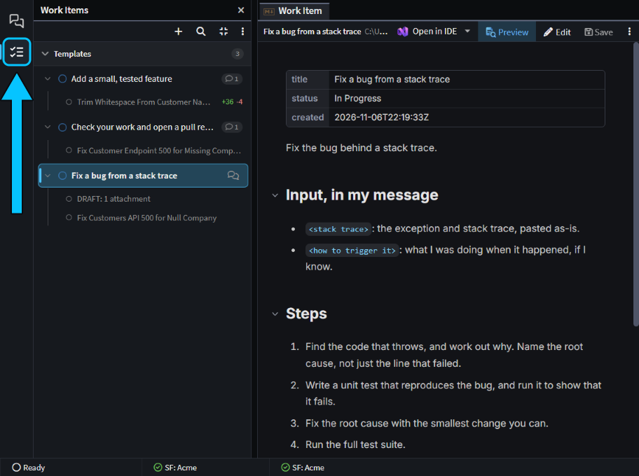
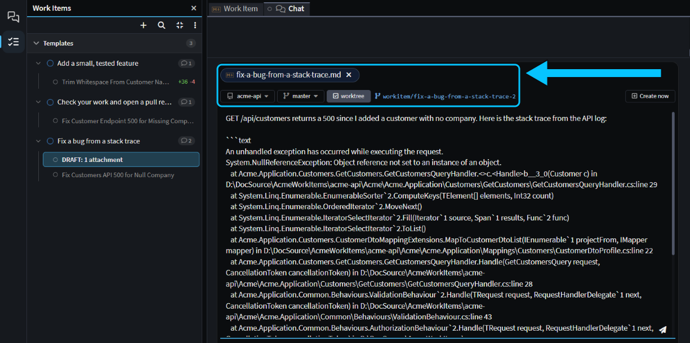
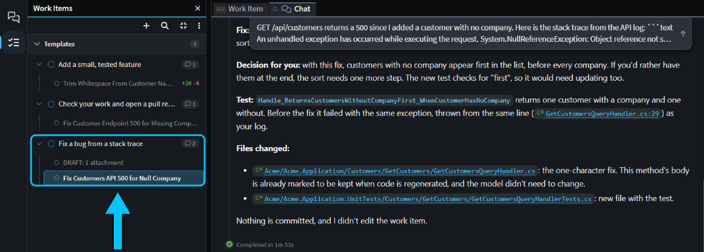

# Reuse your best prompts with Work Item templates

Got a prompt you keep retyping, such as fixing a bug from a stack trace or checking your work before a pull request? Write it once as a Work Item, then start a fresh chat from it whenever you need it: the agent follows your steps, you add the details for this run, and each run gets a worktree of its own.

This guide shows how to write a template, start chats from it and improve it, then turn it into a skill once your team wants it. It ends with three templates you can copy.

## Save a prompt as a Work Item in the Agents Shell

A Work Item is a Markdown note in the Agents Shell that the agent can read. Yours are kept in your user profile rather than in Git, so a template is yours to change whenever you like. See [](xref:application-development.user-interface.work-items) for everything else they do.

1. In the [Agents Shell](xref:application-development.user-interface.agents-shell-and-solution-shell), click **Work Items** on the left-hand bar.
2. Click **+** (**New work item**), type a name such as `Fix a bug from a stack trace`, and press `Enter`. The item opens as a document.
3. Click **Edit** and write the template, or click **Open in IDE** to write it in your editor. It's saved as you type.

Using a template moves it to **In Progress**, like any Work Item with a chat working on it. To keep your templates together, right-click one, choose **Move to group** > **New group**, name the group `Templates`, and move the others into it.


_The **Work Items** button (boxed) and three templates in a group of their own, with the bug-fix template open._

## Write a Work Item template the agent can follow

The template is what stays the same, and your message is what changes each time. A good template has:

- **Marked placeholders** for what changes, such as `<stack trace>`, saying they come in your message. **Start chat** leaves the message box empty for them.
- **Explicit steps**, including the ones you'd otherwise remind the agent of, such as writing a failing test first.
- **The skills to use**, by name, such as `review-changes`.
- **A verification step**, such as running the tests.
- **A definition of done**, and what to tell you at the end.
- **What not to do.** Include "Don't edit this work item": the agent can update Work Items, and its chat is linked to this one.

This is the bug-fix template:

```markdown
Fix the bug behind a stack trace.

## Input, in my message

- `<stack trace>`: the exception and stack trace, pasted as-is.
- `<how to trigger it>`: what I was doing when it happened, if I know.

## Steps

1. Find the code that throws, and work out why. Name the root cause, not just the line that failed.
2. Write a unit test that reproduces the bug, and run it to show that it fails.
3. Fix the root cause with the smallest change you can.
4. Run the full test suite.

## Done when

- The new test failed before your fix and passes after it.
- All the other tests pass.
- You've told me the root cause in a sentence or two, and listed the files you changed.

Don't commit, and don't edit this work item.
```

## Start a chat from a Work Item template with Start chat

Hover the template and click **Start chat**, right-click it and choose **Start chat**, or select it and press `Ctrl+Enter`. A new chat opens with the template attached and nothing sent, in the folder of the chat you had open. Paste the details for this run, check the folder and branch, and send it.

By default the chat runs in a Git worktree, a second checkout of your Git repository in its own folder, so it doesn't touch your files. Its branch is `workitem/<id>`, where `<id>` is the template's name in lower case with hyphens, and later chats from the same template get `workitem/<id>-2`, `-3` and so on.


_The second chat from the bug-fix template, on `workitem/fix-a-bug-from-a-stack-trace-2`, with the template attached and a stack trace pasted in._

> [!NOTE]
> Send each chat before you start the next one from the same template. Until a chat is sent its branch doesn't exist, so the next chat proposes the same name, and asks you for another once the first one takes it.

The worktree needs a CLI agent such as Claude Code (see [](xref:ai.cli-agents)) and a Git repository. To work in your own checkout instead, untick **worktree** before you send, or turn off **Start chats from work items in a worktree** in [User Settings](xref:application-development.user-interface.how-to-change-user-settings#agents).

With the stack trace from a 500 on `GET /api/customers`, the agent found the cause in the last commit, wrote a test that failed with the same exception, fixed it and ran all 46 tests in under two minutes. It ended: _"Nothing is committed, and I didn't edit the work item."_

## Improve a Work Item template from its runs

Each chat you start from a template stays linked to it, so the template builds up a history of its runs. Click the template to list them under it, newest first, with their status, and click one to open it.


_The bug-fix template's two chats, one finished and one not sent yet, with the finished one's report._

When a run goes wrong in a way the template could have prevented, add the missing step or rule to the template. The next chat you start gets it.

## Three Work Item templates to start from

Copy one into a new Work Item and adapt it to your code. We ran each one on a small .NET API, and the bug-fix template is above.

**Check your work and open a pull request.** Start it while the chat whose work you want to check is open, so it starts in that chat's folder, and untick **worktree** so it works on that chat's branch. The agent built, tested and reviewed our fix, called the API to check it, and committed it. Our Git repository has no remote, so it stopped at the pull request and said why. See [](xref:application-development.pull-requests).

```markdown
Check the work in this folder, then open a pull request for it.

## Input, in my message

- `<what the change is for>`: a sentence or two, or a link to the issue.
- `<base branch>`: the branch to merge into, if it isn't `master`.

## Steps

1. Build the solution and run the full test suite. Fix anything that fails.
2. Review the changes with the `review-changes` skill, and fix what it finds that's worth fixing.
3. If the change affects what a user sees, check it in the running app and take screenshots.
4. Commit the changes with a clear message.
5. Open the pull request with the `creating-pull-requests` skill. Say what changed, why, and how you checked it.

## Done when

- The build and all the tests pass.
- The pull request is open, or ready to create, and you've told me where.

Don't edit this work item.
```

**Add a small, tested feature.** Asked to trim spaces from the start and end of a customer's name and email, the agent changed two handlers, added a test for each, had `review-changes` check its work and ran all 47 tests, in about four minutes. It also pointed out that a name of only spaces would now be saved as an empty string.

```markdown
Add a small feature, with tests.

## Input, in my message

- `<feature>`: what it should do, in a sentence or two.
- `<examples>`: an input and the result I expect, if I have them.

## Steps

1. Read the code around the change, and tell me your plan in three or four bullets. Then carry on without waiting.
2. Make the change the way the code around it does things.
3. Add unit tests for the new behaviour, with one for each example I gave.
4. Build and run the full test suite.
5. Review your changes with the `review-changes` skill, and fix what it finds that's worth fixing.

## Done when

- The build and all the tests pass.
- You've listed the files you changed and the tests you added.

Don't commit, and don't edit this work item.
```

## Turn a Work Item template into a skill when your team needs it

A template is yours alone, and quick to change between runs. A skill is a `SKILL.md` file in your Git repository: your team gets it when they pull, it's reviewed and versioned like code, and the agent loads it by name (see [](xref:ai.context-management#3-skills)). Keep a template while you're still changing it every few runs, and turn it into a skill once it's stable or your team wants it.

To turn it into one, ask the agent. When we asked _"Turn my work item "Fix a bug from a stack trace" into a skill in this repository, so the rest of the team can use it."_, it wrote the skill next to the application's other skills, dropped "Don't edit this work item", added this Git repository's test commands, and committed it on its own branch, ready to merge.

## Related articles

- [](xref:application-development.user-interface.work-items) - everything else Work Items can do.
- [](xref:how-to.run-agents-in-parallel) - running chats in worktrees, and merging and cleaning them up.
- [](xref:ai.context-management) - where skills go and how the agent loads them.
- [The next level in agentic development with Intent Architect v5.4](https://www.youtube.com/watch?v=ynpJXprfuZ4&t=2397s) - the webinar's Work Items walkthrough, from 39:57.
