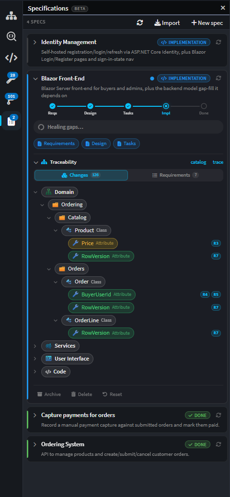
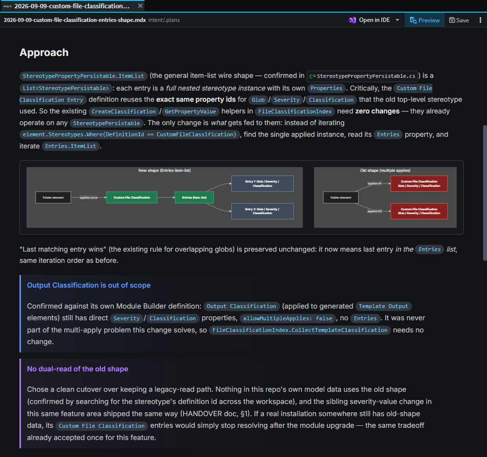

# Living Specifications and Mockups

To drive an agentic development process, teams need high-quality specifications. But specifications go stale, so they can't describe how the system behaves or prevent behavioral regressions. Intent Architect is the first platform to enable living specifications: an always-accurate description of your system's behavior, traced to the code and proven by the tests that cite it. Every behavioral change is made explicit, so teams can track how the system evolves in natural language, instead of reverse engineering code.

Teams can also generate mockups of their actual system, built from its real layout, screens and styles, to preview changes and confirm requirements before implementation.

---

## Key benefits

- **📋 Hold agents accountable and prevent behavioral regressions**

  Intent Architect is the first platform to enable living specifications: specs that always represent the current state of the codebase, and are continuously tested and updated as agents make changes to the system. Teams prevent behavioral regressions by tracking changes in natural language, rather than relying purely on tests or onerous code reviews. Specs can also be imported from tools like BMAD, Spec Kit, OpenSpec, Kiro etc. and transformed into living specifications.

- **🖼️ Preview changes as mockups of your actual system**

  Confirm that requirements will actually be met before implementation. Intent Architect lets teams gauge the impact of new requirements on the system's behavior up front, and generate mockups of their actual system. This means teams can preview changes and confirm requirements with business analysts and other stakeholders before any code is written.

- **🔗 Trace code to requirements, and requirements to code**

  Traceability answers the why: why code was implemented, and why changes were made. Links run in both directions, from each requirement to the model elements and code that realize it, and from any piece of code back to the specification and requirement that drove it. They are discoverable in Change Review, the visual models and the SDD environment. This means teams can see why code exists across the entire SDLC, from upstream to downstream.

---

## The Specs Panel

Spec-Driven Development is a structured, model-native way to go from an idea to implemented, traceable code, driven by AI but anchored to your Intent Architect model. A dedicated Specs panel guides teams through a phased flow:

1. **Requirements** – capture a feature as precise, testable user stories (EARS-style) with stable IDs.
2. **Design** – turn those requirements into intended model changes plus a per-requirement realization plan.
3. **Tasks** – break the design into a checkpointed task list, organised into dependency-ordered waves.
4. **Implement** – work the waves in order, applying model changes, generating code, and implementing and testing the bespoke logic.
5. **Verify & Heal** – check the implementation against its acceptance criteria, and repair any gaps the verification finds.

Because the design is expressed as changes to your designer model – not just prose – SDD stays true to Intent Architect's core principle: the model is the source of truth, and code is generated output.

Existing specification documents, such as BMAD PRDs, can be imported and integrated with the SDD system, so teams can bring specs and workflows they already have into Intent Architect's model-native flow.

 

_The Specs panel, showing a spec and its phase progress._

---

## End-to-End Traceability

As work is implemented, Intent Architect records traceability links from each requirement to the model elements and files that realize it. Those links flow straight through to Change Review, so when you review a change you can see the requirement behind it – and when you read a requirement you can see where it lives in the model and the code.

---

## Specifications in MDX

Specifications are generated in MDX rather than plain markdown. MDX extends markdown with support for React components, so a document can embed rich, rendered content alongside ordinary prose rather than being limited to static text.

Plans, specs and pull request descriptions support purpose-built MDX blocks – DataModel, ApiEndpoint, Wireframe, Canvas and ModelChanges – alongside Mermaid diagrams, authored by the agent as part of the plan. A proposed data model or API surface can be seen rather than described, so the intent of a specification is far easier to follow at a glance than the equivalent plain markdown file.

 

_A DataModel block rendered inline in a plan document._

---

## Learn More

- **[Reliable Architectural Guardrails](xref:key-concepts.deterministic-codegen)**
- **[Authoritative Design Blueprints](xref:key-concepts.visual-modeling)**
- **[Advanced Validation Tools](xref:key-concepts.codebase-integration)**
