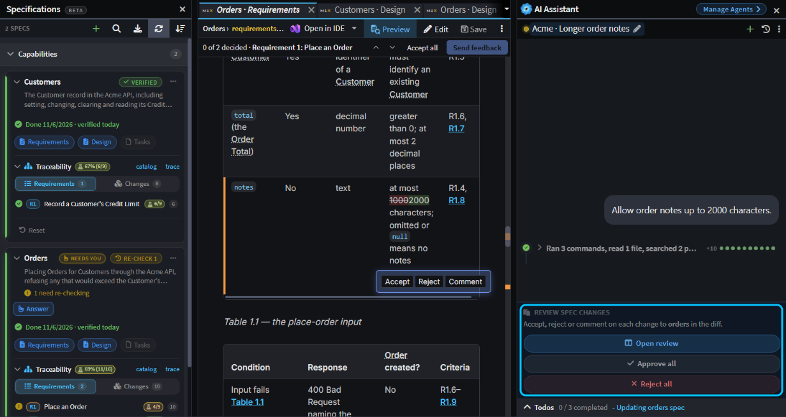

# Living Specifications and Mockups

To drive an agentic development process, teams need high-quality specifications. But specifications go stale, so they can't describe how the system behaves or prevent behavioral regressions. Intent Architect is the first platform to enable living specifications: an always-accurate description of your system's behavior, traced to the code and proven by the tests that cite it. Every behavioral change is made explicit, so teams can track how the system evolves in natural language, instead of reverse engineering code.

Teams can also generate mockups of their actual system, built from its real layout, screens and styles, to preview changes and confirm requirements before implementation.

---

## Key benefits

- **📋 Hold agents accountable and prevent behavioral regressions**

  Intent Architect is the first platform to enable living specifications: specs that always represent the current state of the codebase, and are continuously tested and updated as agents make changes to the system. Teams prevent behavioral regressions by tracking changes in natural language, rather than relying purely on tests or onerous code reviews. Specs can also be imported from tools like BMAD, Spec Kit, OpenSpec, Kiro etc. and transformed into living specifications.

- **🖼️ Preview changes as mockups of your actual system**

  Confirm that requirements will actually be met before implementation. Intent Architect lets teams gauge the impact of new requirements on the system's behavior up front, and generate mockups of their actual system. This means teams can preview changes and confirm requirements with business analysts and other stakeholders before any code is written.

- **🔗 Trace code to requirements, and requirements to code**

  Traceability answers the why: why code was implemented, and why changes were made. Links run in both directions, from each requirement to the model elements and code that realize it, and from any piece of code back to the specification and requirement that drove it. They are discoverable in Change Review, the visual models and the SDD environment. This means teams can see why code exists across the entire SDLC, from upstream to downstream.

---

## The Specs Panel

The Specs panel holds two kinds of spec. A **Change spec** covers one piece of work, a new feature, story, ticket, etc. A **Capability spec** is a living specification of how one area of your system behaves, kept true as the code changes. Related Capabilities can be grouped into **Areas**.

A Change spec moves through these phases:

1. **Requirements**: testable acceptance criteria with stable IDs. They name each Capability the Change affects and what it changes, and you approve that in **Spec Review**, so the effect on your system's behavior is agreed before any code is written.
2. **Design and Tasks**: intended model changes, broken into dependency-ordered waves.
3. **Implement**: apply the model changes, generate code, and implement and test.
4. **Verify & Heal**: check every acceptance criterion against the code and tests, and repair any gaps.
5. **Fold**: merge what the Change spec established into its Capabilities, which then stay living.

To share a spec outside Intent Architect, any spec document, including a rendered diff, can be exported as a PDF.

 

_A change to the Orders Capability, waiting for review before any code changes._

---

## Mockups

To confirm what a requirement will look like before it's built, an agent can mock up the screen in your app's own look. The built-in `mockup-kit` skill captures a snapshot of your application's styles once, so mockups match the real system. A mockup appears right in the agent's chat reply as a before and after, in light and dark, with numbered pins that explain each change.

Instead of describing changes in words alone, you can click any part of a mockup, comment on it, and send your comments to the agent, which revises the mockup. When the change goes into a spec, the approved mockup is kept in its requirements, in a **Screens** section, so whoever reviews the spec sees the screen as well as the requirements.

<video style="max-width: 100%" controls src="videos/mockups-in-chat.mp4"></video>

For a step-by-step walkthrough, see [Mock up a screen before it's built](xref:how-to.mock-up-a-screen).

---

## End-to-End Traceability

As work is implemented, Intent Architect records traceability links from each requirement to the model elements and files that realize it. Those links flow straight through to Change Review, so when you review a change you can see the requirement behind it – and when you read a requirement you can see where it lives in the model and the code.

---

## Specifications in MDX

Specifications are generated in MDX rather than plain markdown. MDX extends markdown with support for React components, so a document can embed rich, rendered content alongside ordinary prose rather than being limited to static text.

Plans, specs and pull request descriptions support purpose-built MDX blocks – DataModel, ApiEndpoint, Wireframe, Canvas and ModelChanges – alongside Mermaid diagrams, authored by the agent as part of the plan. A proposed data model or API surface can be seen rather than described, so the intent of a specification is far easier to follow at a glance than the equivalent plain markdown file.

 

_A DataModel block rendered inline in a plan document._

---

## Learn More

- **[Reliable Architectural Guardrails](xref:key-concepts.deterministic-codegen)**
- **[Authoritative Design Blueprints](xref:key-concepts.visual-modeling)**
- **[Advanced Validation Tools](xref:key-concepts.codebase-integration)**
