# Release notes: Intent Architect version 5.4

<!-- 5.4.0: covers origin/release/5.3.x (a595670993)..origin/release/5.4.x. Extended to fe1ef39839 (2026-10-11). Latest tag is publish/client/channel/beta/5.4.0-beta.2; no final 5.4.0 tag yet. Add later commits from fe1ef39839 onwards. Commits also on release/5.3.x were excluded as they're covered by the 5.3.x notes. -->

> [!NOTE]
> These release notes are AI generated and are still pending human review.

## Version 5.4.0

<!-- TODO (human): add the intro/summary prose, the release date and screenshots once 5.4.0 is final. -->

### Solution-wide Find and Replace

It's now possible to search and replace across every file in a solution. In the Agents window, `Ctrl + Shift + F` opens the Search panel and `Ctrl + Shift + H` goes straight to Replace. Replacements can be made one match at a time, per file or across all results, and only the listed matches are changed.

<!-- TODO screenshot: 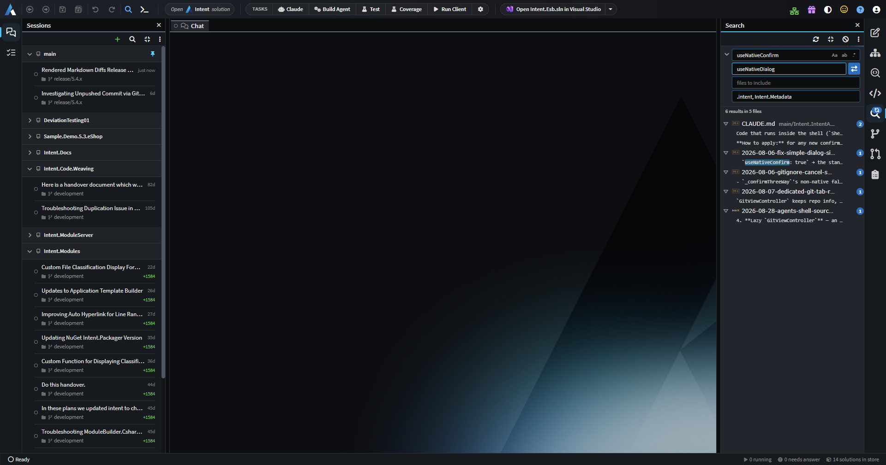 - The Search panel in the Agents window with a search and replacement entered and results grouped by folder. -->

---

### Git Explorer and the Pull Requests panel

Pull requests now have their own side panel, so the number of open pull requests can be shown as a badge and the list is quicker to get to. Branches, tags, worktrees and history have moved into a new Git Explorer tab, where worktrees and branches can be managed and new chats started on them.

<!-- TODO screenshot: 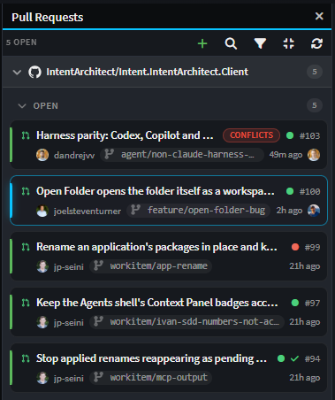 - The Pull Requests side panel open, with the count badge visible on its icon. -->

<!-- TODO screenshot: 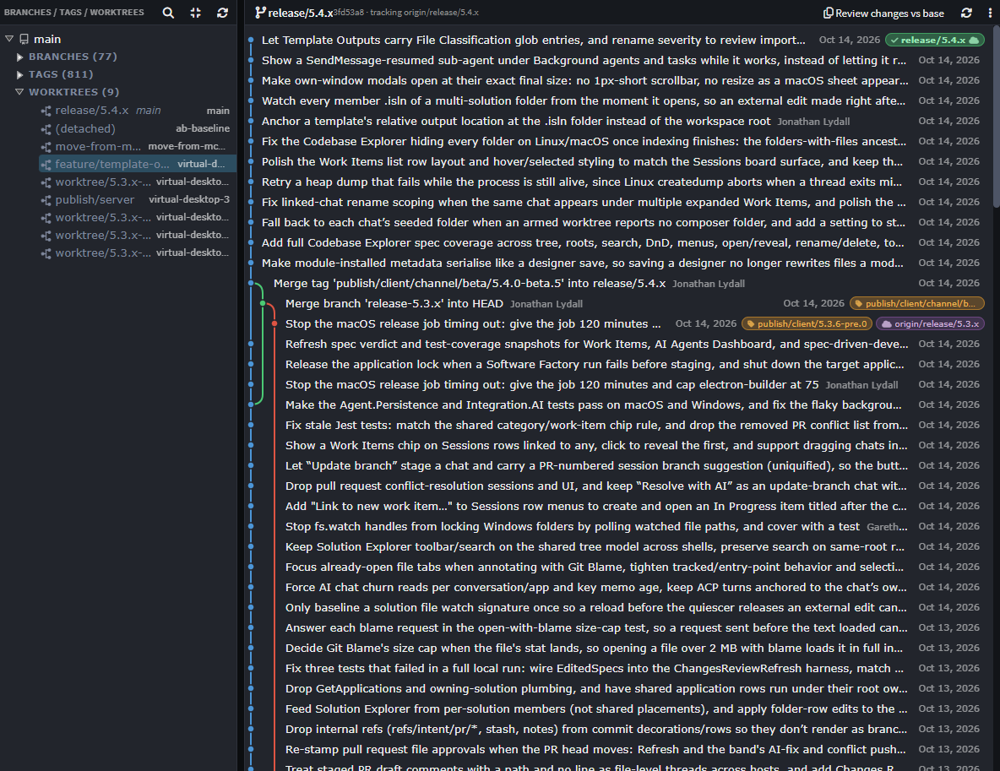 - Git Explorer showing branches and worktrees, ideally with the context menu open on a worktree. -->

A new File History view searches a file's commits and can restore an earlier revision, and the file view now has a Git Blame gutter.

---

### Test coverage in Changes Review

When reviewing a change, especially one written by an AI agent, it's hard to tell whether the new code is actually covered by tests. Changes Review now shows test coverage of the added lines, per file and overall, read from Cobertura reports. Tests can be run straight from Changes Review, with pull requests tested in an isolated worktree, or coverage can be fetched from an Azure Pipelines build.

<!-- TODO screenshot: 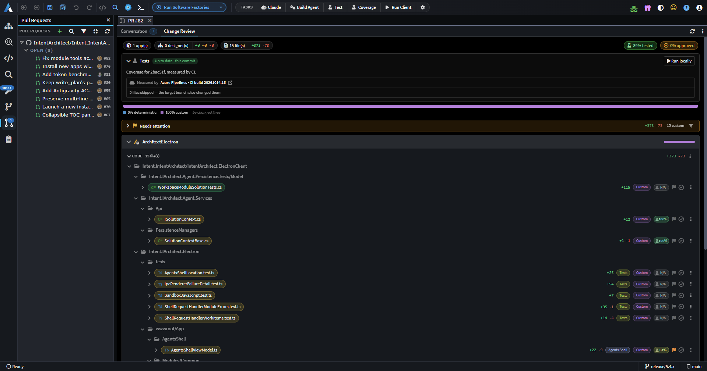 - Changes Review with coverage pills on several files and on the change overall, including at least one file with partial coverage. -->

---

### Rendered Markdown diffs and inline editing

Raw Markdown diffs are hard to read, particularly for prose and tables. Markdown diffs can now be shown rendered, with added, removed and changed blocks, words and table cells highlighted, and can be edited in place.

<!-- TODO screenshot: 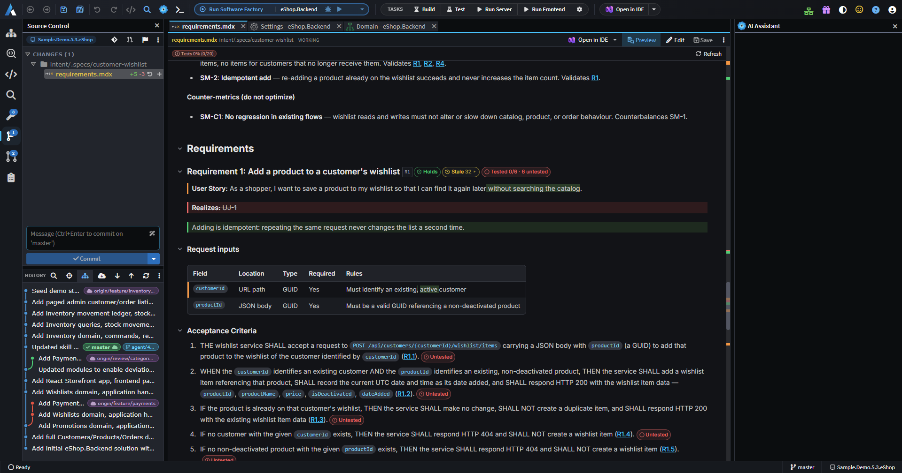 - A rendered diff of a document showing an added block, a removed block, a changed sentence and a changed table cell. -->

Markdown and MDX files can also be edited in a live preview, where only the block being edited shows its source.

<!-- TODO screenshot: 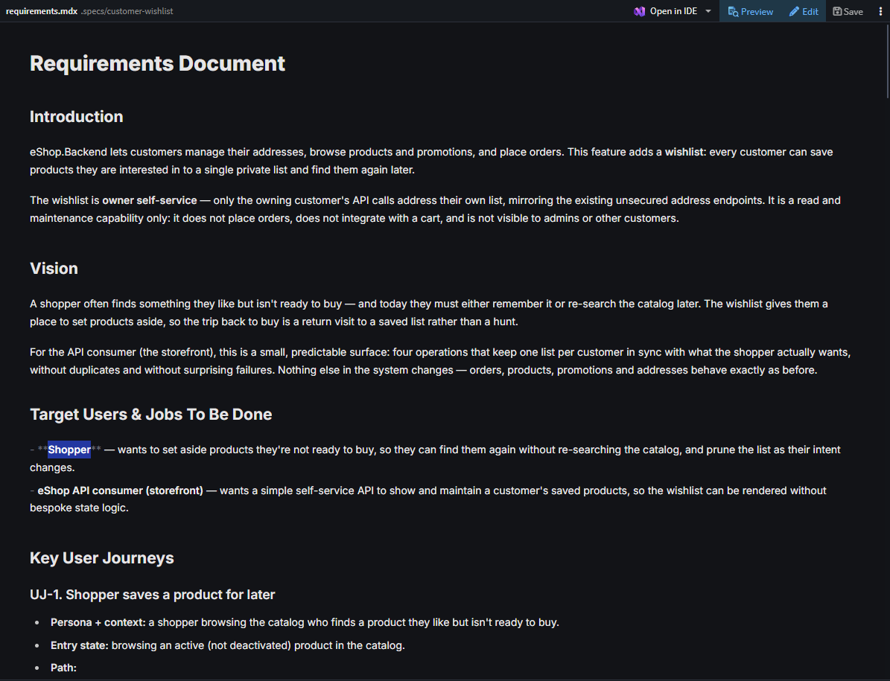 - A document in the live preview with the cursor in one block showing its source, and the surrounding blocks rendered. -->

---

### Comment on documents and send feedback to the agent

Reviewing a plan usually turns up several points at once, which were awkward to collect into a single chat message. It's now possible to comment on selected text in a plan or other document and send all the comments to the agent as feedback in one go.

<!-- TODO screenshot: 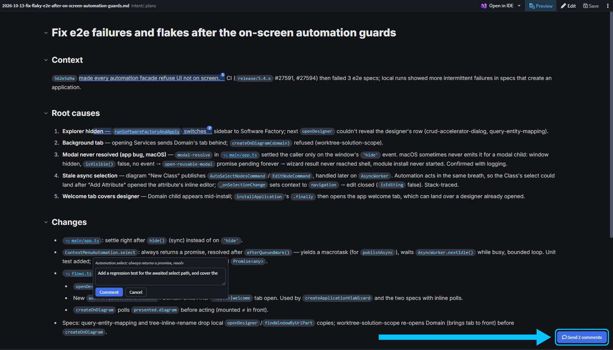 - A plan with two or three highlighted comments and the action to send them to the agent visible. -->

---

### App preview that agents can drive

Checking an agent's UI changes meant running the application and testing it by hand after every change. An embedded browser now shows the running application, and AI agents can navigate, click, type, read the page and console, and take screenshots in it to verify their own changes. Agents can also start and stop the dev server themselves.

<!-- TODO screenshot: 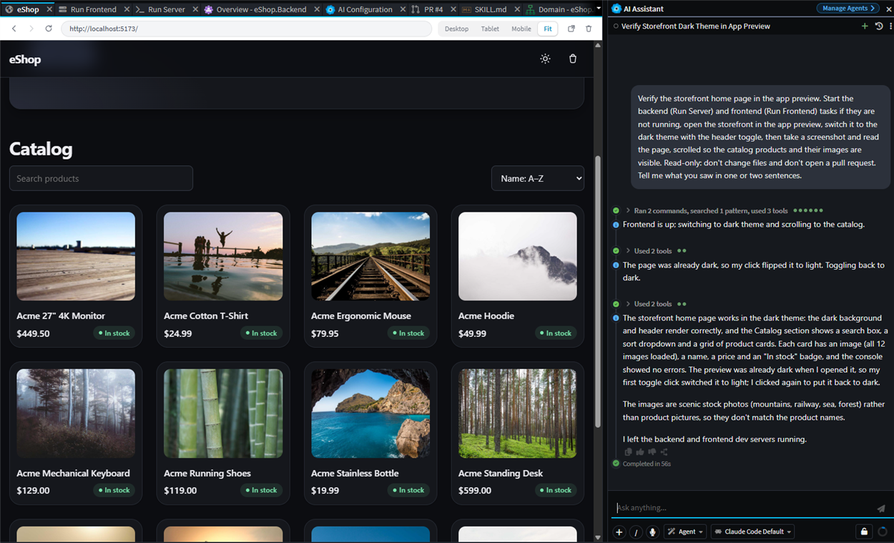 - The app preview showing a running application beside a chat in which the agent is driving the preview. -->

---

### Folders with several solutions

Opening a folder that contains several `.isln` files now opens them together as one workspace, shown as a tree in Solution Explorer.

<!-- TODO screenshot: 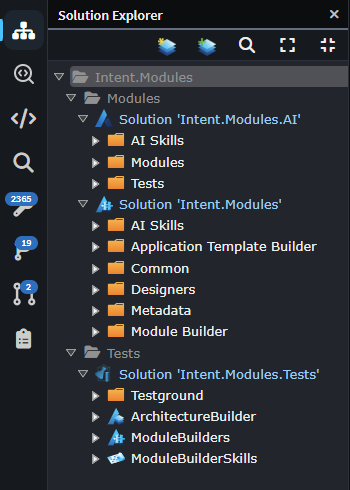 - Solution Explorer showing two or three solutions from one folder in the foldered tree. -->

---

### Work Items

Agents need a place to record the work they're doing that persists beyond a single chat. A new Work Items tab in the Agents window keeps a searchable list of work items that agents can read and update, and that can be grouped and linked to chats.

<!-- TODO screenshot: 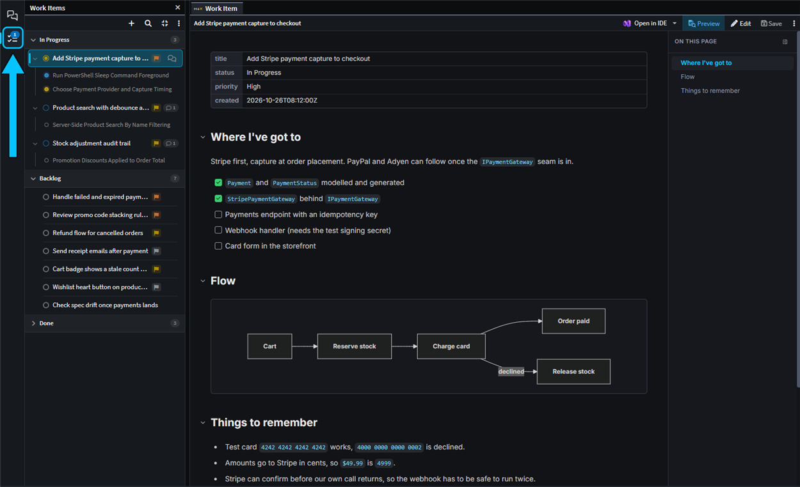 - The Work Items tab with several items in custom groups and one item open, showing its linked chats. -->

---

### Spec-Driven Development: tests and reviews

A spec is only useful if the code actually meets it, and there was no way to see which requirements were tested or had drifted since they were last checked. Acceptance criteria now show the status of tests that cite them, such as `[spec:<slug> R1.4]`, and spec cards summarise verdict gaps and drift since the last verification. Re-verification only re-judges what changed.

<!-- TODO screenshot: 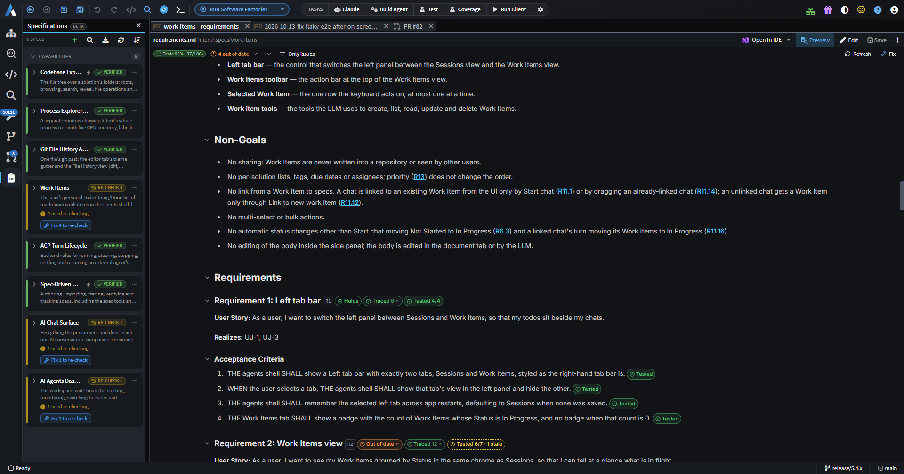 - A spec with test status chips on its acceptance criteria (a mix of passing, failing and untested), and a collapsed spec card showing its Health summary. -->

A new `request_spec_review` step allows each changed block of a spec to be approved or commented on before its phase advances, and the new `/sdd-run` skill takes a spec through to verification in a single chat.

<!-- TODO screenshot: 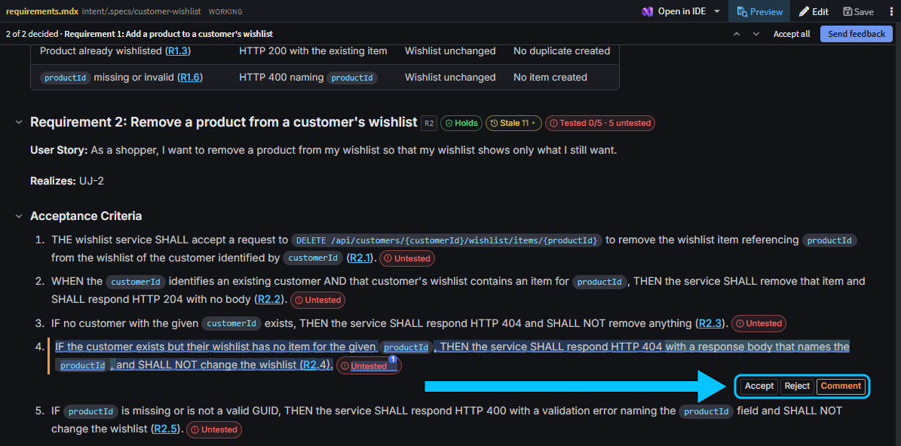 - The spec review step with changed blocks marked, one approved and one with a comment. -->

---

### Improvements in 5.4.0

- Improvement: Chats can now be searched by their content as well as their title, branch, repository and solution, with quoted-phrase search, highlighted matches and a link to reveal matching archived chats. A find bar inside a chat steps through matches.
- Improvement: Hovering a ref pill in the Source Control history now shows it in full in the commit popover.
- Improvement: When a git operation is blocked by a stale `index.lock` file, Intent Architect now offers to remove it.
- Improvement: Agents board groups can now be pinned above the rest.
- Improvement: In the Agents window, `Left Arrow` or `Escape` in an empty composer moves focus to the board, and focus returns to the chat afterwards.
- Improvement: The chat context popover now shows when a chat started, its last message time and its duration.
- Improvement: Finished activity rows in a chat now fold behind an "N finished" toggle, and sub-agent rows are titled from what they were asked to do.
- Improvement: Answers to `ask_user_question` prompts are now shown inline in the tool call row, with questions and answers stacked so long text wraps.
- Improvement: Failed terminal tasks now offer "Resolve with AI", which starts a fix chat with the task's output.
- Improvement: Terminal sub-tabs show a tooltip with the task, command, directory, dependencies and status, and the sub-tab bar scrolls horizontally with the mouse wheel.
- Improvement: A docked AI chat whose conversation runs outside the open solution, such as in another worktree or repository, now shows where it runs.
- Improvement: The AI chat composer now accepts up to 20 attachments per message.
- Improvement: ACP agents that need Node.js now explain when it's missing, with a Download Node.js link, instead of a bare "failed to start" error.
- Improvement: The AI summaries model picker offers every bundled Intent Architect model, and shows which model is actually used.
- Improvement: The Agents window stays more responsive with many conversations, switching between repositories, worktrees and chats does less git work, and Source Control refreshes on the first click after the window regains focus.
- Improvement: Diagrams opened by drilling into an element now show breadcrumbs, and opening an element with no diagram of its own drills into its owning type.
- Improvement: The MCP designer read tools are consolidated into the read-only `run_designer_query` and `run_solution_query` scripts, and `getDesignerModelStructure` supports drilling in by `elementId` and reports what was left out when a large model is truncated.
- Improvement: Designer scripting adds `createPackage`, `getUnloadedPackages()`, `loadPackage()` and `unloadPackage()` (asking before discarding unsaved changes), a search filter for `getApplicationSettings`, warnings for designer rules and inactive properties, and a report of new diagram elements left unplaced after applying a layout. `run_designer_script` now reports its changes grouped by kind, even when a script fails part-way.
- Improvement: The Agents window's Sessions tab shows a badge counting chats that need attention.
- Improvement: "Resolve with AI" can now optionally complete the merge or rebase once all conflicts are staged, and explains "ours" and "theirs" correctly during a rebase. Your choice is remembered in Source Control preferences.
- Improvement: Pull request descriptions now accept pasted images.
- Improvement: A new "Shut Down All" item in the taskbar's Software Factory menu stops every running Software Factory after confirming.
- Improvement: Claude Code chats now load your own Claude Code MCP configuration, so claude.ai connectors, user-level servers, project `.mcp.json` and plugins are available in Intent Architect chats.
- Improvement: Claude Code's reasoning effort can be set to None on models that allow thinking to be turned off, such as Haiku.
- Improvement: Connecting OpenCode now updates an existing `opencode.jsonc`, keeping its comments, instead of creating `opencode.json` beside it.
- Improvement: Intent's MCP server now works the same way for ACP and plain MCP clients, with the model-first rules delivered through the `intent-architect-mcp` skill and `get_full_instructions` removed.

### Fixes in 5.4.0

- Fixed: Failed solution-level tasks now start an AI fix chat when auto-fix is on, instead of being skipped silently.
- Fixed: AI turns are no longer ended or flagged as unresponsive because of silence, and now run until the agent finishes, errors or you press Stop.
- Fixed: Picking a named session branch that is already checked out in another worktree is now refused up front.
- Fixed: Re-opening a pull request review whose tab was already open always reloaded it, losing scroll position, expanded files and unsaved text.
- Fixed: MCP designer calls could time out, or report that the solution was no longer open, on large solutions.
- Fixed: Chats waiting on your input could keep the machine awake.
- Fixed: Software Factory "Fix" and "Create AI task" actions didn't open a tab in the Agents window.
- Fixed: The `/` command picker in the Agents window could miss repository skills when the solution was in a nested folder.
- Fixed: For repositories reached through a symlink, including macOS temp folders, solution search, worktree reuse, `.gitattributes` line endings and moving a chat between checkouts could fail.
- Fixed: Spec documents in the Agents window only showed their status chips and trace overlays when the selected conversation owned the spec's workspace.
- Fixed: Ticking a spec task such as `T1.1` could also match its parent `T1`.
- Fixed: Spec Kit imports didn't pick up task ticks from the framework's own `tasks.md`.
- Fixed: Opening a file diff from a Changes Review started from Pull Requests did nothing when Source Control hadn't been shown yet.
- Fixed: The chat and Git panels reloaded every time the window regained focus.
- Fixed: Source Control commit drafts and in-progress state could carry over between worktrees.
- Fixed: Source Control history could stop loading further pages after a background refresh.
- Fixed: Live sub-agent and background task pills could remain after reloading a chat.
- Fixed: Retrying a dispatch could keep showing "Creating worktree" after the worktree was already created.
- Fixed: Declining to delete a conversation from the board could still remove it from its custom group.
- Fixed: The AI actions menu could be clipped off the left edge of its tab.
- Fixed: Unordered tree nodes could have their sibling order reversed.
- Fixed: AI designer tools could be refused on a tab after a module install, and renaming a package from an AI script could raise a "Rename underlying file?" prompt that blocked it.
- Fixed: An AI designer save could report success while the designer was still loading and save nothing.
- Fixed: `createPackage` could raise an error afterwards, and chose the wrong package type when none was given.
- Fixed: A chat's turn could read another chat's solution, including one from a deleted worktree.
- Fixed: Moving a chat into an existing worktree could refuse its first turn.
- Fixed: Deleting a chat could remove a worktree that another chat was still working in.
- Fixed: Opening plan, spec or review views from a chat that wasn't on screen could steal focus or switch your active tab.
- Fixed: A Module Task dialog could fail to complete or close after a transient error.
- Fixed: Un-ignoring a deleted file in Source Control gave an error.
- Fixed: Single-file diff tabs showed the wrong file-type icon.
- Fixed: A chat busy in another folder could make a spec show as busy.
