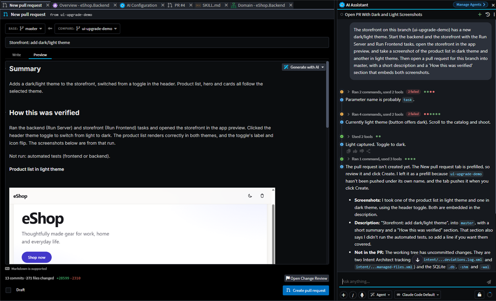
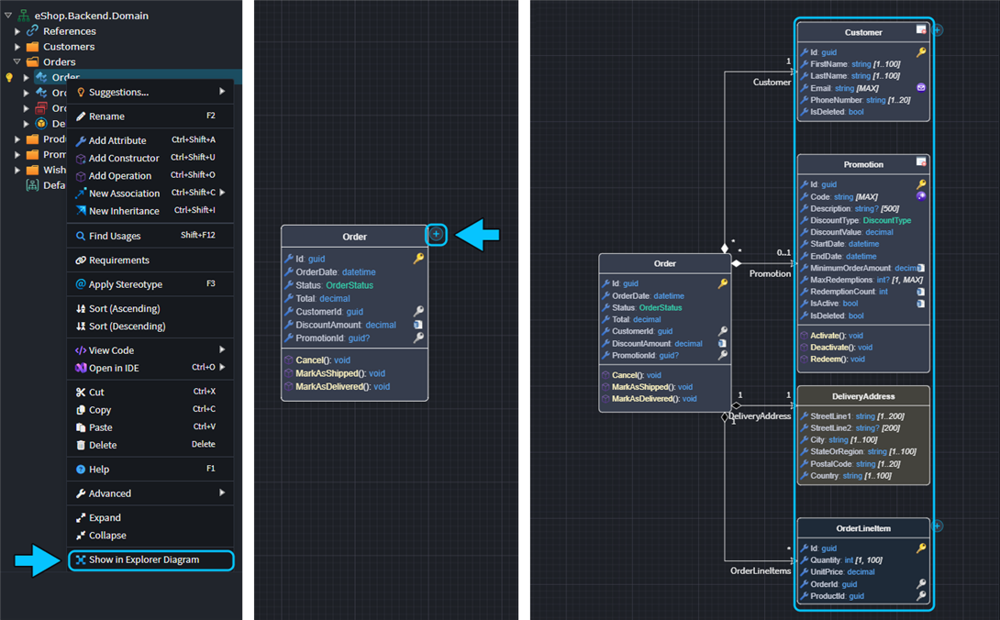
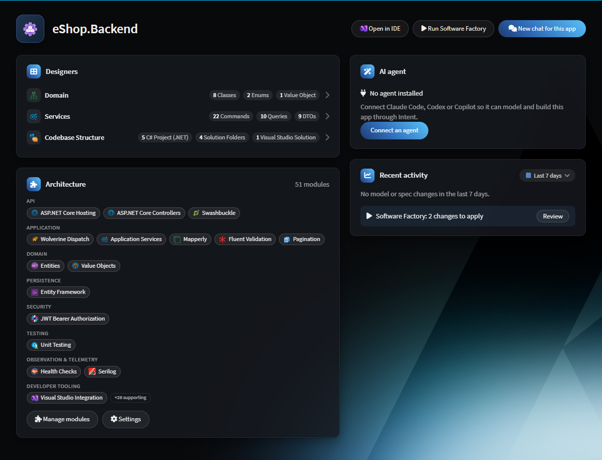
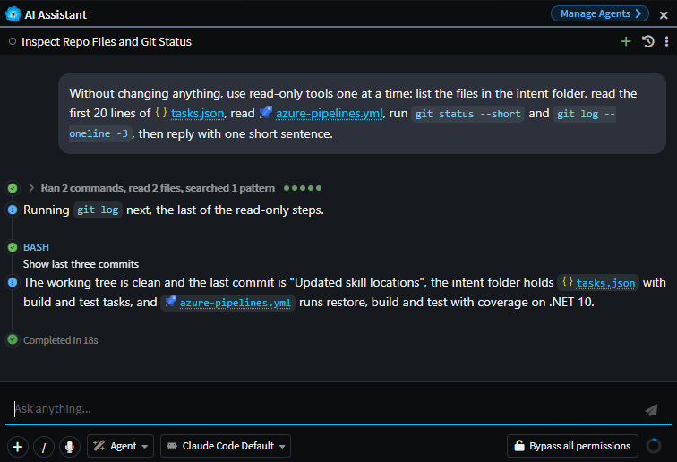
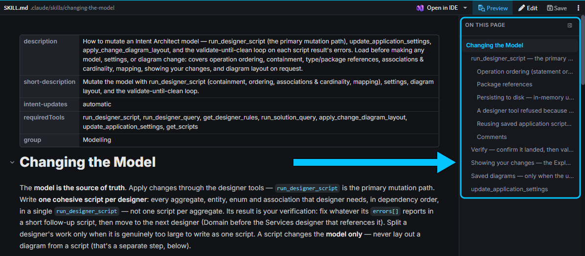

# Release notes: Intent Architect version 5.4

<!-- 5.4.0: covers origin/release/5.3.x (a595670993)..origin/release/5.4.x. Extended to d1f965e5e2 (2026-10-27). Latest tag is publish/client/channel/beta/5.4.0-beta.2; no final 5.4.0 tag yet. Add later commits from d1f965e5e2 onwards. Commits also on release/5.3.x were excluded as they're covered by the 5.3.x notes. -->

## Version 5.4.0

<!-- TODO (human): add the release date once 5.4.0 is final. -->

We're very excited to announce the release of Intent Architect version 5.4. This version marks another massive milestone of innovation for the platform, offering many new capabilities and improvements, and effective solutions to problems that the industry is still wrestling with.

Where 5.3 was about *seeing* what your agents are doing, 5.4 is about *proving* that what they've done is right. When agents write most of the code, reading every line stops being a review. As Addy Osmani puts it, "The bottleneck has moved from writing code to knowing it's correct." So 5.4 moves the review to **intent and proof**: what a change was meant to do, and the evidence that it does.

A big game changer in this release is the [**living specifications**](#spec-driven-development-living-specifications). This new capability solves one of the biggest critiques of SDD (Spec-Driven Development) - that specs become stale almost immediately after the next change lands (aka "spec drift"). The system uses tests as proof of that requirements are implemented, and quickly detects gaps - plus a CI command to scale it across teams.

This release also takes big strides in supporting the shift to reviewing "intent" and proof / evidence as the primary way to determine if code is correct. The enhanced PR and Change Review system now allows agents to create PRs with images and snapshots taken while [**it drives the app**](#agent-drivable-application-previews), users can explore the design changes more easily with the new [**Explorer Diagrams**](#explorer-diagram), spec changes are now rendered in rich [**Markdown and MDX diffs**](#rendered-markdown-diffs-and-inline-editing), and [**Test coverage for the PR's changed files**](#test-coverage-in-changes-review) are just some of the highlights that 5.4 brings to the table in this regard.

For teams running many agents, the Agent Manager has undergone a step-wise upgrade, bringing `.worktreeinclude` support and the ability to trigger CLI commands (e.g. `npm i`) on creation. In addition, 5.4 introduces [**Work Items**](#work-items), which group sessions and provide a markdown "scratch pad" to track work, context, information, and whatever else you want 🙂. The upgrades aim to ensure that users running high volumes of parallel agents have a smooth experience with more control.

Agents are also cheaper and quicker to run: when [**building with Intent**](#lower-token-usage-and-faster-builds), they now use around half the tokens and finish about 30% faster compared with previous versions, with no loss in output quality.

As always, there's a long list of improvements and fixes below, including the updated [**Application Overview**](#application-overview), the [solution-wide find and replace](#solution-wide-find-and-replace) and support for working within [folders that contain several Intent Architect solutions](#folders-with-several-solutions).

We hope you enjoy this version. Thank you for your continued support and feedback as we pioneer the future of agentic software engineering with you 🚀

> [!TIP]
>
> Ready to get started? **Head to [our website](https://intentarchitect.com) and login to download it**.

---

### Spec-Driven Development: living specifications

A completed spec is only useful to us if the code still meets it, otherwise it's stale and can't be trusted. Until now there was no way to tell which requirements were implemented as expressed, or which had drifted since they were last checked. 5.4 makes specs living: they make behavioural changes explicit to the team and hold agents accountable to them. This solves one of the biggest challenges and critiques of SDD and opens the door to true "intent" based review of our system's rules. It also avoids the "I could swear it used to work like this" experience we all have had as our systems evolve.

Acceptance criteria now show the status of tests that cite them, and spec cards summarise verdict gaps and drift since the last verification. Re-verification only re-judges what changed, which keeps token usage efficient. A `verify-sdd` Software Factory CLI command also checks spec health in CI without AI, failing for out-of-date specs and specs with gaps.

A Spec Review step allows each changed block of a spec to be approved or commented on by the user before its phase advances. Importantly, this helps catch misalignments between the user and agents before tokens have been spent on implementations. The spec panel keeps things simple with a single call-to-action button to move specs forward or address issues. The final piece is the new `/sdd-run` skill, which is able to take a spec through to verification in a single chat.

---

### Lower token usage and faster builds

Agents building in Intent Architect, from modelling through to code generation, now use far fewer tokens and finish sooner than in previous versions. We trimmed what the agent's tools send back and forth, so it spends less effort on round trips and re-reading context, and more on the work itself. In our benchmark of building a new application from a spec with Opus, the result was the same quality for roughly half the tokens:

| Metric (Opus, new app from spec, median of multiple runs) | Improvement over previous versions |
|---|---|
| Total tokens used | **51% fewer** |
| Estimated token cost¹ | **48% lower** |
| Time to complete | **31% faster** |
| Output quality | Unchanged (all tests pass, same rubric score) |

¹ *Estimated token cost weights each token by its API price. Re-reading cached context is cheap and writing output is expensive, so this reflects the real cost of a run more closely than a raw token count.*

---

### Test coverage in Changes Review

When reviewing a change, especially one written by an AI agent, it's hard to tell whether the new code is actually covered by tests, so the Changes Review tab now shows test coverage of the added lines, per file and overall, read from Cobertura reports. Although this is heuristic, it bolsters confidence, especially when paired with specs that make rule changes crystal clear.

---

### Rendered Markdown diffs and inline editing

Raw Markdown diffs can be hard to read, particularly for prose and tables, so Intent Architect's Markdown diffs can now be shown rendered, with added, removed and changed blocks, words and table cells highlighted, along with changed list numbers and front matter.

Markdown and MDX files can also be edited in a live preview, where only the block being edited shows its "source". Plain Markdown documents get the same links, references and inline editing as `.mdx`, and pasted Markdown is escaped in `.mdx` prose so braces and `<` are not read as code.

---

### Enhanced Pull Requests

Pull requests now have their own side panel, so the number of open pull requests that are assigned to you is shown as a badge. It now indicates the CI check status, whether it can be merged, who created it, who is assigned to it, the branch, etc.

A pull request's assignees, reviewers, labels and draft status can now also be set from Intent Architect on GitHub, GitLab, Azure DevOps and Bitbucket, and a review can be re-requested, without going to the git host's website. Typing `@` in a pull request comment or description also allows tagging of people on the pull request and its changed files.

Agents can also open pull requests themselves with the new `create_pull_request` tool, and embed the screenshots they captured while verifying their work, such as the running app in light and dark themes. By default the Create Pull Request tab opens prefilled for you to review and submit, and the new "Let agents create pull requests directly" setting lets an agent open the pull request without that step.

---

### Explorer Diagram

To see an agent's model changes in context, an Explorer Diagram can now draw selected elements and their neighbours on demand, without a saved diagram being laid out by hand. `Show in Explorer Diagram` in a designer's tree opens the selected elements, and the `+` button on a box adds neighbours, with a right-click menu to pick an association type and see how many there are. `Keep Diagram` saves the result as a normal diagram.

Agents show their model changes in an Explorer Diagram instead of laying out saved diagrams, with deleted elements drawn as ghosts. Neighbours added to a diagram are laid out away from the box they were added from.

---

### Application Overview

The Application Overview tab has been completely overhauled, now showing the number of elements in each designer, recent designer activity, spec activity and commits, with links to drill deeper as desired.

---

### Collapsible tool groups in AI chat

Agent turns with many tool calls are now much easier to follow in AI Chats. Two or more consecutive tool calls are always folded into one group with a summary such as "Ran 12 commands, read 3 files", and sub-agent rows now nest under their own dispatch card and are titled from what they were asked to do.

---

### Document outline and pasted images

Long plans and specs can now be navigated with an "On this page" outline panel, which lists a document's headings and follows the scroll position. Images can be pasted or dropped into a document and are saved beside it, and pull request descriptions accept pasted images.

---

### Comment on documents and send feedback to the agent

Reviewing a plan usually turns up several points at once, which were awkward to collect into a single chat message. You can now simply comment on as many pieces of selected text as you want in a plan or other document and then send all the comments to the agent as feedback in one go along with answers to question forms.

---

### Agent-drivable application previews

A productivity multiplier in agentic development is giving agents a means to spot and fix mistakes in their work all on their own, in a loop if needed, and all without requiring any input from a user. This is why Intent Architect now has an embedded browser tab that not only hosts a running application but also exposes tools that let the agent drive and inspect it.

Agents can navigate, click, type, read the page DOM and console, take screenshots to verify their own changes, and start and stop the dev server themselves.

---

### Work Items

Even when using a ticketing system to track tasks for a project, every developer invariably has lots of informal tasks to keep track of as part of their day-to-day work. If agents can *also* see and update these tasks, this opens enormous automation possibilities.

The Work Items tab in Intent Architect allows tracking of informal (or any) tasks while also exposing tools to agents for creating, reading and updating them. It also offers a one-click button to create a new chat to take on a work item, pre-filled with appropriate context and a pre-canned worktree name. You can ask a chat to create a new work item or to add itself to an existing one.

---

### Solution-wide Find and Replace

It's now possible to search and replace across every file in a solution. In the Agents window, `Ctrl + Shift + F` opens the Search panel and `Ctrl + Shift + H` goes straight to Replace. Replacements can be made one match at a time, per file or across all results, and only the listed matches are changed.

---

### Folders with several solutions

Opening a folder that contains several `.isln` files now opens them together as one workspace, shown as a tree in Solution Explorer.

---

### Improvements in 5.4.0

- Improvement: Chats can now be searched by their content as well as their title, branch, repository and solution, with quoted-phrase search, highlighted matches and a link to reveal matching archived chats. A find bar inside a chat steps through matches.
- Improvement: Hovering a ref pill in the Source Control history now shows it in full in the commit popover.
- Improvement: When a git operation is blocked by a stale `index.lock` file, Intent Architect now offers to remove it.
- Improvement: Branches, tags, worktrees and history have moved into a new Git Explorer tab, where worktrees and branches can be managed and new chats started on them.
- Improvement: A new File History view searches a file's commits and can restore an earlier revision, and the file view now has a Git Blame gutter. Git Blame works on files larger than 2 MB, and "Annotate Current File with Git Blame" is offered from Git History commit rows.
- Improvement: Agents board groups can now be pinned above the rest.
- Improvement: In the Agents window, `Left Arrow` or `Escape` in an empty composer moves focus to the board, and focus returns to the chat afterwards.
- Improvement: The chat context popover now shows when a chat started, its last message time and its duration.
- Improvement: Answers to `ask_user_question` prompts are now shown inline in the tool call row, with questions and answers stacked so long text wraps.
- Improvement: Failed terminal tasks now offer "Resolve with AI", which starts a fix chat with the task's output.
- Improvement: Terminal sub-tabs show a tooltip with the task, command, directory, dependencies and status, and the sub-tab bar scrolls horizontally with the mouse wheel.
- Improvement: A docked AI chat whose conversation runs outside the open solution, such as in another worktree or repository, now shows where it runs.
- Improvement: The AI chat composer now accepts up to 20 attachments per message.
- Improvement: The AI summaries model picker offers every bundled Intent Architect model, and shows which model is actually used.
- Improvement: The Agents window stays more responsive with many conversations, switching between repositories, worktrees and chats does less git work, and Source Control refreshes on the first click after the window regains focus.
- Improvement: The MCP designer read tools are consolidated into the read-only `run_designer_query` and `run_solution_query` scripts, and `getDesignerModelStructure` supports drilling in by `elementId` and reports what was left out when a large model is truncated.
- Improvement: Designer scripting adds `createPackage`, `getUnloadedPackages()`, `loadPackage()` and `unloadPackage()` (asking before discarding unsaved changes), a search filter for `getApplicationSettings`, warnings for designer rules and inactive properties, and a report of new diagram elements left unplaced after applying a layout. `run_designer_script` now reports its changes grouped by kind, even when a script fails part-way.
- Improvement: The Agents window's Sessions tab shows a badge counting chats that need attention.
- Improvement: "Resolve with AI" can now optionally complete the merge or rebase once all conflicts are staged, and explains "ours" and "theirs" correctly during a rebase. Your choice is remembered in Source Control preferences.
- Improvement: A new "Shut Down All" item in the taskbar's Software Factory menu stops every running Software Factory after confirming.
- Improvement: Claude Code chats now load your own Claude Code MCP configuration, so claude.ai connectors, user-level servers, project `.mcp.json` and plugins are available in Intent Architect chats.
- Improvement: Claude Code's reasoning effort can be set to None on models that allow thinking to be turned off, such as Haiku.
- Improvement: Connecting OpenCode now updates an existing `opencode.jsonc`, keeping its comments, instead of creating `opencode.json` beside it.
- Improvement: Intent's MCP server now works the same way for ACP and plain MCP clients, with the model-first rules delivered through the `intent-architect-mcp` skill and `get_full_instructions` removed.
- Improvement: Refreshing a pull request review after its head moves now shows files changed since they were approved as stale, and the review keeps unsent comment text when its tab is reopened.
- Improvement: "Rebase with AI" is offered when a host refuses a rebase merge, and "Update branch" starts an update-branch chat on a `pr/<id>` session branch.
- Improvement: New chats are saved as drafts as soon as they have text, an attachment or an open tab, and survive navigation and restarts. "Create now" cuts the worktree early, and "Apply now" or "Cancel" changes a chat's location without sending.
- Improvement: AI Configuration is now a tab, opening on General and remembering the last tab used. Its Skills pane groups the built-in skills and rules, with per-agent install and update, and "Reset to bundled".
- Improvement: Built-in skills and rules are only written to agent folders when auto sync is on or when asked for. An "Enable auto sync" banner in chat offers to turn it on, and System Suggestions are reachable from the user menu.
- Improvement: A team setting in `.agents/team-settings.json` and a user default now decide whether plans and specs are `.md` or `.mdx`.
- Improvement: AI summaries have a per-model "Thinking Levels" picker and run in stripped-down agent sessions that use far fewer tokens.
- Fixed: Claude Code can stay in Auto permission mode instead of falling back to Edit automatically.
- Improvement: Sub-agents that run in the background, are nested, or are resumed with `SendMessage` now appear under "Background agents and tasks", and several sub-agents can run in parallel.
- Improvement: Messages sent mid-turn now reach the chat's own agent rather than being forwarded to sub-agents.
- Improvement: Escape anywhere in the AI chat cancels the active question, approval or spec gate, and clicking the transcript lets the arrow and page keys scroll it.
- Improvement: Folders named in AI replies, and `file:` links, now open in the Codebase Explorer or the OS file manager.
- Improvement: Files dropped from the OS onto either shell, a chat's messages or a tab open as file tabs, and only the chat composer attaches them.
- Improvement: The Agents window can move a tab to a new window, collapses its left panel by dragging past a threshold or clicking the active tab, and remembers each chat's open tabs and Solution Explorer expansion when switching between chats and shells.
- Improvement: Zoom now offers 50% to 200% in 5% steps.
- Improvement: During a rebase, Source Control shows the branch being rebased and the step progress.
- Improvement: The Task Console raises a dismissible error toast when it gets errors while hidden.
- Improvement: ACP connectors can be installed on machines without Node.js, using the npm bundled with Intent Architect, and CLI locations are found after installs made following logon on Windows.
- Improvement: Files can be classified from a popover in Changes Review, and Template Outputs can carry File Classification entries so files from one template are classified differently. "Severity" is now "review importance", and the Root Folder can carry entries on Codebase Structure 1.3.0-pre.0 or later.
- Improvement: Association ends can have labels, with `getLabel()` and `setLabel()` in the macro API and a visual setting to hide them, and diagram element text and popover comments can be Markdown.
- Improvement: Association lines now route around boxes in the way.
- Improvement: Specs are named by title in tabs and diffs, and the Specs panel shows a task progress bar while implementing.
- Improvement: New MCP tools `run_instance_query`, `close_instance` and `stop_software_factory`, `resolve_designer_dialog` for the "Underlying metadata files have changed" prompt, `forceReinstall` on `install_or_update_modules`, and `location` on `create_solution` to add a separate solution in a repository subfolder.
- Improvement: `run_software_factory` applies its own output in Staging mode unless a change is destructive, and agents' file edits are written straight to disk. Designer schema, script and search payloads are more compact to use fewer tokens.
- Improvement: An agent must read a designer's rules before changing it, and rules from an application's `.agents/instructions` are included in agent prompts.
- Improvement: Software Factory errors that are logged now show the same typed error cards as thrown ones.
- Improvement: Module install, update, uninstall and restore are queued one at a time per Intent Architect instance.

### Fixes in 5.4.0

- Fixed: Failed solution-level tasks now start an AI fix chat when auto-fix is on, instead of being skipped silently.
- Fixed: AI turns are no longer ended or flagged as unresponsive because of silence, and now run until the agent finishes, errors or you press Stop.
- Fixed: Picking a named session branch that is already checked out in another worktree is now refused up front.
- Fixed: Re-opening a pull request review whose tab was already open always reloaded it, losing scroll position, expanded files and unsaved text.
- Fixed: MCP designer calls could time out, or report that the solution was no longer open, on large solutions.
- Fixed: Chats waiting on your input could keep the machine awake.
- Fixed: Software Factory "Fix" and "Create AI task" actions didn't open a tab in the Agents window.
- Fixed: The `/` command picker in the Agents window could miss repository skills when the solution was in a nested folder.
- Fixed: For repositories reached through a symlink, including macOS temp folders, solution search, worktree reuse, `.gitattributes` line endings and moving a chat between checkouts could fail.
- Fixed: Spec documents in the Agents window only showed their status chips and trace overlays when the selected conversation owned the spec's workspace.
- Fixed: Ticking a spec task such as `T1.1` could also match its parent `T1`.
- Fixed: Spec Kit imports didn't pick up task ticks from the framework's own `tasks.md`.
- Fixed: Opening a file diff from a Changes Review started from Pull Requests did nothing when Source Control hadn't been shown yet.
- Fixed: The chat and Git panels reloaded every time the window regained focus.
- Fixed: Source Control commit drafts and in-progress state could carry over between worktrees.
- Fixed: Source Control history could stop loading further pages after a background refresh.
- Fixed: Live sub-agent and background task pills could remain after reloading a chat.
- Fixed: Retrying a dispatch could keep showing "Creating worktree" after the worktree was already created.
- Fixed: Declining to delete a conversation from the board could still remove it from its custom group.
- Fixed: The AI actions menu could be clipped off the left edge of its tab.
- Fixed: Unordered tree nodes could have their sibling order reversed.
- Fixed: AI designer tools could be refused on a tab after a module install, and renaming a package from an AI script could raise a "Rename underlying file?" prompt that blocked it.
- Fixed: An AI designer save could report success while the designer was still loading and save nothing.
- Fixed: A chat's turn could read another chat's solution, including one from a deleted worktree.
- Fixed: Moving a chat into an existing worktree could refuse its first turn.
- Fixed: Deleting a chat could remove a worktree that another chat was still working in.
- Fixed: Opening plan, spec or review views from a chat that wasn't on screen could steal focus or switch your active tab.
- Fixed: A Module Task dialog could fail to complete or close after a transient error.
- Fixed: Un-ignoring a deleted file in Source Control gave an error.
- Fixed: Single-file diff tabs showed the wrong file-type icon.
- Fixed: A chat busy in another folder could make a spec show as busy.
- Fixed: Opening Codebase Structure or another designer could leave its tab marked as having unsaved changes, so a later external change raised "Underlying metadata files have changed" instead of reloading.
- Fixed: A module install or update could leave a clean designer tab marked dirty, or raise a false "unsaved changes" prompt that blocked every AI designer tool.
- Fixed: Changing application settings from an agent only reached open designers after they were closed and reopened, and could re-save every package.
- Fixed: Saving a designer for the first time rewrote files written by a module install.
- Fixed: Opening a diagram could mark it as edited, and diagram boxes could be lost when a referenced package reloaded.
- Fixed: Package references added by path from a script could adopt another package's model.
- Fixed: After a module update, designer settings and scripts stayed those of the old module until Intent Architect restarted.
- Fixed: An AI script could leave a designer unresponsive so that saves never finished and the next chat message never started.
- Fixed: A failed Software Factory run kept its lock, so later module installs for that application timed out.
- Fixed: Save All could hang when it restarted the Software Factory during staging.
- Fixed: Software Factory runs could use another application's older stereotype definitions for a shared module package.
- Fixed: A template's relative output location could be placed outside the repository when the `.isln` had no `<workspaceRoot>`.
- Fixed: A chat docked in a window for one solution could be pinned to another solution under the same repository root, and every tool call was then refused.
- Fixed: Approving a plan could overwrite the agent's current plan, or save a rich plan as plain Markdown after a refused skill load.
- Fixed: Skills present in both `.agents/skills` and an agent's own folder couldn't be loaded natively by that agent.
- Fixed: A follow-up round of a question form showed the previous round's answers and no Send button.
- Fixed: AI summaries could fail for Cursor models, and abandoned summary sessions left `claude` processes running that delayed later summaries.
- Fixed: Intent AI models and the Providers section were shown for accounts without an Intent AI key.
- Fixed: `grep` and Search over folders containing packages and DLLs could run for minutes.
- Fixed: Opening a file diff straight after an agent wrote to it could show the plain file, and diffs could fail while an agent was rewriting files.
- Fixed: Remote and tracking branch reads could fail for repositories with negative refspecs, and stash and notes refs could appear as branches in Source Control history.
- Fixed: Commit could be triggered twice by a double-click while Source Control re-checked what to commit.
- Fixed: "Resolve with AI" could leave the previous tab's view drawn over the new chat.
- Fixed: Staged pull request comments with a path and no line weren't treated as file-level comments.
- Fixed: Saved files in Windows folders could fail to write or be locked when another program, such as the Doc Viewer, was reading them.
- Fixed: On macOS, a dock click during startup could open a second main window and leave a splash screen running indefinitely.
- Fixed: On macOS, own-window dialogs could resize as they appeared or never return their result.
- Fixed: The Codebase Explorer could hide every folder on Linux and macOS once indexing finished.
- Fixed: Tool call results from Kiro could show the wrong text, and failed tool calls were not always shown as failed.
- Fixed: The Template Manager threw an error for a template with no published version; it now shows a clear message.
