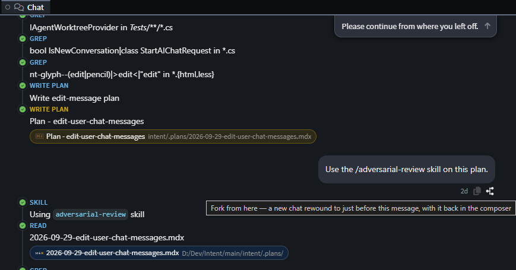
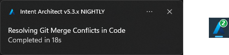
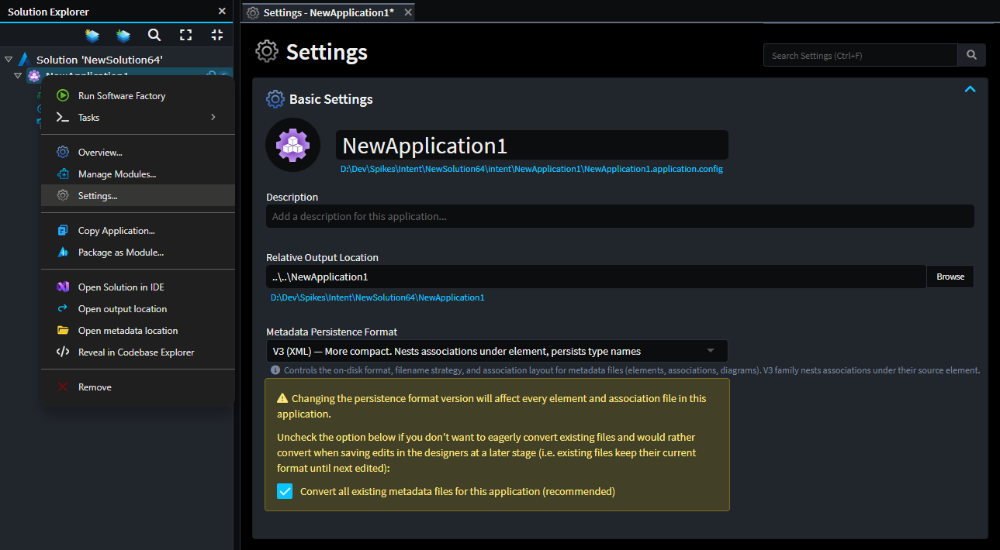
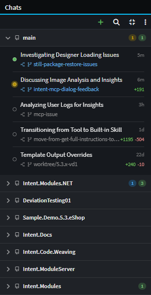
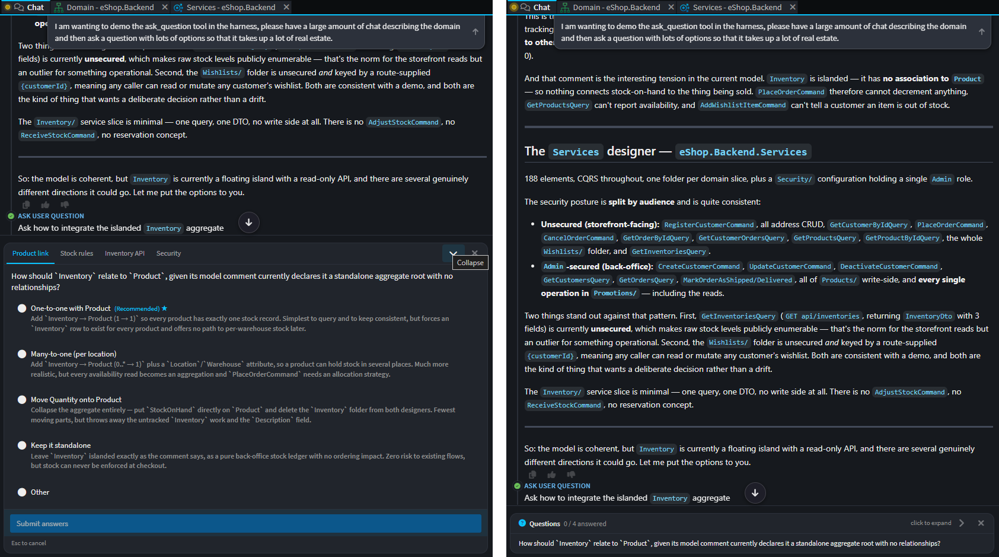
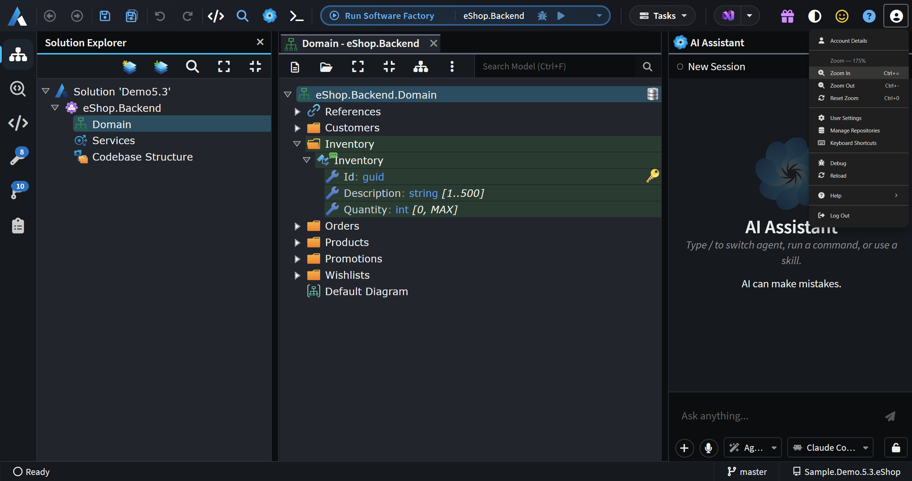

# What's new in Intent Architect (October 2026)

Welcome to the October edition of What's New in Intent Architect. September's 5.3 release brought every agent conversation into one place. The 5.3 updates since then, 5.3.2 to 5.3.6, are about what comes next, once running several agents is part of your day: knowing when one needs you without watching it, trying a different direction without losing the conversation you have, and starting each agent in a worktree that's ready to work in.

Read the [full 5.3 release notes](xref:release-notes.intent-architect-v5.3) for complete details on everything covered below.

- Highlights
  - **[Fork a chat from any message](#fork-a-chat-from-any-message)** – Take a conversation in a different direction from any point, without losing the one you have.
  - **[Get notified when an agent needs you](#get-notified-when-an-agent-needs-you)** – Stop switching back to check on agents. An OS notification and a taskbar badge tell you when one finishes or is waiting on you.
  - **[New worktrees that are ready to work in](#new-worktrees-that-are-ready-to-work-in)** – Ignored files are copied in and setup steps run automatically, so an agent's first turn isn't spent re-downloading modules and packages.
  - **[V3 (XML) metadata is now the default for new applications](#v3-xml-metadata-is-now-the-default-for-new-applications)** – Smaller, quieter metadata diffs, and type names in Change Review instead of ids.
  - **[Commit messages and PR descriptions from your own agent](#commit-messages-and-pr-descriptions-from-your-own-agent)** – Generated text now comes from the agent you've already connected, so your diffs go nowhere else.

- More updates
  - **[Organize the Agents board](#organize-the-agents-board)** – Categories and per-group status counts show what's running, finished or waiting at a glance.
  - **[AI chat and agent setup improvements](#ai-chat-and-agent-setup-improvements)** – Collapsible question and plan cards, clickable file paths, chat tips, and agent connectors that update without a new Intent Architect release.
  - **[Application-wide UI zoom](#application-wide-ui-zoom)** – Scale the whole application, designers and dialogs included, to suit your screen.
  - **[Git and pull request improvements](#git-and-pull-request-improvements)** – Stash and retry when a pull is blocked, hide whitespace-only changes, fast-forward any branch, and Bitbucket Cloud pull requests are back.
  - **[A verification phase for Spec-Driven Development](#a-verification-phase-for-spec-driven-development)** – A spec now has to be verified before it's done, not just have its tasks ticked.
  - **[Install with Homebrew or Chocolatey](#install-with-homebrew-or-chocolatey)** – Install and update Intent Architect from the package manager you already use.
  - **[Process Explorer](#process-explorer)** – See every Intent Architect process with its CPU and memory use, and capture a memory dump for support.
  - **[File classifications on Solution Folders and projects](#file-classifications-on-solution-folders-and-projects)** – Classify custom files for Change Review once, at the folder or project that holds them.
  - **[AI skill for building on .NET modules](#ai-skill-for-building-on-net-modules)** – Teaches an agent how to build a module that extends ASP.NET Core Controllers' generated output.
  - **[Blazor: use your own stylesheets](#blazor-use-your-own-stylesheets)** – Turn off the default theme stylesheets when your application has its own.
  - **[Floating package versions with Central Package Management](#floating-package-versions-with-central-package-management)** – Use versions such as `8.0.*` in `Directory.Packages.props` without restore failing.

## Update details

### Fork a chat from any message

Conversations with an agent rarely run in a straight line. Halfway through, you want to try a different approach or ask the same thing with a different instruction. Carrying on in the same chat drags everything that went wrong along with it, and starting a new chat means explaining everything that went right all over again.

Each of your messages in a chat now has a footer of actions, including **Fork from here**. It starts a new chat rewound to just before that message, with the message's text back in the composer, so you can change it and take the conversation somewhere else.



Available from:

- Intent Architect 5.3.4

### Get notified when an agent needs you

Running agents in parallel only saves time if you can get on with something else while they work. Until now, the only way to find out that an agent had finished, or was sitting blocked on a question for you, was to switch back to Intent Architect and look.

When an AI chat finishes a turn or needs your input while Intent Architect isn't focused, you now get an OS notification, and the taskbar icon shows a badge counting the chats you haven't seen. Clicking the notification takes you straight to the right chat, and notifications are withdrawn once you've seen it. Both can be turned off in settings.



To learn more, see [Stay on top of many agents at once](xref:how-to.stay-on-top-of-many-agents#get-notified-when-an-agent-needs-you-from-any-app).

Available from:

- Intent Architect 5.3.4

### New worktrees that are ready to work in

Git ignores your module cache, `node_modules` and `.env` files for good reason, but it means a fresh worktree checks out without them. An agent given its own worktree would spend its first turn re-downloading every module before the Software Factory could run, or fail on a missing dependency, unless you set the worktree up by hand first.

Intent Architect now reads a [`.worktreeinclude`](https://code.claude.com/docs/en/worktrees#copy-gitignored-files-into-worktrees) file at the root of your repository, the same file Claude Code uses, and copies the git-ignored files and folders it lists into every new worktree it creates. New solutions get one automatically, covering Intent Architect's module cache, `node_modules`, local `.env` files and per-machine AI agent configuration.

For setup that has to run rather than be copied, such as `npm install` or `dotnet restore`, add a task to the solution's `tasks.json` with `"triggers": ["worktree.created"]`. It runs in the background in each new agent worktree before the agent's first turn, with its progress shown in the chat and a banner if it fails.

To learn more, see [Run agents in parallel](xref:how-to.run-agents-in-parallel) and [Set up each new worktree with a setup task](xref:how-to.set-up-tasks#set-up-each-new-agents-shell-worktree-with-a-setup-task).

Available from:

- Intent Architect 5.3.3 (`.worktreeinclude`)
- Intent Architect 5.3.4 (setup tasks)

### V3 (XML) metadata is now the default for new applications

New applications now use the `V3 (XML)` metadata persistence format by default. It has been available since 5.1.0, and with most teams now on 5.1 or later, other people on your repository are unlikely to have an Intent Architect version too old to open it.

The newer format matters most when you review changes. Change Review needs it to show element type changes, such as `int` to `long`, by type name rather than as GUIDs. It's also more compact, leaving out empty elements, and it nests associations under their elements, so adding an attribute to a class no longer changes `<order />` values across several association files in your commit.

Existing applications can be switched from the application's **Settings** tab. Because switching rewrites the application's metadata files in one go, make it a commit or pull request of its own, and coordinate it with your team to avoid merge conflicts.



Available from:

- Intent Architect 5.3.2

### Commit messages and PR descriptions from your own agent

Generating a commit message or pull request description means sending your diff to a model. That model should be one you've already chosen to trust with your code.

Generated commit messages, pull request descriptions and chat titles now run through your own connected AI agent, so no prompt or key leaves your machine for anywhere else. A new **General** tab in AI Configuration lets you choose the model used, defaulting to your agent's recommended model, and the **Generate** buttons are disabled when no agent is available.

To learn more, see [AI Configuration](xref:ai.configuration).

Available from:

- Intent Architect 5.3.5

### Organize the Agents board

Once you're running several agents across several repositories, the Agents board in Manage Agents has to tell you what's happening without you opening every conversation.

- **Categories**: give any conversation one of six coloured categories from its row menu, to mark related chats that a group can't hold together.
- **Status counts on groups**: group headers show badges counting conversations by status, so a collapsed group still shows that something is waiting.
- **Keep All**: the Changes panel's **Keep All** accepts everything a conversation has changed so far and starts tracking again from there, without touching the files.
- **Gather Diagnostics**: one action on a conversation's row collects its chat, agent, Software Factory and MCP logs into a single zip, for when you need to hand a misbehaving run to support.



To learn more, see [Keep the board tidy with groups, categories and archiving](xref:how-to.stay-on-top-of-many-agents#keep-the-agents-shell-board-tidy-with-groups-categories-and-archiving).

Available from:

- Intent Architect 5.3.2 (categories, Keep All and Gather Diagnostics)
- Intent Architect 5.3.3 (status counts)

### AI chat and agent setup improvements

- **Collapsible question and plan cards**: collapse a question or a plan approval to a single header row, so you can read the conversation behind it while the card stays live.
- **Clickable file paths**: file names in AI replies and in previewed `.md` and `.mdx` files, such as `src/Ordering/OrderService.cs:42`, are now links that open the file at that line.
- **Chat tips**: a new, empty chat shows a rotating card of usage tips.
- **Slash command button**: a `/` button in the composer opens the slash command picker.
- **Missing skills banner**: when a chat's solution is missing Intent Architect's built-in skills or rules, a banner above the composer offers to add them.
- **Connector updates**: the Claude Code, Codex and GitHub Copilot ACP connectors can now be updated without a new Intent Architect release, and the AI Providers tab has a [Connector package](xref:ai.configuration#connector-packages) field for overriding them.



Available from:

- Intent Architect 5.3.2 (collapsible cards and clickable file paths)
- Intent Architect 5.3.3 (chat tips)
- Intent Architect 5.3.4 (missing skills banner and connector updates)
- Intent Architect 5.3.5 (slash command button)

### Application-wide UI zoom

`Ctrl` + `+` / `-` / `0` now scales the whole application, including designer tabs, the AI chat panel and dialogs. Zoom is also in the account menu and in User Settings.



Available from:

- Intent Architect 5.3.2

### Git and pull request improvements

- **Stash & retry**: when git refuses a pull, rebase or merge because the working tree has uncommitted changes, you're offered **Stash & retry**, which re-runs it with `--autostash`.
- **Show whitespace changes**: a toggle in the diff toolbar shows or hides indentation-only differences, and is remembered.
- **One branch menu**: branches share one context menu with push, pull, fetch, rename and set upstream. A branch that isn't checked out, even one checked out in another worktree, can be fast-forwarded to its upstream.
- **Pull request targets**: a new pull request now targets the branch its source branch was created from.
- **Bitbucket Cloud**: pull requests on Bitbucket Cloud, turned off in an earlier 5.3 update, are enabled again, with sign-in through your browser.

To learn more, see [Pull requests](xref:application-development.pull-requests).

Available from:

- Intent Architect 5.3.2 (Stash & retry and whitespace changes)
- Intent Architect 5.3.4 (branch menu and pull request targets)
- Intent Architect 5.3.5 (Bitbucket Cloud)

### A verification phase for Spec-Driven Development

Finishing a spec's tasks isn't the same as meeting the spec. Spec-Driven Development now has an explicit verification phase between implementation and done. Ticking a spec's last task moves it into verification, whether the task was ticked in the Specs panel, in chat or by an agent through MCP.

The Plan persona can now also read and write specs, so `/sdd-requirements`, `/sdd-design` and `/sdd-tasks` work from a Plan chat without enabling the spec tools first.

To learn more, see [Spec-Driven Development](xref:application-development.spec-driven-development).

Available from:

- Intent Architect 5.3.2 (verification phase)
- Intent Architect 5.3.6 (spec tools in the Plan persona)

### Install with Homebrew or Chocolatey

Stable releases of Intent Architect are now published to Homebrew, as the `intent-architect@5` cask in the `IntentArchitect/homebrew-tap` tap, and to the Chocolatey Community Repository as `intent-architect`, so you can install and update Intent Architect with the package manager you already use.

On macOS:

```bash
brew install --cask intentarchitect/tap/intent-architect@5
```

On Windows:

```powershell
choco install intent-architect
```

Available from:

- Intent Architect 5.3.6

### Process Explorer

When Intent Architect is slow or using more memory than you expect, the first question is which process is responsible. The new **Process Explorer** window lists every Intent Architect process with a clear label and its CPU and memory use, and can capture a memory dump of any of them to send to support.

Open it with `Ctrl` + `Shift` + `Alt` + `P` (`Cmd` + `Shift` + `Alt` + `P` on macOS), from the About window, or from the Help menu (and the Window menu on macOS).

Available from:

- Intent Architect 5.3.6

### File classifications on Solution Folders and projects

Change Review uses file classifications to show you which changed files matter most. Custom files, the ones you write rather than generate, no longer have to be classified one by one: a `Custom File Classification` stereotype on a Solution Folder, folder or .NET project now applies to the custom files that qualify under it.

Entries now display as `[Severity - Classification] glob, glob`, which makes several easier to scan. Where more than one entry matches a file, the last one wins, so put broad catch-all entries first and exceptions below them.

To learn more, see [Change Review](xref:application-development.change-review).

Available from:

- Intent Architect 5.3.3
- Intent.Modelers.CodebaseStructure 1.1.2
- Intent.VisualStudio.Projects 4.1.10

### AI skill for building on .NET modules

`Intent.ModuleBuilder.AI.DotNet` is a new module for module authors. It installs the `intent-dotnet-module-integration` AI agent skill into your repository's `.claude/skills` and `.opencode/skills` folders, so an agent building a module that hooks into another .NET module's generated output doesn't have to read that module's templates cold.

For each target module, the skill covers what to reference, its templates and the shape of the code they generate, the metadata that links generated members back to the designer model, and its extension points. This first version covers ASP.NET Core Controllers (`Intent.AspNetCore.Controllers`).

Visit the [documentation](https://docs.intentarchitect.com/modules-dotnet/intent-modulebuilder-ai-dotnet/intent-modulebuilder-ai-dotnet.html) to learn more.

Available from:

- Intent.ModuleBuilder.AI.DotNet 1.0.0

### Blazor: use your own stylesheets

The Blazor modules generate a token-based theme: `ux-tokens.css`, `ux-base.css` and `ux-components.css`, plus `ux-mudblazor.css` when MudBlazor is installed. If your application's styling doesn't build on that theme, the new **Use Custom Stylesheets** setting stops those stylesheets being generated and removes their `<link>` tags from `App.razor`. Page structure, the theme toggle and MudBlazor's layout components are unaffected.

The AI skills bundled with these modules still assume the default `ux-*` classes, so adjust their guidance if you turn the setting on and also use the skills.

Visit the [documentation](https://docs.intentarchitect.com/modules-dotnet/intent-blazor/intent-blazor.html#use-custom-stylesheets) to learn more.

Available from:

- Intent.Blazor 2.0.5
- Intent.Blazor.Components.MudBlazor 2.0.5

### Floating package versions with Central Package Management

NuGet's Central Package Management rejects floating versions such as `8.0.*` unless the solution opts in, and restore fails with `NU1011`. A new **Central Package Floating Versions Enabled** property on the **Visual Studio Solution Options** stereotype adds `CentralPackageFloatingVersionsEnabled` to `Directory.Packages.props` for you.

This update also stops `.slnx` regeneration from discarding custom solution configurations, per-project build rules, comments and other content that Visual Studio or you added to the file, unless a rename, move or removal actually requires changing it.

Visit the [documentation](https://docs.intentarchitect.com/modules-dotnet/intent-visualstudio-projects/intent-visualstudio-projects.html#floating-package-versions) to learn more.

Available from:

- Intent.VisualStudio.Projects 4.1.10
