# What's new in Intent Architect (November 2026)

Welcome to the November edition of What's New in Intent Architect. This month brings the release of **Intent Architect 5.4**, followed by 5.4.1 and 5.4.2. Where 5.3 was about _seeing_ what your agents are doing, 5.4 is about _proving_ that what they've done is right. When agents write most of the code, reading every line stops being a review, so 5.4 moves the review to intent and proof: what a change was meant to do, and the evidence that it does.

Read the [full 5.4 release notes](xref:release-notes.intent-architect-v5.4) for complete details on everything covered below.

- Highlights
  - **[Living specifications](#living-specifications)** – Specs that show which requirements are still met, flag drift as soon as it happens, and can be checked in CI.
  - **[Agents that prove their own work](#agents-that-prove-their-own-work)** – Agents can run your app, check their change in it, and open a pull request with the screenshots as evidence.
  - **[Explorer Diagram](#explorer-diagram)** – Judge a design change as a diagram in context, not as XML and generated code.
  - **[Test coverage in Changes Review](#test-coverage-in-changes-review)** – See whether the lines a change adds are actually tested.
  - **[Child chats](#child-chats)** – Agents can split big work into focused chats that run on their own, grouped under the chat that started them.
  - **[One Intent Architect for all your MCP clients](#one-intent-architect-for-all-your-mcp-clients)** – Any open Intent Architect instance can now do the work for any MCP client, on any solution.

- More updates
  - **[More efficient agents](#more-efficient-agents)** – More than 20% better token efficiency in most use cases, over MCP, ACP or your own API key.
  - **[Faster Software Factory, designers and Git](#faster-software-factory-designers-and-git)** – Shorter waits for generated changes, snappier large designers, and Git operations up to twenty times faster.
  - **[Switch AI provider mid-chat](#switch-ai-provider-mid-chat)** – Get a second opinion from another agent without repeating the conversation.
  - **[AI chat improvements](#ai-chat-improvements)** – Collapsible tool groups, re-asking questions, custom agents and per-chat settings.
  - **[Reviewing plans, specs and documents](#reviewing-plans-specs-and-documents)** – Rendered Markdown diffs, inline editing, comments for the agent, an outline and Save as PDF.
  - **[Work Items](#work-items)** – A shared to-do list and scratch pad that you and your agents can both read and update.
  - **[Spec Areas](#spec-areas)** – Group related Capabilities, and see their health rolled up in one place.
  - **[Pull request improvements](#pull-request-improvements)** – A Pull Requests panel, editable assignees, reviewers and labels, `@` mentions and local drafts.
  - **[Git Explorer, file history and tags](#git-explorer-file-history-and-tags)** – Branches, worktrees and history in one tab, a file's history and blame, and git tags.
  - **[Workspace improvements](#workspace-improvements)** – A rebuilt Application Overview, solution-wide find and replace, and folders that hold several solutions.
  - **[Mediator support for CQRS](#mediator-support-for-cqrs)** – A dispatch stack on the source-generated Mediator library, with handler bodies written by your agent.
  - **[Value Objects inside Value Objects](#value-objects-inside-value-objects)** – Value Objects can now contain other Value Objects through associations.
  - **[Domain types as service operation parameters](#domain-types-as-service-operation-parameters)** – Use Domain Classes, Data Contracts and Value Objects directly as Service Operation parameters and return types.
  - **[File Classification and Review Importance](#file-classification-and-review-importance)** – Classify files from Changes Review, per folder, extension or template output.
  - **[Module Builder AI skills are now built in](#module-builder-ai-skills-are-now-built-in)** – Module-building skills ship with Intent Architect, with new modules for workflow and designer integration.
  - **[Other module updates](#other-module-updates)** – Switch statements merged case by case, MSTest SDK projects, Service Proxies from the Services diagram, and more.

## Update details

### Living specifications

A completed spec is only useful if the code still meets it. Until now there was no way to tell which requirements were still implemented as written, or which had drifted since they were last checked, so specs went stale as soon as the next change landed and stopped being trusted. That's one of the most common criticisms of Spec-Driven Development, and the reason "I could swear it used to work like this" never goes away.

Specs are now living. Acceptance criteria show the status of the tests that cite them, and spec cards summarize gaps in the last verdict and any drift since it. Re-verifying only re-judges what changed, which keeps token use down, and the new `verify-sdd` Software Factory CLI command checks spec health in CI without AI, failing for specs that are out of date or have gaps.

A new Spec Review step lets you approve or comment on each changed block of a spec before its phase advances, so a misunderstanding between you and the agent is caught before tokens are spent implementing it. The `/sdd-run` skill takes a spec all the way to verification in a single chat.

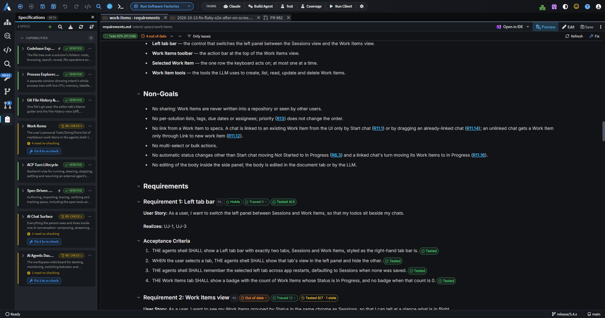

To learn more, see [Turn existing code into living specs](xref:how-to.turn-existing-code-into-living-specs) and the [verify-sdd command](xref:tools.software-factory-cli#verify-sdd-command).

Available from:

- Intent Architect 5.4.0

### Agents that prove their own work

The quickest way to catch an agent's mistake is to let the agent catch it, without waiting on you. But an agent that can't see your running application can only tell you it thinks the change works.

Agents can now start your app's dev server, open it in an embedded App Preview, click through it, read the page and the console, and take screenshots to check their work. With the new `create_pull_request` tool, an agent can then open a pull request with those screenshots in its description, so you see the change working before you read the code behind it. By default the New pull request tab opens prefilled for you to review and submit; turn on **Let agents create pull requests directly** to skip that step. App Preview runs can also be recorded as video from the preview toolbar.

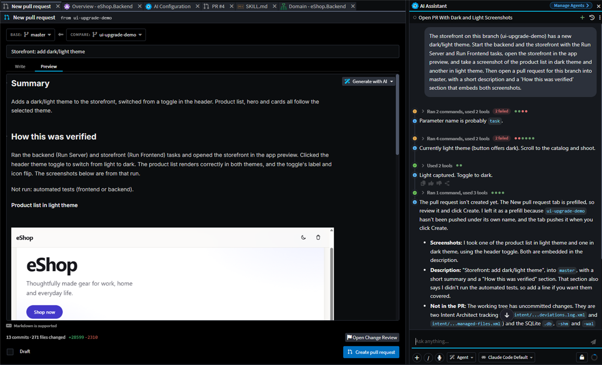

To learn more, see [Open pull requests that prove they work](xref:how-to.prove-it-works).

Available from:

- Intent Architect 5.4.0
- Intent Architect 5.4.2 (video recording)

### Explorer Diagram

A change to the model arrives in a pull request as XML and hundreds of lines of generated code, which is the wrong level at which to judge whether the design change is the one you intended.

Explorer Diagrams show design changes in context, whether they come from an agent or a pull request, along with the related elements and any deleted ones drawn as ghosts. The `+` button on any element adds its neighbours, filtered by association type, so you can follow relationships through the system without being overwhelmed, and **Keep Diagram** saves the result as a normal diagram. To open one, right-click one or more elements in a designer's tree and choose **Show in Explorer Diagram**.

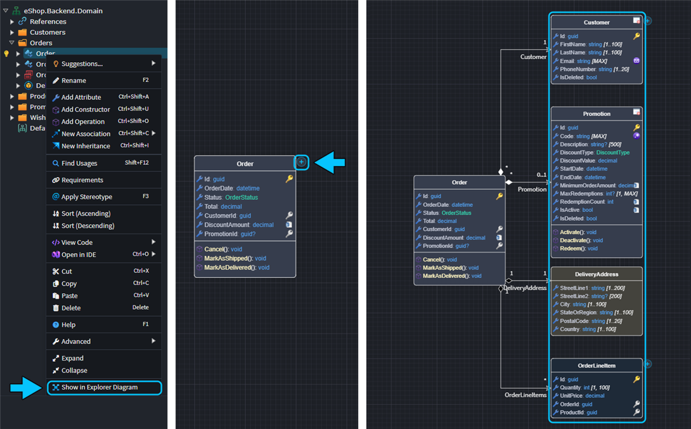

Available from:

- Intent Architect 5.4.0

### Test coverage in Changes Review

When you review a change, especially one an agent wrote, it's hard to tell from the diff whether the new code is actually tested.

Changes Review now shows the test coverage of the added lines, per file and overall, read from Cobertura reports. There's nothing to configure for local runs: it reads the newest report in any `TestResults` folder, and it can also read coverage from your Azure Pipelines builds. It also shows which files are covered by tested spec requirements, and the Needs Attention filter can hide them. Coverage is measured for .NET, TypeScript, Python, Java and Kotlin.

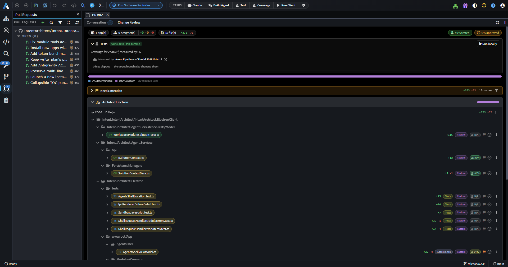

To learn more, see [Test coverage](xref:application-development.change-review#test-coverage).

Available from:

- Intent Architect 5.4.0
- Intent Architect 5.4.2 (Python, Java and Kotlin, and spec requirement coverage)

### Child chats

A big task in a single chat means one ever-growing context, and one agent working through everything in turn.

Agents can now split larger work into focused child chats with the `start_child_chats` tool. The proposed chats appear on an approval card, where you can start them, create them without starting, or cancel, and choose each one's worktree. Each child chat runs on its own and is grouped under its parent, and the parent can follow and steer them with `list_child_chats`, `message_child_chat` and `stop_child_chat`.

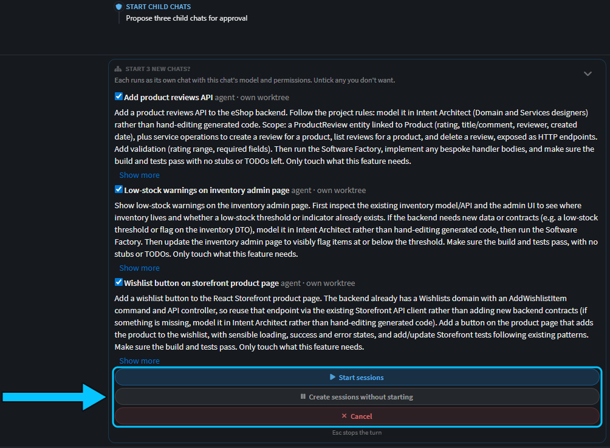

To learn more, see [Split a big task across child chats](xref:how-to.split-a-big-task-across-child-chats).

Available from:

- Intent Architect 5.4.1
- Intent Architect 5.4.2 (worktree choice on the approval card)

### One Intent Architect for all your MCP clients

Intent's MCP server no longer needs a separate Intent Architect instance open for each solution an MCP client works on. Any open instance can now do the work, such as opening and updating designers and running the Software Factory. Work done over MCP shows as **MCP session** rows in Manage Agents, and carries on in the background whether or not Manage Agents is open.

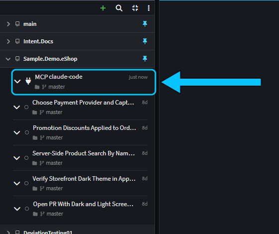

To learn more, see [Intent MCP server](xref:ai.intent-mcp-server).

Available from:

- Intent Architect 5.4.1

### More efficient agents

Agents building with Intent Architect, whether through the [Intent MCP server](xref:ai.intent-mcp-server), as a [CLI agent connected over ACP](xref:ai.cli-agents) or as a built-in agent using your own API key, are more efficient from modelling through to code generation. Intent Architect's tools now exchange less with the agent, improving token efficiency by more than 20% in most use cases.

5.4.1 goes further: Claude Code sessions start with a cached system prompt, skills load reference detail only when it's needed, and large results such as `get_change_review` are paged. There's nothing to set up.

Available from:

- Intent Architect 5.4.0
- Intent Architect 5.4.1 (further reductions)

### Faster Software Factory, designers and Git

- **Software Factory**: the "Preparing changes" stage now processes files concurrently for transformers that support it. On one of Intent Architect's own applications, a hot run went from about 9 seconds to under 3.
- **Designers and startup**: the Home screen shows sooner, and large designers are much more responsive. The five most recently shown diagrams stay rendered, so switching back to one takes about 0.5 seconds instead of 1.3. Opening a large solution on macOS dropped from about 10 seconds to 0.6.
- **Git**: Intent Architect now uses your installed git instead of a built-in library, so newer git features such as relative worktrees just work. Status is about three times faster, blame about twenty times, and committing and listing branches are noticeably quicker. **Settings** > **Tools** > **Git Executable** shows which git was found, with a warning for versions older than 2.29.

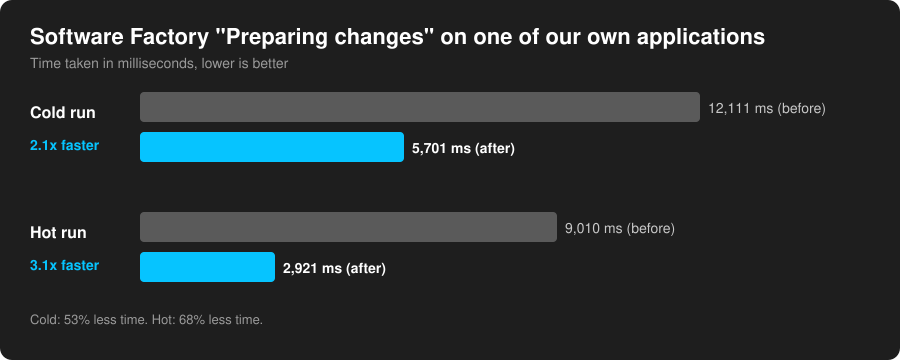

Available from:

- Intent Architect 5.4.1 (designers, startup and Git)
- Intent Architect 5.4.2 (Software Factory)
- Intent.OutputManager.RoslynWeaver 5.1.0 (Software Factory)

### Switch AI provider mid-chat

Switching AI provider in a chat used to leave the new provider with no memory of what had been discussed. Now the new provider continues the same conversation, with the earlier messages handed over, so you can get a second opinion or use a different model's strengths without repeating yourself, for example switching from Claude Code to Codex. A divider marks each switch, and expanding it shows how many messages and tool calls were handed over.

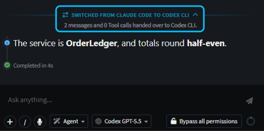

Available from:

- Intent Architect 5.4.2

### AI chat improvements

- **Collapsible tool groups**: two or more consecutive tool calls fold into one group with a summary such as "Ran 12 commands, read 3 files", and sub-agents nest under their own dispatch card, titled from what they were asked to do.
- **Revisit and re-ask questions**: an answered question can be expanded to show every option and what was picked, and **Fork and re-ask** forks the chat to just before the question and asks it again.
- **Custom agents**: create custom agents, generate them with the new `create-agent` skill, and edit them as `.agent.md` files from the Agents tab of [AI Configuration](xref:ai.configuration).
- **Your own Claude Code MCP servers**: Claude Code chats load your Claude Code MCP configuration, so claude.ai connectors, user-level servers, a project's `.mcp.json` and plugins are available in Intent Architect chats.
- **Per-chat settings**: permission mode and reasoning effort are kept for each chat. Codex, Copilot and OpenCode now follow them too, and Plan mode uses each agent's own plan mode.
- **Queued messages**: messages sent while a turn is running wait in a Queued strip until the agent reads them, and `Up Arrow` in an empty composer recalls earlier messages.

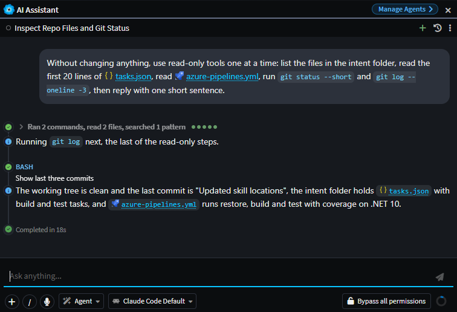

Available from:

- Intent Architect 5.4.0 (tool groups and Claude Code MCP servers)
- Intent Architect 5.4.1 (custom agents, per-chat settings and queued messages)
- Intent Architect 5.4.2 (re-asking questions)

### Reviewing plans, specs and documents

- **Rendered Markdown diffs**: Markdown diffs can be shown rendered, with added, removed and changed blocks, words and table cells highlighted, which makes changes to prose, tables and specs far easier to read.
- **Inline editing**: Markdown and MDX files can be edited in a live preview, where only the block you're editing shows its source.
- **Comments for the agent**: comment on as many selected passages of a plan or document as you like, then send them all to the agent as feedback in one go.
- **Document outline**: an "On this page" panel lists a long document's headings and follows your scroll position.
- **Save as PDF**: any previewed document, including a rendered diff, can be saved as a single-page PDF to share outside Intent Architect.

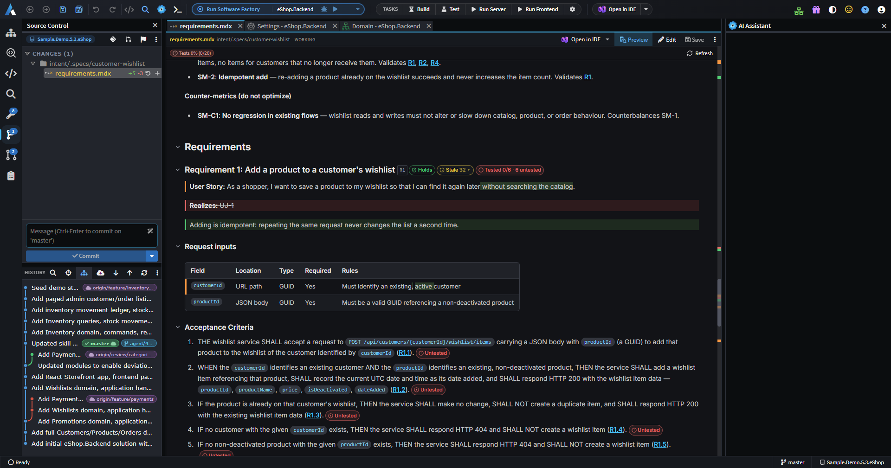

Available from:

- Intent Architect 5.4.0
- Intent Architect 5.4.2 (Save as PDF)

### Work Items

Even with a ticketing system, every developer has a pile of informal tasks to keep track of, or just needs a scratch pad. If agents can see and update those too, a lot of follow-up work can be handed straight to them.

The **Work Items** tab holds informal tasks and notes, and gives agents tools to create, read and update them. A work item has a one-click button to start a new chat on it, prefilled with its context and a worktree name, and you can ask a chat to create a work item or add itself to an existing one. Work items can be stored in a folder you choose, as `.md` or `.mdx` files.

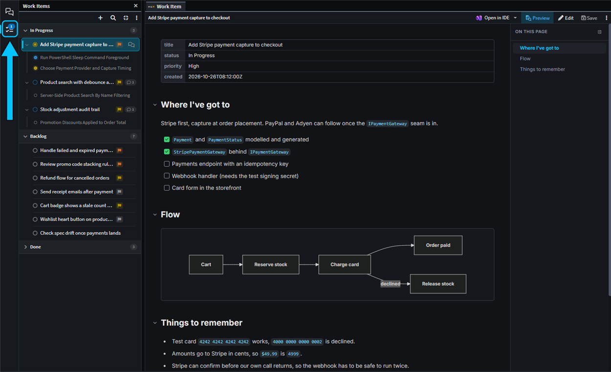

To learn more, see [Work Items](xref:application-development.user-interface.work-items).

Available from:

- Intent Architect 5.4.0
- Intent Architect 5.4.1 (storage folder and `.md` files)

### Spec Areas

To keep a growing set of Capabilities organized, the Specs panel can now group them into Areas. An Area is an overview spec, written with the new `sdd-area` skill, that rolls up the health of the Capabilities under it. Create an Area from the specs menu, then drag Capabilities onto it or choose **Move to Area**.

To learn more, see [Changes, Capabilities and Areas](xref:application-development.spec-driven-development#changes-capabilities-and-areas).

Available from:

- Intent Architect 5.4.1

### Pull request improvements

- **Pull Requests panel**: pull requests have their own side panel, with a badge counting the open ones assigned to you, and each showing its CI checks, whether it can be merged, its author, assignees and branch.
- **Edit pull requests in place**: set assignees, reviewers, labels and draft status, and re-request a review, on GitHub, GitLab, Azure DevOps and Bitbucket, without going to the host's website. Typing `@` in a comment or description mentions people on the pull request and its changed files.
- **Multi-line comments**: review comments can cover a range of lines, selected by dragging over the line numbers.
- **CLI sign-in**: sign in to pull requests with a token from the GitHub, GitLab or Azure DevOps CLI (`gh`, `glab`, `az`).
- **Local drafts**: a New pull request tab that hasn't been sent is kept as a local draft, listed first on the board, and survives restarts.

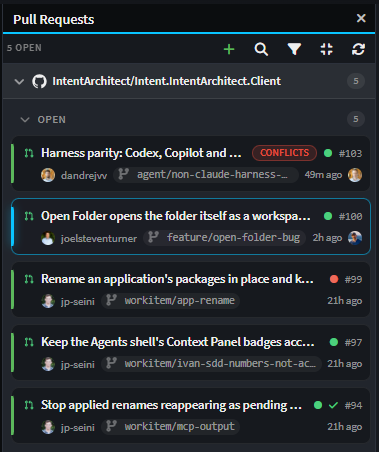

To learn more, see [Review pull requests effectively](xref:how-to.review-pull-requests).

Available from:

- Intent Architect 5.4.0
- Intent Architect 5.4.1 (multi-line comments and CLI sign-in)
- Intent Architect 5.4.2 (local drafts)

### Git Explorer, file history and tags

- **Git Explorer**: branches, tags, worktrees and history have moved into a new Git Explorer tab, where you can manage worktrees and branches and start new chats on them.
- **File history and blame**: a File History view searches a file's commits and can restore an earlier revision, and the file view has a Git Blame gutter.
- **Tags**: create tags from the commit and branch menus in Source Control and the Git tab, and push them to a remote of your choice.

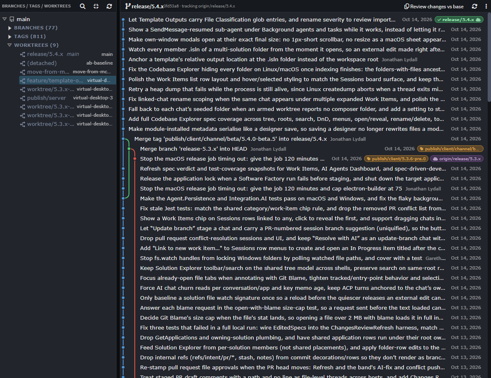

Available from:

- Intent Architect 5.4.0
- Intent Architect 5.4.2 (tags)

### Workspace improvements

- **Application Overview**: the Application Overview tab has been rebuilt to show the number of elements in each designer, recent designer activity, spec activity and commits, with links to drill deeper. Right-click an application in Solution Explorer and choose **Overview...**.
- **Solution-wide find and replace**: in the Agents window, `Ctrl` + `Shift` + `F` searches every file in the solution and `Ctrl` + `Shift` + `H` goes straight to Replace, one match, one file or all results at a time.
- **Folders with several solutions**: opening a folder that contains several `.isln` files opens them together as one workspace, shown as a tree in Solution Explorer.

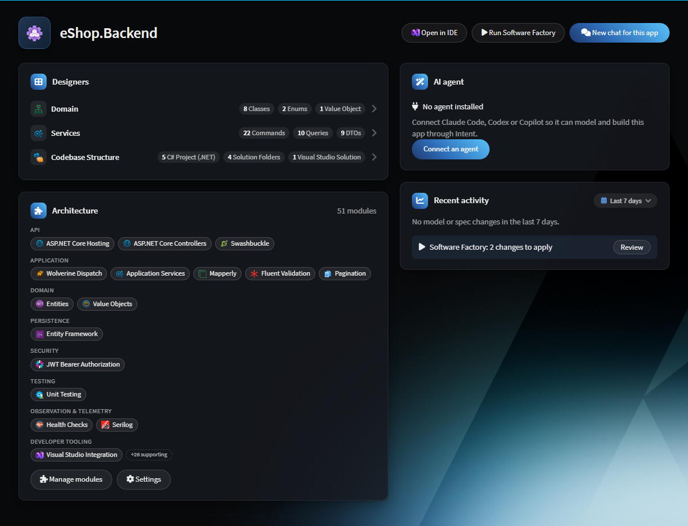

Available from:

- Intent Architect 5.4.0

### Mediator support for CQRS

A new set of modules generates a CQRS dispatch stack on the source-generated [Mediator](https://github.com/martinothamar/Mediator) library, an alternative to MediatR, which has moved to a commercial licence, and to Wolverine.

These modules work differently from the MediatR and Wolverine modules: handler bodies aren't generated. You model commands, queries and what they do in the Services designer, the module generates the command and query classes and a stub for each handler, and an AI agent implements each stub from the model, following skills the module generates.

**Key features:**

- `Intent.Application.Mediator`: commands, queries, handler stubs, a pipeline with logging, unhandled exception, performance, authorization and unit of work behaviours, and the handler skills
- `Intent.Application.Mediator.FluentValidation`: every command and query is validated before its handler runs, with rules your agent writes from your domain
- `Intent.Application.Mediator.DomainEvents`: domain events dispatched through Mediator, with a stub for every modelled handler
- `Intent.AspNetCore.Controllers.Dispatch.Mediator` and `Intent.FastEndpoints.Dispatch.Mediator`: expose every command and query with HTTP settings as ASP.NET Core controller actions or FastEndpoints endpoints

Visit the [documentation](https://docs.intentarchitect.com/modules-dotnet/intent-application-mediator/intent-application-mediator.html) to learn more.

Available from:

- Intent.Application.Mediator 1.0.0
- Intent.Application.Mediator.FluentValidation 1.0.0
- Intent.Application.Mediator.DomainEvents 1.0.0
- Intent.AspNetCore.Controllers.Dispatch.Mediator 1.0.0
- Intent.FastEndpoints.Dispatch.Mediator 1.0.0

### Value Objects inside Value Objects

A Value Object can now contain other Value Objects through associations, not only through attributes. Each navigable association generates a property, a constructor parameter and an equality component, where previously the designer accepted these associations but they generated nothing. Value Objects have a **New Association** context menu option (`Ctrl` + `Shift` + `C`), and Cosmos DB documents include the nested Value Objects too.

This update also fixes equality for Value Objects that hold a collection, which were never equal to each other because the collection was compared by reference.

> [!WARNING]
> Value Objects with associations to other Value Objects gain a constructor parameter for each association, after the attribute parameters. Hand-written `new MyValueObject(...)` calls for them must pass the new arguments.

Visit the [documentation](https://docs.intentarchitect.com/modules-dotnet/intent-valueobjects/intent-valueobjects.html) to learn more.

Available from:

- Intent.ValueObjects 4.3.0
- Intent.Modelers.Domain.ValueObjects 3.6.5
- Intent.CosmosDB 2.1.0

### Domain types as service operation parameters

Service Operation parameters and return types can now be any element with the new Service Argument trait, which Domain Classes, Data Contracts and Value Objects all carry, so you no longer need a DTO only to pass a domain type through a service. The Services designer also gains a **Parameter Naming Convention** setting, and its duplicate operation check now takes collections, nullability and generic type arguments into account, so valid overloads such as `Create(ids: int[*])` and `Create(id: int)` are no longer reported as duplicates.

Available from:

- Intent.Modelers.Services 4.0.17
- Intent.Modelers.Domain 3.13.3
- Intent.Modelers.Domain.ValueObjects 3.6.4

### File Classification and Review Importance

File classifications tell Changes Review which changed files matter most. `Custom File Classification` is now simply `File Classification`, and its `Severity` is now `Review Importance`, which better describes what it's for. Existing data keeps working, and existing Output Classifications are migrated.

Classifications can now be applied to Template Outputs, so different files generated by the same template can be classified differently, and to the Root Folder, for files such as `NuGet.Config` and `.editorconfig`. In Changes Review, you can classify a file from a popover, or a whole folder, or every file of an extension in a folder, and the classification applies immediately.

To learn more, see [Classify your codebase so reviews focus on what matters](xref:how-to.classify-your-codebase).

Available from:

- Intent Architect 5.4.0
- Intent Architect 5.4.2 (classifying folders and extensions)
- Intent.Modelers.CodebaseStructure 1.3.0
- Intent.ModuleBuilder 3.20.0

### Module Builder AI skills are now built in

From 5.4.0, Intent Architect ships its module-building skills out of the box: `file-builder-expert`, `intent-metadata-consumer`, `add-designer-extension`, `add-module-migration`, `architecture-templates`, `module-docs` and `module-versioning`, joined in 5.4.1 by a **Configuring Designers** skill. That makes the `Intent.ModuleBuilder.AI.Skills` module introduced in September obsolete. Version 1.2.0 can be uninstalled, and installs `Intent.ModuleBuilder.AI.Guidelines` in its place.

**Key features:**

- `Intent.ModuleBuilder.AI.Guidelines` (new): a four-phase workflow for module work, process skills for version increments, documentation, `CONTEXT.md` and dependency audits, the `intent-module-orchestrator`, `module-building-strategies` and `module-svg-icon` skills, and an optional agent gate for Claude Code, Codex, GitHub Copilot CLI, Cursor, Kiro and OpenCode that blocks hand-edits to Intent Architect metadata and invalid version changes
- `Intent.ModuleBuilder.AI.Modelers` (new): the `intent-modelers-integration` skill, for wiring a module against the Domain, Services, Eventing and User Interface designers, with a full model API reference for each
- `Intent.ModuleBuilder.AI.DotNet` 1.0.1: integration guides for the ASP.NET Core host, Entity Framework Core and repository interfaces, alongside ASP.NET Core Controllers

Visit the documentation for [Intent.ModuleBuilder.AI.Guidelines](https://docs.intentarchitect.com/modules-common/intent-modulebuilder-ai-guidelines/intent-modulebuilder-ai-guidelines.html) and [Intent.ModuleBuilder.AI.Modelers](https://docs.intentarchitect.com/modules-common/intent-modulebuilder-ai-modelers/intent-modulebuilder-ai-modelers.html) to learn more.

Available from:

- Intent Architect 5.4.0
- Intent.ModuleBuilder.AI.Guidelines 1.0.0
- Intent.ModuleBuilder.AI.Modelers 1.0.0
- Intent.ModuleBuilder.AI.DotNet 1.0.1
- Intent.ModuleBuilder.AI.Skills 1.2.0

### Other module updates

- **Switch statements merged case by case**: cases you add to a generated `switch` are kept in Merge mode, and individual cases can be controlled with `// IntentIgnore`, `// IntentMerge` or `// IntentFully` above the `case` label.
- **Handler bodies left to you**: the MediatR and Wolverine modules now generate command and query handler `Handle` methods with `Body = Mode.Ignore` when no CRUD module is installed to implement them. The new `Intent.Application.Interop.CRUD` module installs the CRUD module that matches your dispatcher.
- **Service Proxies from the Services diagram**: Service Proxies can be created from a Services diagram's context menu and at the package root, and operations in a proxy can share a name.
- **MSTest SDK projects**: `MSTest.Sdk` is now an SDK option on .NET projects, existing `launchSettings.json` and `appsettings.json` files are only added to rather than rewritten, and Worker projects have a **Generate Program File** option.
- **No more distributed caching dependency**: `Intent.Integration.HttpClients` no longer depends on `Intent.AspNetCore.DistributedCaching`, and registers an in-memory cache for token caching itself on .NET 8 and later.

Available from:

- Intent.OutputManager.RoslynWeaver 5.0.2
- Intent.Application.MediatR 4.7.6
- Intent.Application.Wolverine 1.1.2
- Intent.Application.Interop.CRUD 1.0.0
- Intent.Modelers.Types.ServiceProxies 5.5.8
- Intent.VisualStudio.Projects 4.1.12
- Intent.Integration.HttpClients 6.2.0
